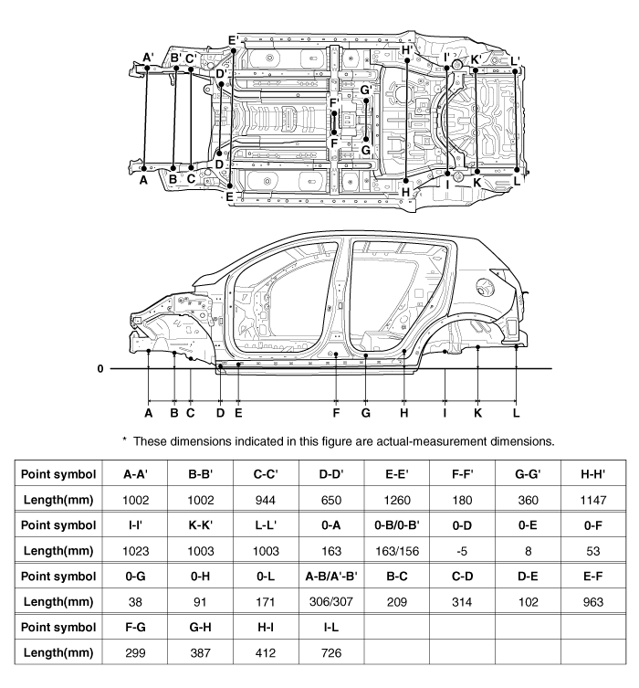
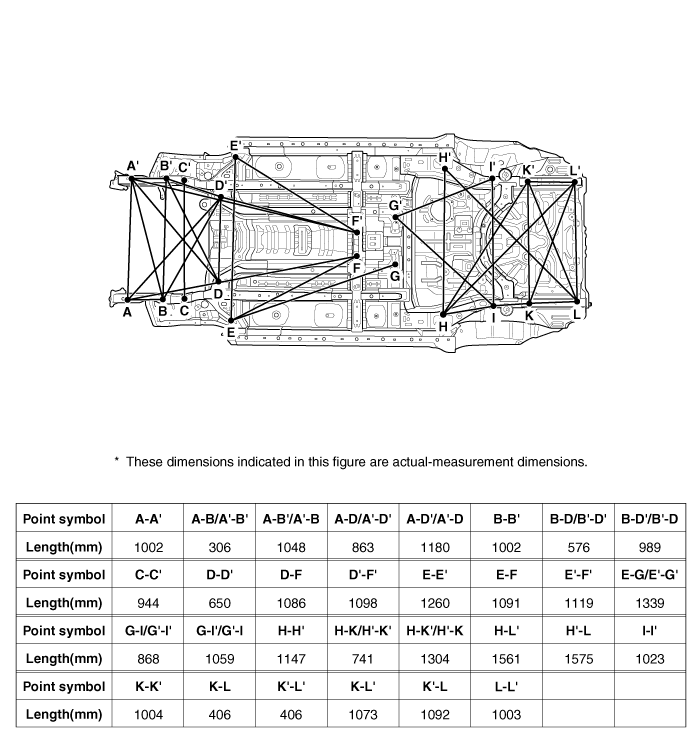

# Kia Sportage: Baixo do Veículo: Reparo do Corpo

[Home](../../index.md) / [Manual de Serviço e Reparo do Kia Sportage SL](../sportage-482.md) / [Corpo (Interior e Exterior)](sportage-934.md) / [Dimensões do Corpo](sportage-939.md) / Reparo do Baixo do Veículo

## Dimensões Projetadas

| Buraco de ferramenta do membro lateral frontal (O6,5) | Buraco de montagem da cobertura latera (O8) | Buraco de montagem do subquadro frontal (O17) |
| --- | --- | --- |
| Buraco de montagem do subquadro frontal (O18) | Buraco de ferramenta do prolongamento posterior do membro lateral frontal (O8) | Buraco do suporte do rolamento central do diferencial (O14) |
| Buraco de ferramenta de reforço frontal do chão de carga (O10) | Buraco de montagem do braço traseiro (O17) | Buraco de montagem do sistema de suspensão traseira (O28) |
| Buraco de ferramenta do membro lateral lateral do chão de carga (O14,5) | Buraco de ferramenta do membro lateral lateral do chão de carga (O15) |  |

## Dimensões de Medida Real

| Buraco de ferramenta do membro lateral frontal (O6,5) | Buraco de montagem da cobertura latera (O8) | Buraco de montagem do subquadro frontal (O17) |
| --- | --- | --- |
| Buraco de montagem do subquadro frontal (O18) | Buraco de ferramenta do prolongamento posterior do membro lateral frontal (O8) | Buraco do suporte do rolamento central do diferencial (O14) |
| Buraco de ferramenta de reforço frontal do chão de carga (O10) | Buraco de montagem do braço traseiro (O17) | Buraco de montagem do sistema de suspensão traseira (O28) |
| Buraco de ferramenta do membro lateral lateral do chão de carga (O14,5) | Buraco de ferramenta do membro lateral lateral do chão de carga (O15) |  |
