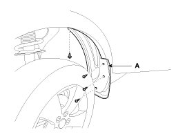
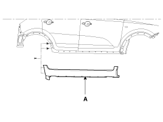
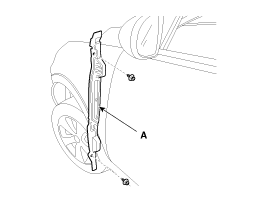
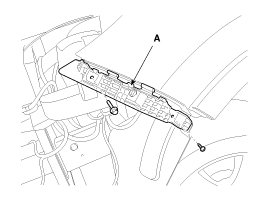
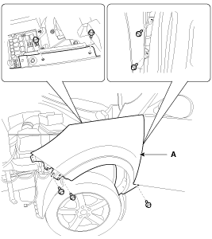

# Kia Sportage: Para-choque: Procedimentos de reparo

[Home](../../index.md) / [Manual de Serviço e Reparo do Kia Sportage SL](../sportage-482.md) / [Corpo (Interior e Exterior)](sportage-934.md) / [Exterior](sportage-946.md) / Procedimentos de reparo do para-choque

## Troca

> **Cuidado**
>
> - Ao remover e instalar o para-choque, é necessário a ajuda de uma pessoa.
> - Cuide para não danificar o para-choque e o corpo.
> - Ao remover as pinças, use uma pinça removível.

1. Remova a capa do para-choque frontal.

   (Consulte o grupo BD – “Para-choque frontal”)

2. Desafine as varetas de fixação (A) e as pinças do para-choque lateral.

   

3. Após desafinar as varetas de fixação e as pinças, remova a moldura do para-choque lateral (A).

   

4. Desafine as pinças e, em seguida, remova o isolador (A).

   

5. Após desafinar a vareta de fixação e o parafuso, remova o suporte de fixação do para-choque lateral (A).

   

6. Após desafinar os parafusos de fixação, remova o para-choque (A).

   

7. A instalação é o inverso da remoção.
