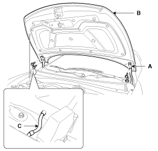
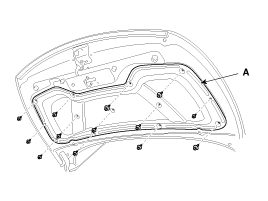
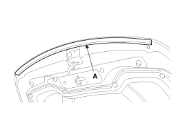
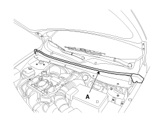
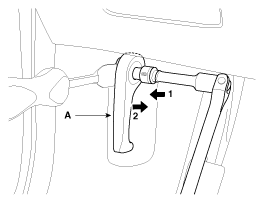
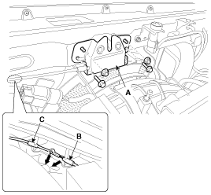
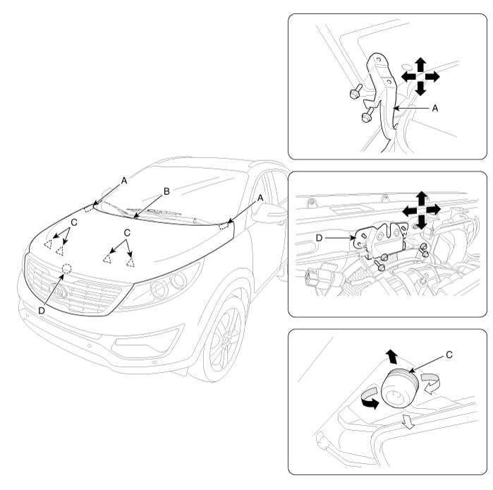

# Kia Sportage: Capot: Procedimentos de reparo

[Home](../../index.md) / [Manual de Serviço e Reparo do Kia Sportage SL](../sportage-482.md) / [Corpo (Interior e Exterior)](sportage-934.md) / [Exterior](sportage-946.md) / Procedimentos de reparo do capot

## Troca

Troca da Montagem do Capot

> **Cuidado**
>
> - Ao remover e instalar o capot, é necessário um auxiliar.
> - Cuide para não danificar o capot e o corpo.

1. Depois de soltar os parafusos de montagem do amortecimento do capot (A), remova o capot (B).

2. Remova o mangote do nozzle do lavador de para-brisas (C).

   ```
   Torque de aperto :
   21.6 ~ 26.5 N.m (2.2 ~ 2.7 kgf.m, 15.9 ~ 19.5 lb-ft)
   ```

   

3. A instalação é o inverso da remoção.

   > **Nota**
   >
   > - Certifique-se de que o capot se abra corretamente e se feche firmemente.
   > - Ajuste a alinhamento do capot.

Troca da Vela Isolante do Capot

1. Usando um desengripador, desengripa as velas e remova a vela isolante do capot (A).

   > **Cuidado**
   >
   > - Cuide para não arranhar a placa do capot.

   

2. A instalação é o inverso da remoção.

   > **Nota**
   >
   > - Substitua quaisquer velas danificadas.

Troca da Vela de Selagem do Capot

1. Desengripa as velas, depois remova a vela de selagem do capot (A).

   > **Cuidado**
   >
   > - Cuide para não arranhar a vela de selagem do capot.

   

2. A instalação é o inverso da remoção.

Troca da Vela de Selagem do Capot

1. Remova a vela de selagem do capot (A).

   > **Cuidado**
   >
   > - Cuide para não arranhar a vela de selagem do capot.

   

2. A instalação é o inverso da remoção.

Troca do Manípulo de Liberação do Capot

1. Remova o manípulo de liberação do capot (A).

   

2. A instalação é o inverso da remoção.

   > **Nota**
   >
   > - Certifique-se de que o cabo do travamento do capot esteja conectado corretamente.
   > - Certifique-se de que o capot se feche firmemente.

Troca do Travamento do Capot

1. Remova os parafusos e parafusos de montagem do travamento do capot (A).

2. Desconecte o cabo do travamento do capot (B) e o cabo do manípulo de liberação do capot (C).

   ```
   Torque de aperto :
   Parafusos : 7.8 ~ 11.8 N.m (0.8 ~ 1.2 kgf.m, 5.8 ~ 8.7 lb-ft)
   parafusos : 6.9 ~ 10.8 N.m (0.7 ~ 1.1 kgf.m, 5.1 ~ 8.0 lb-ft)
   ```

   

3. A instalação é o inverso da remoção.

   > **Nota**
   >
   > - Certifique-se de que o cabo do travamento do capot esteja conectado corretamente.
   > - Certifique-se de que o capot se feche firmemente.

## Ajuste

Ajuste do Capot

1. Depois de soltar o parafuso de montagem do amortecimento do capot (A), ajuste o capot (B) movendo-o para cima ou para baixo, ou para a esquerda ou para a direita.

2. Ajuste a altura do capot girando os amortecedores de batida do capot (C).

3. Depois de soltar os parafusos e parafusos de montagem do travamento do capot (D), ajuste o travamento movendo-o para cima ou para baixo, ou para a esquerda ou para a direita.

   
