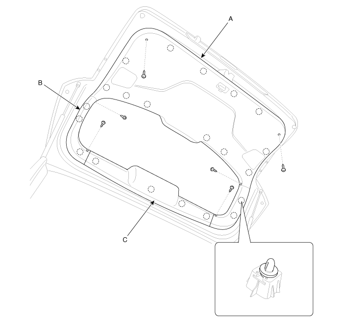
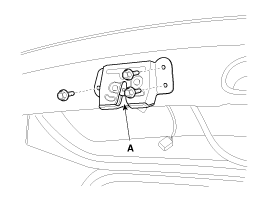
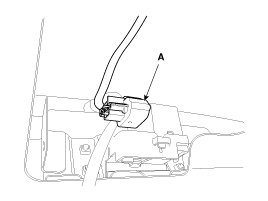
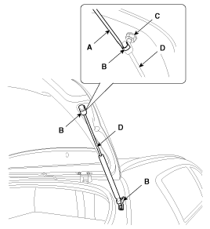
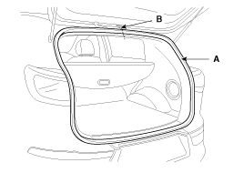
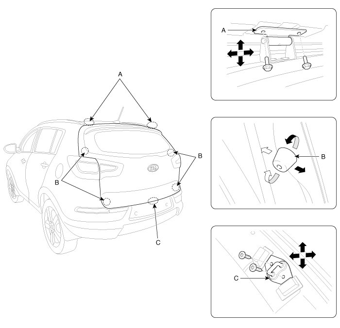

# Kia Sportage: Porta-malas: Procedimentos de reparo

[Home](../../index.md) / [Manual de Serviço e Reparo do Kia Sportage SL](../sportage-482.md) / [Corpo (Interior e Exterior)](sportage-934.md) / [Exterior](sportage-946.md) / Procedimentos de reparo do porta-malas

## Troca

Troca do Trim do Porta-malas

> **Cuidado**
>
> - Ao arrombar com uma régua plana, embrulhe-a com fita isolante e aplique fita isolante nas partes relacionadas para prevenir danos.
> - Use luvas para proteger as mãos.

1. Remova o trim superior (C).

2. Depois de soltar as engrenagens de montagem, remova o trim lateral (B) e o trim do porta-malas (A).

   > **Nota**
   >
   > - Substitua quaisquer engrenagens danificadas.

3. A instalação é o inverso da remoção.

   

Troca da Engrenagem do Bloqueio do Porta-malas

1. Remova o trim do porta-malas.

2. Depois de soltar as engrenagens de montagem, remova a engrenagem do bloqueio (A).

   ```
   Torque de aperto :
   6,9 ~ 10,8 N.m (0,7 ~ 1,1 kgf.m, 5,1 ~ 8,0 lb-ft)
   ```

   

3. Desconecte o conector do bloqueio do porta-malas (A).

   

4. A instalação é o inverso da remoção

   > **Nota**
   >
   > - Certifique-se de que o conector esteja conectado corretamente e que o eixo esteja conectado corretamente.
   > - Certifique-se de que o porta-malas se abra e feche corretamente e se bloqueie corretamente.

Troca do Elevador do Porta-malas

> **Nota**
>
> - Cuide para não fechar o porta-malas ao removê-lo.

1. Usando uma régua (A), levante ligeiramente as engrenagens de conector (B) nos dois extremos do elevador (D), e então remova o elevador do gancho (C).

   

2. Empurre o conector do elevador para o gancho para a instalação.

   > **Nota**
   >
   > - Certifique-se de que o porta-malas se abra e feche corretamente e se bloqueie corretamente.

Troca da Cinta de Selagem do Porta-malas

> **Cuidado**
>
> - Não aplique selante na carroceria.

1. Remova a cinta de selagem do porta-malas (A).

   

2. A instalação é o inverso da remoção.

   > **Nota**
   >
   > - Instale a cinta de selagem alinhada com a linha central (B).

## Ajuste

1. Depois de soltar a engrenagem de montagem (A) do bloco de dobradiças do porta-malas, ajuste o porta-malas movendo-o para cima ou para baixo, ou para a direita ou para a esquerda.

2. Ajuste a altura do porta-malas girando os rebatimentos de sobrecarga do porta-malas (B).

3. Depois de soltar as engrenagens de montagem (C) do bloqueio do porta-malas, ajuste o bloqueio do porta-malas movendo-o para cima ou para baixo, ou para a direita ou para a esquerda.

   
