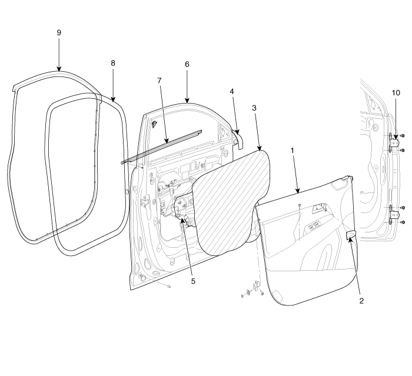

# Kia Sportage: Porta da Frente: Componentes e Localização dos Componentes

[Home](../../index.md) / [Manual de Serviço e Reparo do Kia Sportage SL](../sportage-482.md) / [Corpo (Interior e Exterior)](sportage-934.md) / [Exterior](sportage-946.md) / Componentes da Porta da Frente e Localização dos Componentes

## Componentes

| 1. Trim da Porta da Frente 2. Capa do Puxador Interno da Porta da Frente 3. Selante de Trim da Porta da Frente 4. Cobertura Interna do Quadrante da Porta da Frente 5. Módulo da Porta da Frente | 6. Painel da Porta da Frente 7. Moldura Externa do Cinto da Porta da Frente 8. Selante de Lateral da Porta da Frente 9. Selante Lateral da Porta da Frente 10. Parafuso de Encosto da Porta da Frente |
| --- | --- |
