# Kia Sportage: Porta da Frente: Procedimentos de Reparo

[Início](../../index.md) / [Manual de Serviço e Reparo do Kia Sportage SL](../sportage-482.md) / [Corpo (Interior e Exterior)](sportage-934.md) / [Exterior](sportage-946.md) / Procedimentos de Reparo da Porta da Frente

## Troca

Troca do Trim da Porta Frente

> **Cuidado**
>
> - Cuide para não arranhá-lo o trim da porta e outras peças.
> - Use luvas para proteger as mãos.

1. Usando uma furadeira ou removível, remova a cobertura interna do quadrante da porta frontal (A).

   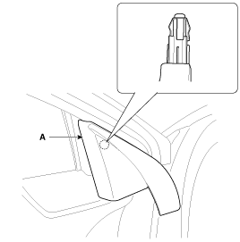

2. Usando uma furadeira ou removível, remova a tampa do puxador interno da porta (B).

3. Depois de soltar as varetas de montagem, remova o trim da porta (A).

   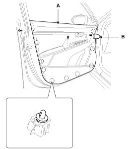

4. Remova a grade do puxador interno (A).

   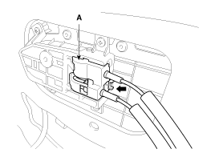

5. Desconecte os conectores do vidro elétrico (A) e o conectores do tweeter (B).

   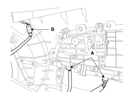

6. A instalação é o inverso da remoção.

   > **Nota**
   >
   > - Certifique-se de que os conectores estão conectados corretamente e cada vareta está conectada de forma segura.
   > - Certifique-se de que a porta trave e se abra corretamente.
   > - Substitua qualquer ganchinho danificado.

Troca do Puxador Interno

1. Remova o trim da porta.

2. Depois de soltar as varetas de montagem do puxador interno da porta, remova o puxador interno (A).

   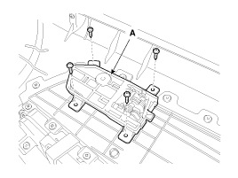

3. A instalação é o inverso da remoção.

   > **Nota**
   >
   > - Substitua qualquer ganchinho danificado.
   > - Certifique-se de que a porta trave e se abra corretamente.

Troca do Vidro

1. Remova o trim da porta.

2. Remova a selagem do vidro da porta (A).

   > **Nota**
   >
   > - Substitua qualquer selagem do trim da porta danificada.

   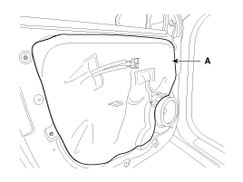

3. Remova a grade interna do cinto de proteção (A).

   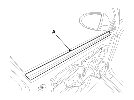

4. Remova o plugue de fixação do vidro.

   > **Cuidado**
   >
   > - Cuide para não deixar cair o vidro e arranhá-lo.

5. Move o vidro (B) cuidadosamente até que você possa ver os parafusos, então os solte. Separe o vidro da ranhura do vidro e puxe cuidadosamente o vidro através da ranhura da janela.

   ```
   Torque de aperto :
   6,9 ~ 10,8 N.m (0,7 ~ 1,1 kgf.m, 5,1 ~ 8,0 lb-ft)
   ```

   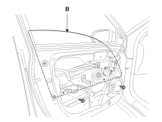

6. A instalação é o inverso da remoção.

   > **Nota**
   >
   > - Role o vidro de cima para baixo para verificar se ele se move livremente sem travar.
   > - Ajuste a posição do vidro conforme necessário.

Troca do Altavoz

1. Remova o trim da porta.

2. Desconecte o conectores do altavoz (B).

3. Remova o altavoz (A) do módulo da porta desengordurando as varetas.

   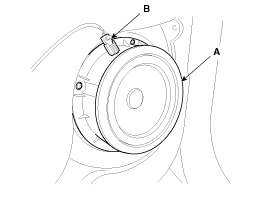

4. A instalação é o inverso da remoção.

   > **Nota**
   >
   > - Use parafusos de metal para fixar o altavoz.
   > - Certifique-se de que os conectores estão conectados corretamente e cada vareta está conectada de forma segura.
   > - Certifique-se de que a porta trave e se abra corretamente.
   > - Substitua qualquer ganchinho danificado.

Troca do Motor do Vidro Elétrico

1. Remova o trim da porta.

2. Remova a selagem do trim da porta (A).

   > **Nota**
   >
   > - Substitua qualquer selagem do trim da porta danificada.

   

3. Desconecte o conectores (B).

4. Após soltar as engrenagens de montagem, remova o motor do vidro elétrico (A).

   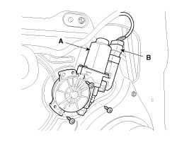

5. A instalação é o contrário da remoção.

   > **Nota**
   >
   > - A área das partes rotativas e molas deve ser aplicada com suficiente graxa.
   > - Role o vidro para cima e para baixo para verificar se ele se move livremente sem travar.
   > - Substitua quaisquer ganchos danificados.
   > - Certifique-se de que a porta se feche e abra corretamente.

Montagem do Módulo da Porta

1. Remova as seguintes peças.

   | • | Trim da porta dianteira. |
   | --- | --- |

   | • | Selante da porta dianteira. |
   | --- | --- |

   | • | Vidro da janela. |
   | --- | --- |

   | • | Manopla externa. |
   | --- | --- |

2. Solte a engrenagem de montagem (A).

   ```
   Torque de aperto :
   6,9 ~ 10,8 N.m (0,7 ~ 1,1 kgf.m, 5,1 ~ 8,0 lb-ft)
   ```

   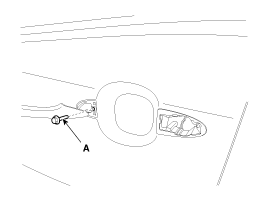

3. Desconecte o conector da manopla externa (A).

   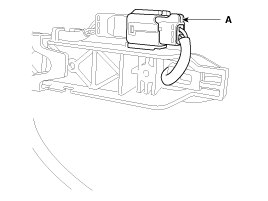

4. Após soltar as engrenagens de montagem, remova a canalha da porta dianteira (A).

   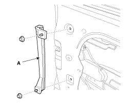

5. Após soltar as engrenagens de montagem e a engrenagem, remova o módulo da porta dianteira (A).

   ```
   Torque de aperto :
   6,9 ~ 10,8 N.m (0,7 ~ 1,1 kgf.m, 5,1 ~ 8,0 lb-ft)
   ```

   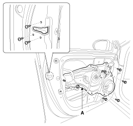

6. Desconecte os conectores e o cabo de alimentação do módulo da porta (A).

   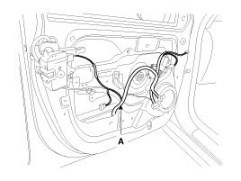

7. A instalação é o contrário da remoção.

   > **Nota**
   >
   > - A área de todas as peças deve ser aplicada com suficiente graxa.
   > - Certifique-se de que o conector esteja conectado corretamente e que cada haste esteja conectada de forma segura.
   > - Certifique-se de que a porta se feche e abra corretamente.
   > - Substitua quaisquer ganchos danificados.

Substituição da Manopla Externa

1. Remova o trim da porta dianteira.

2. Remova o selante da porta dianteira (A).

   > **Nota**
   >
   > - Substitua quaisquer selantes de porta danificados.

   

3. Remova o plug de furo (B).

4. Após soltar a engrenagem de montagem, remova a capa da manopla externa (A).

   ```
   Torque de aperto :
   6,9 ~ 10,8 N.m (0,7 ~ 1,1 kgf.m, 5,1 ~ 8,0 lb-ft)
   ```

   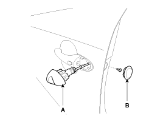

5. Remova a manopla externa (A) deslizando-a para trás.

   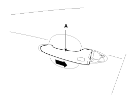

6. Desconecte o conector da manopla externa (A).

   

7. A instalação é o contrário da remoção.

   > **Nota**
   >
   > - Certifique-se de que a porta se feche e abra corretamente.

Substituição do Selante da Porta

1. Desconecte os ganchos, então remova o selante da porta lateral (A).

   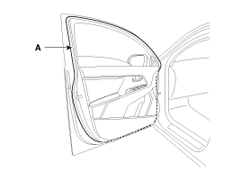

2. A instalação é o contrário da remoção.

   > **Nota**
   >
   > - Substitua quaisquer selantes danificados.

## Ajuste

Ajuste do Vidro

> **Nota**
>
> - Verifique o cano do vidro para danos ou deterioração, e substitua-os se necessário.

1. Remova o trim da porta dianteira.

2. Remova a vedação do trim da porta dianteira.

3. Move o vidro (A) cuidadosamente até que você possa ver os parafusos de montagem do vidro, depois os solte.

   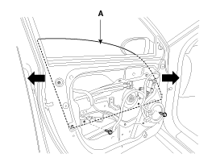

4. Verifique que o vidro se move suavemente.

Ajuste do Estribo da Porta

Certifique-se de que a porta se feche firmemente sem bater. Se necessário, ajuste o estribo (A): As parafusos do estribo estão fixos. O estribo pode ser ajustado para cima ou para baixo, e para dentro ou para fora.

1. Solte os parafusos (B) o suficiente para que o estribo se mova.

   ```
   Torque de aperto:
   (B): 16,7 ~ 21,6 N.m (1,7 ~ 2,2 kgf.m, 12,3 ~ 15,9 lb-ft)
   ```

   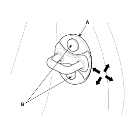

2. Bata no estribo com um martelo de plástico para ajustá-lo. O estribo não se moverá muito, mas dará algum ajuste.

3. Mantenha a alça externa para fora e empurre a porta contra o corpo para garantir que o estribo permita um ajuste liso. Se a porta se fechar corretamente, aperte os parafusos e verifique novamente.

Ajuste da Posição da Porta

> **Nota**
>
> - Após a instalação da porta, verifique um ajuste liso com o corpo, depois verifique os espaços iguais entre os bordos da frente, traseira e inferior da porta e o corpo. Verifique que os bordos da porta e do corpo estejam paralelos. Antes de ajustar, substitua os parafusos de montagem.

1. Verifique que os bordos da porta e do corpo estejam paralelos.

   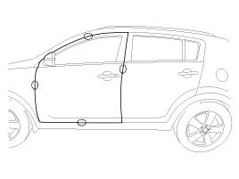

2. Coloque o veículo em uma superfície firme e nível ao ajustar as portas.

3. Ajuste nas dobradiças (A):

   | • | Solte os parafusos de montagem da porta ligeiramente, e mova a porta para dentro ou para fora até que ela alinhe com o corpo. |
   | --- | --- |

   | • | Solte os parafusos de montagem das dobradiças ligeiramente, e mova a porta para trás ou para frente, para cima ou para baixo conforme necessário para igualar os espaços. |
   | --- | --- |

   | • | Coloque um pano de oficina no garfo para prevenir danos à porta ao ajustar a porta. |
   | --- | --- |

   ```
   Torque de aperto :
   (B) : 21,6 ~ 26,5 N.m (2,2 ~ 2,7 kgf.m, 15,9 ~ 19,5 lb-ft)
   (C) : 34,3 ~ 41,2 N.m (3,5 ~ 4,2 kgf.m, 25,3 ~ 30,4 lb-ft)
   ```

   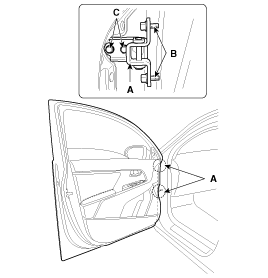

4. Lubrifique as partes articuladas das dobradiças indicadas.

5. Verifique vazamentos de água.
