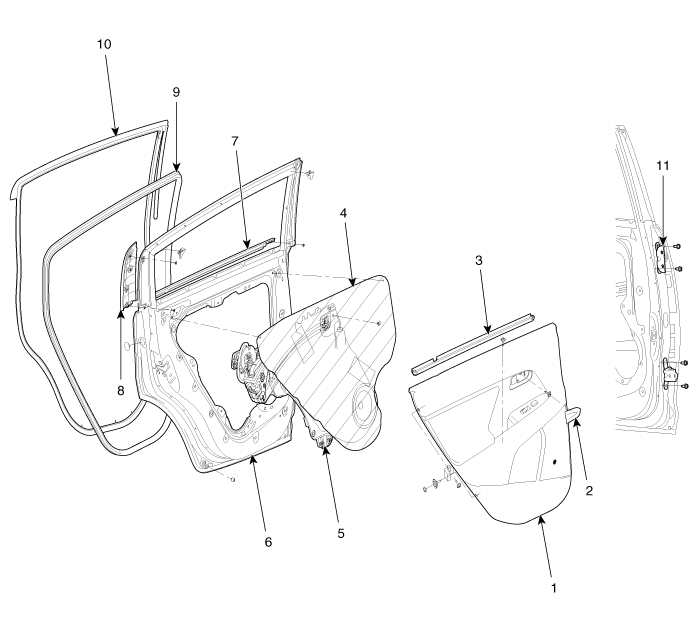

# Kia Sportage: Porta Traseira: Componentes e Localização dos Componentes

[Home](../../index.md) / [Manual de Serviço e Reparo do Kia Sportage SL](../sportage-482.md) / [Corpo (Interior e Exterior)](sportage-934.md) / [Exterior](sportage-946.md) / Porta Traseira: Componentes e Localização dos Componentes

## Componentes

| 1. Trim da porta traseira 2. Capa do puxador interno da porta traseira 3. Aqueleira interna da porta traseira 4. Selante do trim da porta traseira 5. Módulo da porta traseira 6. Painel da porta traseira | 7. Aqueleira da porta traseira 8. Aqueleira de acabamento do quadro da porta traseira 9. Aqueleira do lado do corpo da porta traseira 10. Aqueleira lateral da porta traseira 11. Junta da porta traseira |
| --- | --- |
