# Kia Sportage: Porta Traseira: Procedimentos de Reparo

[Início](../../index.md) / [Manual de Serviço e Reparo do Kia Sportage SL](../sportage-482.md) / [Corpo (Interior e Exterior)](sportage-934.md) / [Exterior](sportage-946.md) / Procedimentos de Reparo da Porta Traseira

## Troca

Troca do Trim da Porta

> **Cuidado**
>
> - Cuide para não arranharem o trim da porta e outras peças.
> - Use luvas para proteger as mãos.

1. Usando uma furadeira ou desmontador, remova a tampa do puxador interno da porta traseira (B).

2. Depois de soltar as parafusos de montagem, remova o trim da porta traseira (A).

   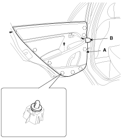

3. Remova a grade do puxador interno (A).

   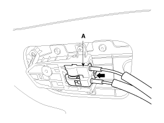

4. Desconecte os conectores do vidro elétrico (A).

   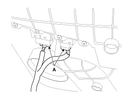

5. A instalação é o contrário da remoção.

   > **Nota**
   >
   > - Certifique-se de que os conectores estejam conectados corretamente e que cada roda esteja conectada de forma segura.
   > - Certifique-se de que a porta trave e se abra corretamente.
   > - Substitua qualquer ganchinho danificado.

Troca do Puxador Interno

1. Remova o trim da porta traseira.

2. Depois de soltar os parafusos de montagem do puxador interno da porta traseira, remova o puxador interno (A).

   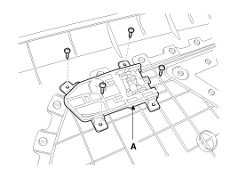

3. A instalação é o contrário da remoção.

   > **Nota**
   >
   > - Substitua qualquer ganchinho danificado.
   > - Certifique-se de que a porta trave e se abra corretamente.

Troca do Vidro

> **Cuidado**
>
> - Use luvas para proteger as mãos.

1. Remova o trim da porta traseira.

2. Remova a borracha interna do cinto de segurança da porta traseira (A).

   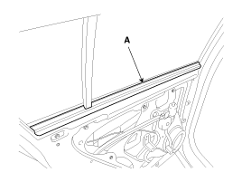

3. Depois de soltar os parafusos de montagem, remova a decoração do painel de porta traseira (A).

   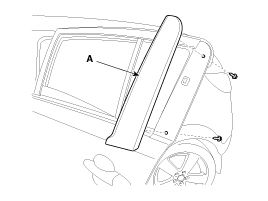

4. Depois de soltar os parafusos de montagem, remova a borracha interna do cinto de segurança da porta traseira (A).

   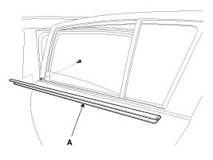

5. Solte os parafusos e parafusos de montagem do canal traseiro (A).

   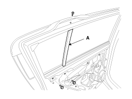

6. Remova o vidro fixo da porta traseira (A).

   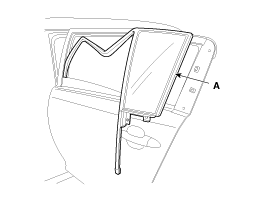

7. Remova o plugue do orifício do vidro.

   > **Cuidado**
   >
   > - Use o interruptor da porta para alinhar o orifício do vidro/bolso com o orifício na porta.
   > - Se não for possível operar o motor do vidro, remova o motor e alinhe o orifício manualmente.
   > - Cuide para não cair o vidro e/ou arranhá-lo.

8. Ajuste cuidadosamente o vidro (A) até que você possa ver os parafusos,
   depois solte-os. Separe o vidro do trilho do vidro e puxe cuidadosamente
   o vidro através da ranhura da janela.

   ```
   Torque de aperto :
   6,9 ~ 10,8 N.m (0,7 ~ 1,1 kgf.m, 5,1 ~ 8,0 lb-ft)
   ```

   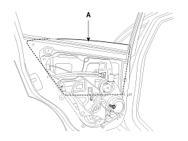

9. A instalação é o contrário da remoção.

   > **Nota**

   | • | Rolle o vidro para cima e para baixo para verificar se ele se move livremente sem engarrafamento |
   | --- | --- |

   | • | Ajuste a posição do vidro conforme necessário. |
   | --- | --- |

   | • | Certifique-se de que a porta trave e se abra corretamente. |
   | --- | --- |

   | • | Substitua qualquer ganchinho danificado |
   | --- | --- |

Troca do Altifalante

1. Remova o trim da porta traseira.

2. Desconecte o conector do altifalante (B).

3. Remova o altifalante (A) desenganchando as pregos.

   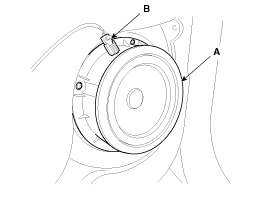

4. A instalação é o contrário da remoção.

   > **Nota**

> - Use preguntas de aço para fixar o alto-falante.
> - Certifique-se de que os conectores estão conectados corretamente e que cada roda está conectada de forma segura.
> - Certifique-se de que a porta se feche e se abra corretamente.
> - Substitua quaisquer ganchos danificados.

Motor do Vidro Eletrônico de Troca

1. Remova o trim da porta traseira.

2. Remova a vedação do trim da porta traseira (A).

   > **Nota**
   >
   > - Substitua quaisquer vedações de trim da porta danificadas.

   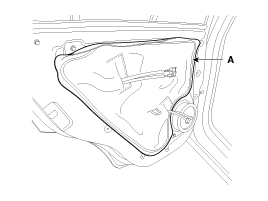

3. Desconecte o conectador do motor do vidro eletrônico (B).

4. Depois de soltar as varetas de montagem, remova o motor do vidro eletrônico (A).

   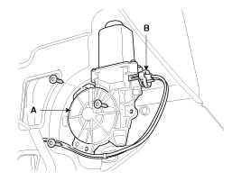

5. A instalação é o inverso da remoção.

   > **Nota**
   >
   > - A área das partes rotativas e das molas deve ser aplicada com suficiente graxa.
   > - Role o vidro para cima e para baixo para verificar se ele se move livremente sem travar.

Troca do Puxador Externo

1. Remova o plug de buraco (B).

2. Depois de soltar o parafuso de montagem, remova a cobertura do puxador externo (A).

   ```
   Torque de aperto:
   6,9 ~ 10,8 N.m (0,7 ~ 1,1 kgf.m, 5,1 ~ 8,0 lb-ft)
   ```

   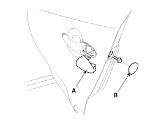

3. Remova o puxador externo (A) movendo-o para trás.

   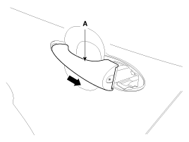

4. A instalação é o inverso da remoção.

   > **Nota**
   >
   > - Certifique-se de que a porta se feche e se abra corretamente.

Troca do Módulo da Porta

1. Remova as seguintes peças.

   | • | Trim da porta traseira |
   | --- | --- |

   | • | Vedação do trim da porta traseira |
   | --- | --- |

   | • | Vidro da janela |
   | --- | --- |

   | • | Puxador externo |
   | --- | --- |

   | • | Canal traseiro |
   | --- | --- |

   | • | Vidro fixo da porta traseira |
   | --- | --- |

2. Solte o parafuso de montagem (A).

   ```
   Torque de aperto:
   6,9 ~ 10,8 N.m (0,7 ~ 1,1 kgf.m, 5,1 ~ 8,0 lb-ft)
   ```

   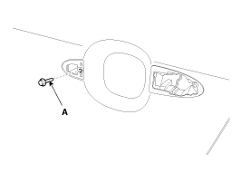

3. Depois de soltar os parafusos de montagem e a vareta do módulo da porta traseira, remova o módulo da porta traseira (A).

   ```
   Torque de aperto:
   6,9 ~ 10,8 N.m (0,7 ~ 1,1 kgf.m, 5,1 ~ 8,0 lb-ft)
   ```

   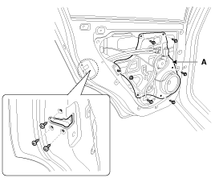

4. Desconecte os conectores e o cabo de alimentação do módulo da porta (A).

   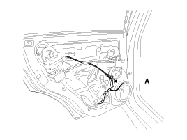

5. A instalação é o inverso da remoção.

   > **Nota**
   >
   > - A área de todas as peças deve ser aplicada com suficiente graxa.
   > - Certifique-se de que o conectador está conectado corretamente e que cada roda está conectada de forma segura.
   > - Certifique-se de que a porta se feche e se abra corretamente.

Troca da Vedação do Pano de Forro da Porta

1. Desconecte os ganchos, depois remova a vedação do pano de forro da porta lateral (A).

   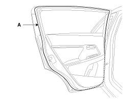

2. A instalação é o inverso da remoção.

   > **Nota**
   >
   > - Substitua quaisquer ganchos danificados.

## Ajuste

Ajuste do Vidro

> **Observação**
>
> - Verifique o canal do vidro para danos ou deterioração, e substitua-os se necessário.

1. Remova o trim da porta traseira.

2. Remova o selo do trim da porta traseira.

3. Move o vidro (A) cuidadosamente até que você possa ver a porca de montagem do vidro, depois solte-as.

   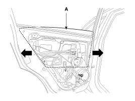

4. Verifique se o vidro move-se suavemente.

Ajuste do Estriador da Porta

Certifique-se de que a porta se feche firmemente sem bater nela. Se necessário, ajuste o estriador (A): As porcas do estriador estão fixas. O estriador pode ser ajustado para cima ou para baixo, e para dentro ou para fora.

1. Solte as parafusos (B) o suficiente para que o estriador possa se mover.

   ```
   Torque de aperto:
   (B) : 16,7 ~ 21,6 N.m (1,7 ~ 2,2 kgf.m, 12,3 ~ 15,9 lb-ft)
   ```

   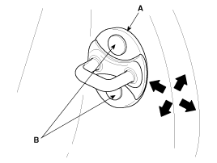

2. Bata no estriador com um martelo de plástico para ajustá-lo. O estriador não se moverá muito, mas dará algum ajuste.

3. Segure a alça externa e empurre a porta contra o corpo para garantir que o estriador permita um ajuste flush. Se a porta se fechar corretamente, aperte os parafusos e verifique novamente.

Ajuste da Posição da Porta

> **Observação**
>
> - Após a instalação da porta, verifique se há um ajuste flush com o corpo, depois verifique as gaps iguais entre os bordos da frente, traseira e inferior da porta e o corpo. Verifique se os bordos da porta e do corpo estão paralelos. Antes de ajustar, substitua as porcas de montagem.

1. Verifique se os bordos da porta e do corpo estão paralelos.

   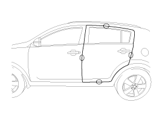

2. Coloque o veículo em uma superfície firme e níveis quando ajustando as portas.

3. Ajuste nas dobradiças (A):

   | • | Solte as porcas de montagem da porta ligeiramente, e mova a porta para dentro ou para fora até que ela alinhe flush com o corpo. |
   | --- | --- |

   | • | Solte as porcas de montagem das dobradiças ligeiramente, e mova a porta para trás ou para frente, para cima ou para baixo conforme necessário para equalizar as gaps. |
   | --- | --- |

   | • | Coloque um pano de oficina no suporte para evitar danos à porta ao ajustar a porta. |
   | --- | --- |

   ```
   Torque de aperto :
   (B) : 21,6 ~ 26,5 N.m (2,2 ~ 2,7 kgf.m, 15,9 ~ 19,5 lb-ft)
   (C) : 34,3 ~ 41,2 N.m (3,5 ~ 4,2 kgf.m, 25,3 ~ 30,4 lb-ft)
   ```

   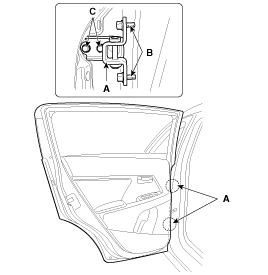

4. Lubrifique as partes articuladas das dobradiças indicadas.

5. Verifique por vazamentos de água.
