# Kia Sportage: Moldura Lateral do Corpo: Procedimentos de Reparo

[Home](../../index.md) / [Manual de Serviço e Reparo do Kia Sportage SL](../sportage-482.md) / [Corpo (Interior e Exterior)](sportage-934.md) / [Exterior](sportage-946.md) / Procedimentos de Reparo da Moldura Lateral do Corpo

## Troca

Troca do Roof Rack

> **Cuidado**
>
> - Ao arrebentar com uma furadeira plana, embrulhe-a com
fita protetiva, e aplique fita protetiva nas partes relacionadas, para
prevenir danos.
> - Use luvas para proteger as mãos.
> - Cuide para não arranhá a superfície do corpo.

1. Use uma furadeira ou removedor para remover a cobertura do roof rack (C).

2. Use uma furadeira ou removedor para remover a cobertura do lado do rail do roof rack (B).

3. Depois de desengarregar os parafusos de montagem, remova o roof rack (A).

   ```
   Torque de aperto :
   3,9 ~ 4,4 N.m ( 0,4 ~ 0,45 kgf.m, 2,9 ~ 3,3 lb-ft )
   ```

   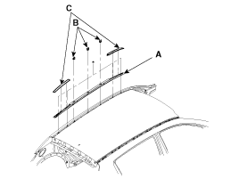

4. A instalação é o contrário da remoção.

   > **Nota**
   >
   > - Substitua qualquer clip danificado.

Troca do Roof Rack [Panoramaroof]

> **Cuidado**
>
> - Ao arrebentar com uma furadeira plana, embrulhe-a com
fita protetiva, e aplique fita protetiva nas partes relacionadas, para
prevenir danos.
> - Use luvas para proteger as mãos.
> - Cuide para não arranhá a superfície do corpo.

1. Use uma furadeira ou removedor para remover a cobertura do lado do rail do roof rack (B).

2. Depois de desengarregar os parafusos de montagem, remova o roof rack (A).

   ```
   Torque de aperto :
   3,9 ~ 4,4 N.m ( 0,4 ~ 0,45 kgf.m, 2,9 ~ 3,3 lb-ft )
   ```

   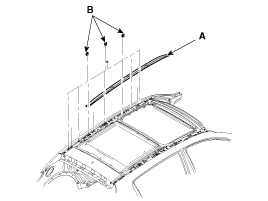

3. A instalação é o contrário da remoção.

   > **Nota**
   >
   > - Substitua qualquer clip danificado.

Troca da Moldura do Teto

> **Cuidado**
>
> - Ao arrebentar com uma furadeira plana, embrulhe-a com
fita protetiva, e aplique fita protetiva nas partes relacionadas, para
prevenir danos.
> - Use luvas para proteger as mãos.
> - Cuide para não arranhá a superfície do corpo.

1. Remova o roof rack.

2. Use uma furadeira ou removedor para remover a moldura do teto (A).

   > **Nota**
   >
   > - A moldura do teto deve ser substituída por um novo produto.

   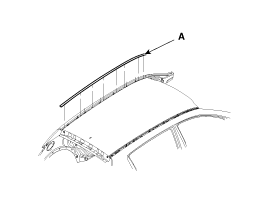

3. A instalação é o contrário da remoção.

   > **Nota**
   >
   > - Substitua qualquer clip danificado.

Troca da Moldura do Teto [Panoramaroof]

> **Cuidado**
>
> - Ao arrebentar com uma furadeira plana, embrulhe-a com
fita protetiva, e aplique fita protetiva nas partes relacionadas, para
prevenir danos.
> - Use luvas para proteger as mãos.
> - Cuide para não arranhá a superfície do corpo.

1. Remova o roof rack.

2. Use uma furadeira ou removedor para remover a moldura do teto (A).

   > **Nota**
   >
   > - A moldura do teto deve ser substituída por um novo produto.

   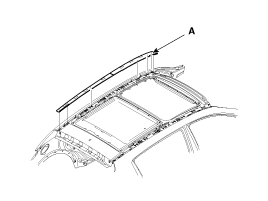

3. A instalação é o contrário da remoção.

   > **Nota**
   >
   > - Substitua qualquer clip danificado.

Troca do Guardanapo e da Guarda-Lama da Dianteira

> **Cuidado**
>
> - Ao arrebentar com uma furadeira plana, embrulhe-a com
fita protetiva, e aplique fita protetiva nas partes relacionadas, para
prevenir danos.
> - Use luvas para proteger as mãos.
> - Cuide para não arranhá a superfície do corpo.

1. Remova a roda da dianteira.

2. Depois de soltar as alças de montagem e parafusos, remova a garrafa de proteção da frente (A) e a proteção do lamaçal (B).

   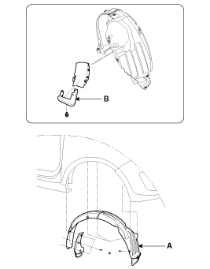

3. A instalação é o contrário da remoção.

   > **Nota**
   >
   > - Substitua as alças danificadas.

Substituição da Garrafa de Proteção e da Proteção do Lamaçal

> **Cuidado**
   >
   > - Ao arrebentar com uma furadeira plana, embrulhe-a com
   > fita protetiva, e aplique fita protetiva nas partes relacionadas, para
   > prevenir danos.
   > - Use luvas para proteger as mãos.
   > - Cuide para não arranhá a superfície do corpo.

1. Remova a roda traseira.

2. Depois de soltar as alças de montagem e o parafuso, remova a garrafa de proteção da traseira (A) e a proteção do lamaçal (B).

   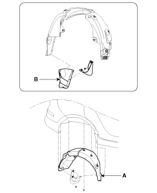

3. A instalação é o contrário da remoção.

   > **Nota**
   >
   > - Substitua as alças danificadas.

Substituição da Garrafa de Proteção do Para-choque Traseiro

> **Cuidado**
   >
   > - Ao arrebentar com uma furadeira plana, embrulhe-a com
   > fita protetiva, e aplique fita protetiva nas partes relacionadas, para
   > prevenir danos.
   > - Use luvas para proteger as mãos.
   > - Cuide para não arranhá a superfície do corpo.

1. Remova o trim do porta-malas.

   (Consulte o grupo BD - "Porta-malas")

2. Desconecte os conectores (A).

   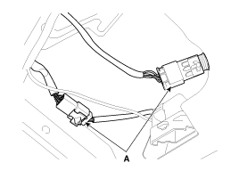

3. Depois de soltar os parafusos de montagem, remova a garrafa decorativa do porta-malas (A).

   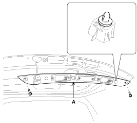

4. A instalação é o contrário da remoção.

   > **Nota**
   >
   > - Substitua as alças danificadas.

Substituição do Spoiler Traseiro

> **Cuidado**
   >
   > - Ao arrebentar com uma furadeira plana, embrulhe-a com
   > fita protetiva, e aplique fita protetiva nas partes relacionadas, para
   > prevenir danos.
   > - Use luvas para proteger as mãos.
   > - Cuide para não arranhá a superfície do corpo.

1. Remova o trim do porta-malas.

   (Consulte o grupo BD - "Porta-malas")

2. Desconecte o cano do limpador (B).

3. Depois de soltar os parafusos de montagem, remova o spoiler traseiro (A).

   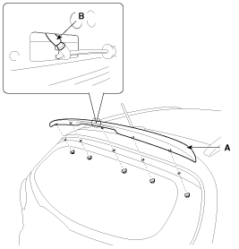

4. A instalação é o contrário da remoção.

   > **Nota**
   >
   > - Substitua as alças danificadas.

Substituição da Garrafa de Proteção do Para-choque Lateral

> **Cuidado**
   >
   > - Ao arrebentar com uma furadeira plana, embrulhe-a com
   > fita protetiva, e aplique fita protetiva nas partes relacionadas, para
   > prevenir danos.
   > - Use luvas para proteger as mãos.
   > - Cuide para não arranhá a superfície do corpo.

1. Solte o parafuso de montagem da garrafa de proteção do para-choque frontal.

2. Usando uma furadeira ou removedor, remova a garrafa de proteção do para-choque frontal (A).

3. Usando uma furadeira ou removedor, remova a garrafa de proteção do para-choque traseiro (B).

4. A instalação é o contrário da remoção.

   > **Nota**
   >
   > - Substitua as alças danificadas.

   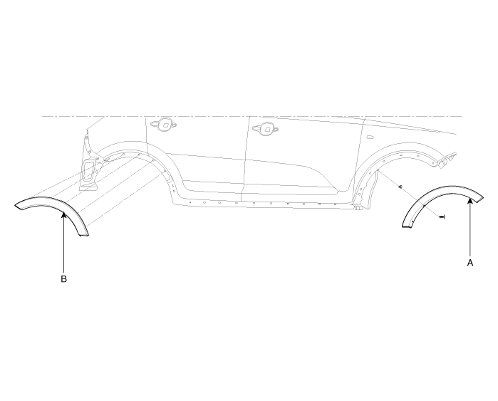

Substituição do Moldura do Piso Lateral

> **Cuidado**
   >
   > - Ao arrebentar com uma furadeira plana, embrulhe-a com
   > fita protetiva, e aplique fita protetiva nas partes relacionadas, para
   > prevenir danos.
   > - Use luvas para proteger as mãos.
   > - Cuide para não arranhá a superfície do corpo.

1. Desafine as engrenagens de fixação do revestimento do vão lateral.

2. Usando uma régua ou removível, remova o revestimento do vão lateral (A).

3. A instalação é o contrário do remoção.

   > **Nota**
   >
   > - Substitua qualquer ganchinho danificado.

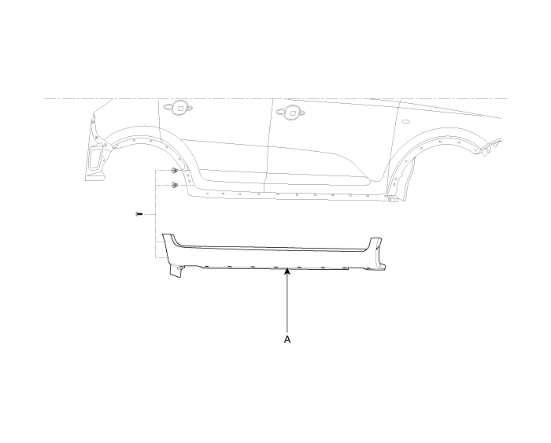
