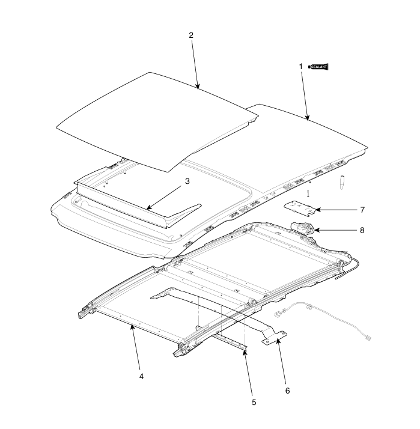

# Kia Sportage: Panoramaroof: Componentes e Localização dos Componentes

[Home](../../index.md) / [Manual de Serviço e Reparo do Kia Sportage SL](../sportage-482.md) / [Corpo (Interior e Exterior)](sportage-934.md) / [Exterior](sportage-946.md) / Panoramaroof: Componentes e Localização dos Componentes

## Componentes

| 1. Montagem do quadro do Panoramaroof 2. Montagem do vidro móvel 3. Montagem do defletor do vento 4. Montagem do mecanismo | 5. Braço de impacto 6. Montagem do membro transversal de impacto 7. Folha metálica EMC 8. Montagem do motor |
| --- | --- |
