# Kia Sportage: Panoramaroof: Procedimentos de Reparo

[Home](../../index.md) / [Manual de Serviço e Reparo do Kia Sportage SL](../sportage-482.md) / [Corpo (Interior e Exterior)](sportage-934.md) / [Exterior](sportage-946.md) / Procedimentos de Reparo do Panoramaroof

## Troca

Troca do Vidro Móvel

1. Remova o rack do teto e o acabamento do teto.

   (Consulte o grupo BD - "Acabamentos Laterais do Corpo")

2. Abra o vidro móvel.

3. Desloque a rosca de montagem (A) do vidro móvel.

   > **Cuidado**
   >
   > - Não danifique a rosca.

   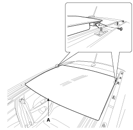

4. Após deslocar as rosquetes de montagem, remova o vidro móvel (A).

   > **Cuidado**
   >
   > - Não danifique a rosca.

   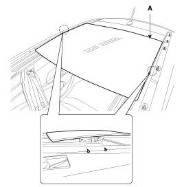

5. A instalação é a inversão da remoção.

Troca do Motor

1. Remova o acabamento do teto.

   (Consulte o grupo BD - "Acabamento do Teto")

2. Desconecte o conector (B).

3. Remova o motor do teto panorâmico após remover as rosquetes do motor do teto panorâmico (A).

   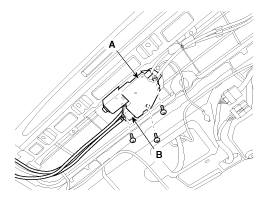

4. A instalação é a inversão da remoção.

   > **Cuidado**
   >
   > - Certifique-se de inicializar o motor.

Troca do Defletor de Vento

1. Abra o vidro móvel completamente.

2. Usando uma chave estrela, desloque o defletor de vento deslocando a rosca de montagem.

   > **Cuidado**
   >
   > - Não danifique a rosca.

   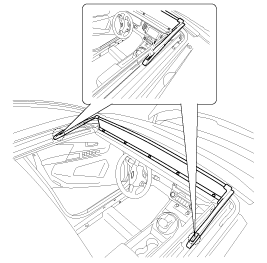

3. Após deslocar as rosquetes de montagem, remova o defletor de vento (A).

   > **Cuidado**
   >
   > - Não danifique a rosca.

   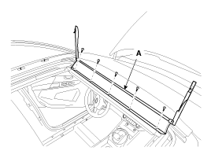

4. A instalação é a inversão da remoção.

Troca da Cortina de Rolamento

Remoção

1. Remova os seguintes itens.

   | • | Acabamento do teto (Consulte o grupo BD - "Acabamento do Teto") |
   | --- | --- |

   | • | Vidro móvel |
   | --- | --- |

   | • | Motor |
   | --- | --- |

2. Remova o suporte da lâmpada do habitáculo usando uma chave de fenda ou um removível (A).

   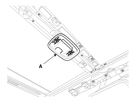

3. Remova a montagem da guia do mecanismo deslocando a rosca de montagem, e então remova a montagem da guia do mecanismo (A).

   > **Cuidado**
   >
   > - Não danifique as rosquetes.

   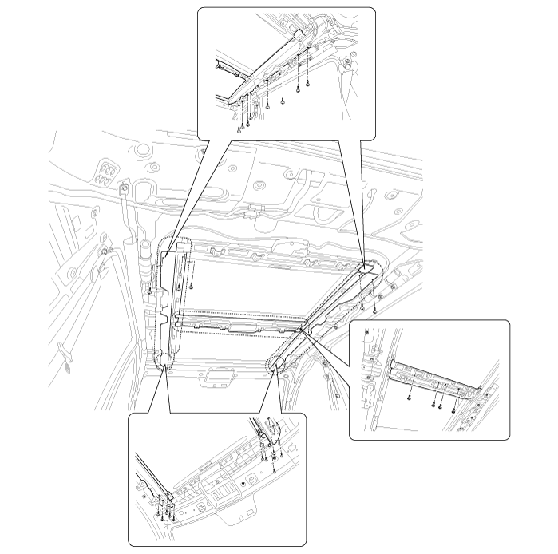

4. Corte a corda de tensão (A) para prevenir a lesão.

   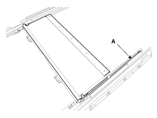

5. Após deslocar as rosquetes de montagem da cortina de rolamento, e removendo o parafuso, remova a cortina de rolamento (A).

   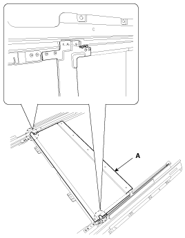

Instalação

1. Instale a cortina de rolamento (A).

   > **Nota**
   >
   > - Insira a parte do tecido nos dois extremos para guiar.

   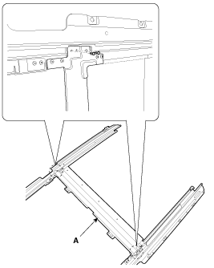

2. Instale a corda (A) na direção do seta.

   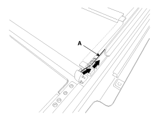

3. Instale a corda (B) na direção do seta.

   > **Nota**
   >
   > - Insira a corda completamente na cobertura durante a instalação.

   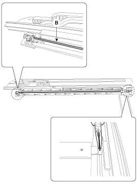

4. Puxe a corda (A) conforme a imagem abaixo.

5. Deslize a corda (A) lentamente após remover o ganchinho (B).

   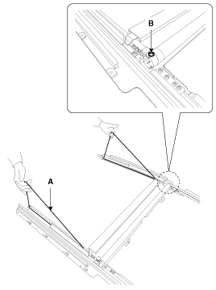

   > **Nota**
   >
   > - Satisfaz a condição de coerência da cortina de rolamento é 6,9 ~ 25,5 N.m (0,7 ~ 2,6 kgf.m, 5,1 ~ 18,8 lb-ft)

6. Instale os seguintes itens.

   | • | Motor |
   | --- | --- |

   | • | Vidro móvel |
   | --- | --- |

   | • | Acabamento do teto (Consulte o grupo BD - "Acabamento do Teto") |

| --- | --- |

Montagem da Capota Panorâmica

[Remoção]

1. Remova os seguintes itens:

   | • | Assento dianteiro (Consulte o grupo BD - "Assento Dianteiro") |
   | --- | --- |

   | • | Assento traseiro (Consulte o grupo BD - "Assento Traseiro") |
   | --- | --- |

   | • | Trim interno (Consulte o grupo BD - "Trim Interno") |
   | --- | --- |

   | • | Trim da capota (Consulte o grupo BD - "Trim da Capota") |
   | --- | --- |

   | • | Antena da capota (Consulte o grupo BE - "Audio") |
   | --- | --- |

   | • | Perno da capota e moldura da capota (Consulte o grupo BD - "Molduras do Lado do Corpo") |
   | --- | --- |

   | • | Defletor do vento |
   | --- | --- |

   > **Nota**
   >
   > - Para proteger o interior, cubra o interior antes de começar a remover a capota panorâmica.

2. Usando uma faca cortadora (B), remova o borrachamento de vedação do vidro dianteiro (A).

   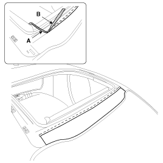

3. Abra o espaço entre o chassi e o vidro dianteiro usando uma furadeira plana, e então corte o selante de trás e laterais usando uma ferramenta (09816-2P127) (B).

   > **Nota**
   >
   > - Cuide para não danificar o vidro dianteiro ao abrir o espaço entre o chassi e o vidro dianteiro usando uma furadeira plana.

   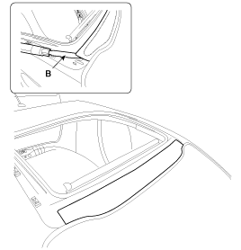

4. Remova o vidro dianteiro (A).

   > **Nota**
   >
   > - O vidro dianteiro precisa ser substituído por um novo produto.

   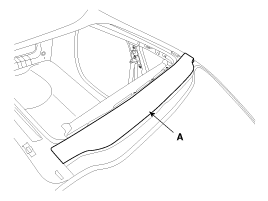

5. Desloque o suporte de montagem da capota panorâmica soltando os parafusos de montagem (A).

   ```
   Torque de aperto:
   19,6 ~ 29,4 N.m (2,0 ~ 3,0 kgf.m, 14,5 ~ 21,7 lb-ft )
   ```

   

6. Solte os parafusos de montagem da capota panorâmica.

   ```
   Torque de aperto:
   19,6 ~ 29,4 N.m (2,0 ~ 3,0 kgf.m, 14,5 ~ 21,7 lb-ft )
   ```

   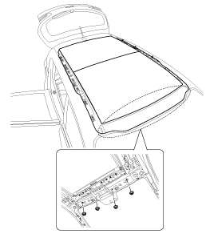

7. Desconecte a linha de terra (A) removendo o parafuso

   ```
   Torque de aperto:
   10,8 ~ 13,7 N.m (1,1 ~ 1,4 kgf.m, 8,0 ~ 10,1 lb-ft )
   ```

   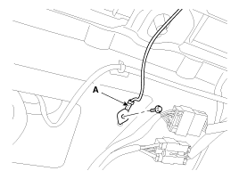

8. Abra o espaço entre o chassi e a capota panorâmica usando uma furadeira plana, e então corte o selante de borda usando uma ferramenta (09816-2P130) (A).

   > **Nota**
   >
   > - Cuide para não danificar a capota panorâmica ao inserir ferramentas entre o chassi e a capota panorâmica.

   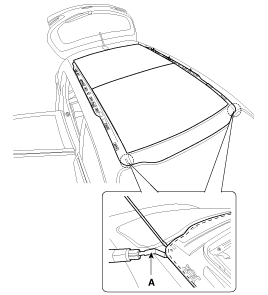

9. Abra o espaço entre o chassi e a capota panorâmica usando uma furadeira plana, e então corte o selante da frente usando uma ferramenta (09816-2P121, 09816-2P122) (A).

   > **Nota**
   >
   > - Esta lâmina tem uma inclinação para empurrar para cima.
   > - (09816-2P121, 09816-2P122)
   > - Esta lâmina tem uma inclinação para empurrar para baixo.
   > - (09816-2P123, 09816-2P124)

   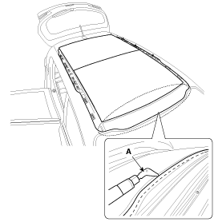

   > **Cautela**
   >
   > - Cuide para não danificar a capota panorâmica ao inserir ferramentas entre o chassi e a capota panorâmica.

10. Abra o espaço entre o chassi e a capota panorâmica usando uma furadeira plana, e então corte o selante das laterais usando uma ferramenta (09816-2P121, 09816-2P122) (A).

   > **Nota**
   >
   >

> - Esta lâmina tem uma inclinação para empurrar para cima.
   > - (09816-2P121, 09816-2P122)
   > - Esta lâmina tem uma inclinação para empurrar para baixo.
   > - (09816-2P123, 09816-2P124)

   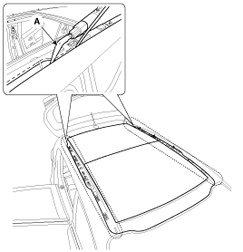

   > **Cuidado**
   >
   > - Tenha cuidado para não danificar o teto panorâmico ao inserir ferramentas entre o chassi e o teto panorâmico.

11. Corte o selante puxando a fita pianoforte (A) ao redor da montagem do teto panorâmico traseiro.

   > **Nota**
   >
   > - Tenha cuidado com a fenda central (B) que pode quebrar.

   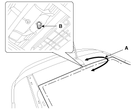

12. Corte o selante entre o teto panorâmico e o corpo, remova o teto panorâmico (A).

   > **Nota**
   >
   > - Trabalhe com pelo menos quatro pessoas ao levantar o teto panorâmico para o veículo ou para fora do veículo.

   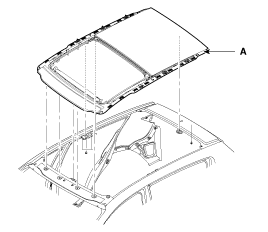

[Instalação]

1. Com uma faca, retire o adesivo antigo até obter uma espessura de aproximadamente 2mm (0,08 polegadas) na superfície de adesão ao redor do todo do abertura do teto panorâmico.

   > **Cuidado**
   >
   > - Não retire até o revestimento pintado do corpo; pintura danificada interfere na adesão correta.
   > - Remova o damante de borracha e as parafusagens do corpo.
   > - Proteja as superfícies adjacentes antes de pintar.

   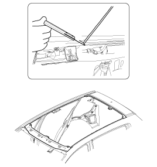

2. Limpe a superfície de adesão do corpo com um esfregão umedecido com álcool. Após a limpeza, evite que óleo, graxa e água atinjam a superfície limpa.

   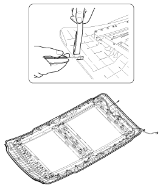

3. Remova o vidro frontal do teto panorâmico usando uma faca cortante.

   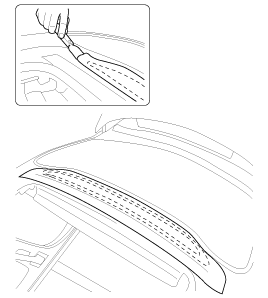

4. Com um esfregão, aplique uma fina camada de preparador de corpo na área de adesão restante ao redor do contorno do vidro do para-brisa. Deixe o preparador de corpo secar por pelo menos 10 minutos:

   > **Cuidado**
   >
   > - Não aplique preparador de vidro no corpo, e tenha cuidado para não misturar preparadores de vidro e de corpo.
   > - Nunca toque nas superfícies preparadas com as mãos.
   > - Proteja as superfícies adjacentes antes de pintar.

   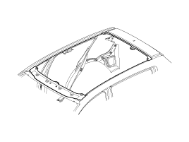

5. Aplique uma fina camada de preparador de vidro na parte externa das parafusagens.

   > **Cuidado**
   >
   > - Nunca toque na superfície preparada com as mãos. Se fizer isso, a adesão pode não se fixar corretamente ao vidro, causando uma fuga após a instalação do vidro do para-brisa.
   > - Não aplique preparador de corpo no vidro.
   > - Mantenha água, poeira e materiais abrasivos longe do preparador.

   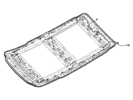

6. Preencha o carregador de adesivo sem bolhas de ar para garantir a entrega contínua. Coloque o carregador de adesivo em uma pistola de selante e faça uma linha de selante (B) ao redor do contorno do teto panorâmico (A) conforme mostrado. Aplique o adesivo dentro de 30 minutos após a aplicação do preparador de vidro. Faça uma linha um pouco mais grossa em cada canto.

   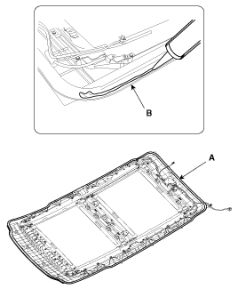

7. Fixe o teto panorâmico no centro do hall (A) do corpo, instale cuidadosamente o teto panorâmico no quadro do corpo.

   > **Nota**

> - Realize este trabalho com pelo menos quatro pessoas quando levantar ou descer o teto panorâmico do veículo.

   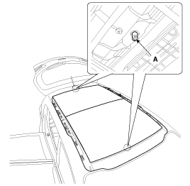

8. Verifique a distância e o espaço entre cada lado após a instalação do teto panorâmico.

   | ? | Seção | Espaço | Distância |
   | --- | --- | --- | --- |
   | Borde frontal | A-A | 5,7mm (0,2244 polegadas) | 0,9mm (0,0354 polegadas) |
   | Borde traseiro | B-B | 5mm (0,1969 polegadas) | 2mm (0,0787 polegadas) |
   | Borde lateral | C-C | 10mm (0,3937 polegadas) | 1,2mm (0,0472 polegadas) |

   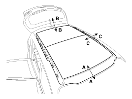

9. Instale as varetas (A) no suporte de montagem do teto panorâmico.

   ```
   Torque de aperto:
   19,6 ~ 29,4 N.m (2,0 ~ 3,0 kgf.m, 14,5 ~ 21,7 lb-ft)
   ```

   [Frontal]

   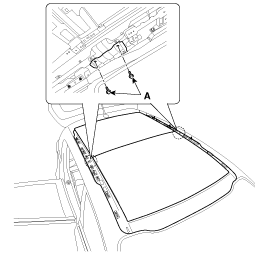

10. Instale as varetas (A) no teto panorâmico.

   ```
   Torque de aperto:
   19,6 ~ 29,4 N.m (2,0 ~ 3,0 kgf.m, 14,5 ~ 21,7 lb-ft)
   ```

   

11. Instale a vareta (A) de montagem da linha de terra.

   ```
   Torque de aperto:
   10,8 ~ 13,7 N.m (1,1 ~ 1,4 kgf.m, 8,0 ~ 10,1 lb-ft)
   ```

   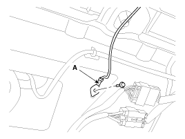

12. Instale o rack do teto e o acabamento do teto.

   (Consulte o grupo BD - "Acabamentos do corpo")

13. Preencha a cartucho de adesivo sem bolhas de ar para garantir a entrega contínua. Coloque a cartucho em uma pistola de selante, e faça uma linha de selante (A) ao redor do borde do painel do teto panorâmico (B) conforme mostrado. Aplicar o adesivo dentro de 30 minutos após a aplicação do primer de vidro. Faça uma linha de adesivo mais grossa em cada canto.

   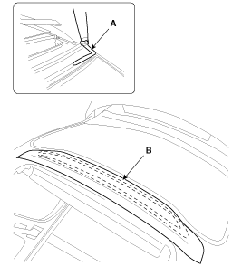

14. Instale o vidro frontal (A).

   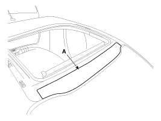

15. Feche o vidro móvel completamente.

16. Verifique a distância e o espaço entre cada lado após a instalação do vidro frontal (A).

   | ? | Seção | Espaço | Distância |
   | --- | --- | --- | --- |
   | Borde frontal | A-A | 5,7mm (0,2244 polegadas) | 0,9mm (0,0354 polegadas) |
   | Borde traseiro | B-B | 7mm (0,2756 polegadas) | 1,2mm (0,0472 polegadas) |
   | Borde lateral | C-C | 0mm | 0mm |

   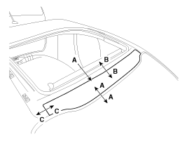

17. Escove ou limpe o excesso de adesivo com uma espátula ou toalha. Para remover adesivo de uma superfície pintada ou do vidro, limpe com uma toalha macia umedecida com álcool.

18. Deixe o adesivo secar pelo menos por uma hora, depois molhe a tampa com água e verifique se há vazamentos. Se ocorrer um vazamento, deixe secar, então selar com selante:

   | • | Deixe o veículo parado pelo menos quatro horas após a instalação do vidro. Se o veículo tiver que ser usado dentro de 4 horas, deve ser usado com lentidão. |
   | --- | --- |

   | • | Manter o vidro seco durante a primeira hora após a instalação. |
   | --- | --- |

19. Reinstale todas as partes removidas restantes. Instale o espelho retrovisor após o adesivo secar completamente. Aconselhe o cliente a não fazer as seguintes coisas nos dois ou três dias seguintes:

   | • | Bater a porta com todas as janelas fechadas. |
   | --- | --- |

| • | Torça o corpo excessivamente (como ao entrar e sair de calçadas em ângulo ou ao percorrer estradas irregulares, com superfícies desníveis). |
   | --- | --- |

20. Instalação dos seguintes itens

   | • | Defletor de vento |
   | --- | --- |

   | • | Antena do teto (Consulte o grupo BE - "Audio") |
   | --- | --- |

   | • | Trimm do teto (Consulte o grupo BD - "Trimm do Teto") |
   | --- | --- |

   | • | Trimm interno (Consulte o grupo BD - "Trimm Interno") |
   | --- | --- |

   | • | Assento traseiro (Consulte o grupo BD - "Assento Traseiro") |
   | --- | --- |

   | • | Assento dianteiro (Consulte o grupo BD - "Assento Dianteiro") |
   | --- | --- |

## Ajuste

Verificação da Alinhamento do Vidro

1. Verifique se há ruídos anormais ou deformações durante a operação.

2. Com o teto-solar totalmente fechado, verifique se há vazamento de água.

3. A placa do teto (B) deve estar alinhada com o borrachão do vidro móvel (A) em todo o percurso, dentro do valor padrão "E". Se não estiver, realize o ajuste a seguir.

   ```
   Torque de aperto :
   Valor padrão "E" [mm(in.)]
   (1) Borrao frontal : 1.2mm (0.0472 in)
   (2) Borrao traseiro : 1.0mm (0.0394 in)
   ```

   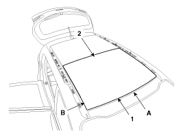

4. Se a posição não for conforme, desafine levemente as varetas de ajuste do vidro (A) para ajustar a altura do vidro e apertá-las.

   > **Cuidado**
   >
   > - Não danifique as varetas.

   

Como Inicializar o Motor

Cada vez que a bateria for desligada, descarregada ou a vareta fusível relacionada for substituída ou reinstalada, o sistema de teto panorâmico deve ser reconfigurado conforme o procedimento abaixo.

1. Coloque a chave do ignição na posição ON e feche completamente o teto panorâmico.

2. Libere o controle do teto panorâmico pressionando o interruptor.

3. Pressione e mantenha pressionado o botão FECHAR por mais de 10 segundos até que o teto-solar se mova ligeiramente.

4. Libere o controle do teto panorâmico.

5. Pressione e mantenha pressionado o botão FECHAR novamente até que o teto-solar faça o seguinte.

   | • | Inclinado > Aberto por滑动 > 关闭 | 然后，释放杠杆。 |
   | --- | --- |

6. O procedimento de reconfiguração do sistema panorâmico foi concluído.

Quando Inicializar o Motor

1. Na hora da fabricação.

2. Se a configuração inicial for apagada devido à perda de energia.

3. Após o uso da alavanca manual.

Operação da Alavanca de Emergência do Teto Panorâmico

1. Use a alavanca de emergência do teto panorâmico para fechar e abrir o teto panorâmico manualmente apenas nos seguintes casos.

   | • | Fechar o teto panorâmico antes de dirigir em um dia chuvoso ou na estrada se o teto panorâmico não puder ser fechado devido a falha no motor ou controlador do teto panorâmico. |
   | --- | --- |

2. Método de operação.

   | • | Remova o acabamento do teto |
   | --- | --- |

   | • | Empurre a alavanca de emergência para cima no drive hexagonal do motor do teto panorâmico. Você deve empurrar com força o suficiente para desengajar a embreagem do motor; caso contrário, a alavanca de emergência irá escorregar devido a uma ajuste incompleto na embreagem do motor. |
   | --- | --- |

   | • | Gire cuidadosamente a alavanca de emergência no sentido horário para fechar o teto panorâmico. |
   | --- | --- |

   | • | Após fechar o teto-solar, agite a alavanca de um lado para o outro enquanto retira a ferramenta do motor, para garantir que a embreagem do motor reengaje. |
   | --- | --- |

   | • | Uma chave de 5mm hexagonal pode ser usada em vez da alavanca de emergência com um "Speeder" tipo de cabo. |
   | --- | --- |

   > **Cuidado**
   >
   > - Não use ferramentas elétricas para operar o teto panorâmico.
   > - Pode ocorrer danos aos componentes.

   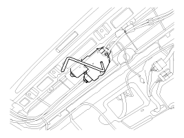
