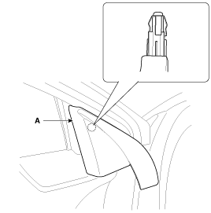
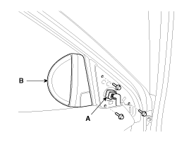
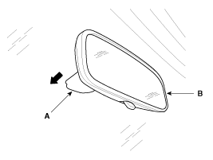
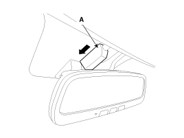
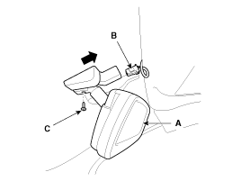

# Kia Sportage: Retrovisor: Procedimentos de Reparo

[Home](../../index.md) / [Manual de Serviço e Reparo do Kia Sportage SL](../sportage-482.md) / [Corpo (Interior e Exterior)](sportage-934.md) / [Exterior](sportage-946.md) / Procedimentos de Reparo do Retrovisor

## Troca

Troca do Conjunto de Retrovisor do Lado Externo

> **Nota**
>
> - Não desmonte o retrovisor ao pintar a caixa do retrovisor. Pinte a caixa do retrovisor após isolar as partes que não precisam ser pintadas.

> **Cuidado**
>
> - Ao arrombar com uma furadeira de borda plana, embrulhe-a com fita protetiva, e aplique fita protetiva nas partes relacionadas, para prevenir danos.
> - Use luvas para proteger as mãos.

1. Remova a cobertura interna do canto da porta frontal (A).

   

2. Desconecte o conectador (A).

3. Depois de soltar os parafusos de montagem, remova o retrovisor do lado externo (B).

   ```
   Torque de apertar :
   6,9 ~ 10,8 N.m (0,7 ~ 1,1 kgf.m, 5,1 ~ 8,0 lb-ft)
   ```

   

4. A instalação é o inverso da remoção.

Troca do Retrovisor do Interior

1. Empurre a base do retrovisor do interior (A) para baixo para remover o conjunto do retrovisor do interior (B).

   

2. A instalação é o inverso da remoção.

Troca do Retrovisor do ECM

1. Remova a cobertura do retrovisor do ECM (A).

   

2. Desconecte o conectador do retrovisor do ECM (B).

3. Solte o parafuso de montagem (C), empurre a base do retrovisor do ECM para cima para remover o conjunto do retrovisor do ECM (A).

   

4. A instalação é o inverso da remoção.

   > **Nota**
   >
   > - Certifique-se de que os conectores estejam conectados corretamente.
