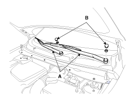
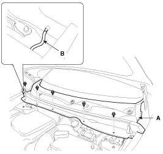

# Kia Sportage: Cobertura do Teto do Cowl: Procedimentos de Reparo

[Home](../../index.md) / [Manual de Serviço e Reparo do Kia Sportage SL](../sportage-482.md) / [Corpo (Interior e Exterior)](sportage-934.md) / [Exterior](sportage-946.md) / Procedimentos de Reparo da Cobertura do Teto do Cowl

## Troca

1. Remova a capa do braço do limpador de para-brisa (B).

2. Depois de soltar os parafusos de montagem, remova o braço do limpador de para-brisa (A).

   ```
   Torque de aperto :
   22,6 ~ 26,5 N.m (2,3 ~ 2,7 kgf.m, 16,6 ~ 19,5 lb-ft)
   ```

   

3. Remova o hose do nozzle do líquido de lavagem (B).

4. Desconecte as ganchos, depois remova a cobertura do teto do cowl (A).

   

5. A instalação é o contrário da remoção.

   > **Nota**
   >
   > - Substitua qualquer ganchos danificados.
