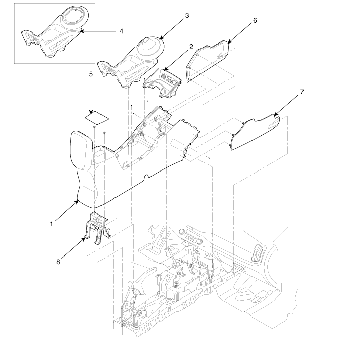

# Console — Componentes e localização

[Home](../../index.md) / [Manual de Serviço e Reparo](../sportage-482.md) / [Corpo (Interior e Exterior)](sportage-934.md) / [Interior](sportage-959.md) / Componentes e localização

## Diagrama — Componentes

## Legenda — Componentes

| Nº | Componente |
| --- | --- |
| 1 | Montagem do console do chão |
| 2 | Prateleira do console do chão |
| 3 | Cobertura superior do console [5 marchas M/T] |
| 4 | Cobertura superior do console [6 marchas M/T] |
| 5 | Mat da caixa de armazenamento do console |
| 6 | Cobertura lateral do console [LH] |
| 7 | Cobertura lateral do console [RH] |
| 8 | Aro de montagem posterior do console |

[	M/T]

[A/T]

## Diagrama — Componentes

## Legenda — Componentes

| Nº | Componente |
| --- | --- |
| 1 | Montagem do console do chão |
| 2 | Prateleira do console do chão |
| 3 | Cobertura superior do console [A/T] |
| 4 | Mat da caixa de armazenamento do console |
| 5 | Cobertura lateral do console [LH] |
| 6 | Cobertura lateral do console [RH] |
| 7 | Aro de montagem posterior do console |
