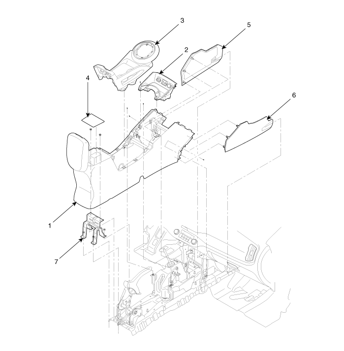

# Kia Sportage: Console: Componentes e Localização dos Componentes

[Home](../../index.md) / [Manual de Serviço e Reparo do Kia Sportage SL](../sportage-482.md) / [Corpo (Interior e Exterior)](sportage-934.md) / [Interior](sportage-959.md) / Console: Componentes e Localização dos Componentes

## Componentes

[	M/T]

| 1. Montagem do console do chão 2. Prateleira do console do chão 3. Cobertura superior do console [5 marchas M/T] 4. Cobertura superior do console [6 marchas M/T] | 5. Mat da caixa de armazenamento do console 6. Cobertura lateral do console [LH] 7. Cobertura lateral do console [RH] 8. Aro de montagem posterior do console |
| --- | --- |

[A/T]

| 1. Montagem do console do chão 2. Prateleira do console do chão 3. Cobertura superior do console [A/T] 4. Mat da caixa de armazenamento do console | 5. Cobertura lateral do console [LH] 6. Cobertura lateral do console [RH] 7. Aro de montagem posterior do console |
| --- | --- |
