# Kia Sportage: Console: Procedimentos de Reparo

[Início](../../index.md) / [Manual de Serviço e Reparo do Kia Sportage SL](../sportage-482.md) / [Corpo (Interior e Exterior)](sportage-934.md) / [Interior](sportage-959.md) / Procedimentos de Reparo do Console

## Troca

Troca do Console do Piso

[M/T]

> **Cuidado**
>
> - Ao arrebentar com uma régua plana, embrulhe-a com
fita protetora, e aplique fita protetora nas partes relacionadas, para
prevenir danos.
> - Use luvas para proteger as mãos.

1. Usando uma régua ou removedor, remova as coberturas do câmbio (A).

   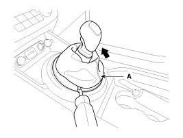

2. Usando uma régua ou removedor, remova a tampa superior do console (A).

   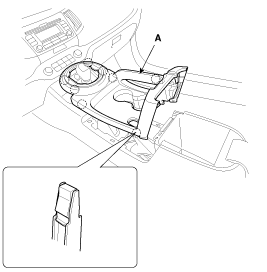

3. Depois de soltar as parafusos de montagem, remova a bandeja do console do piso (A).

   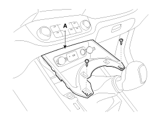

4. Desconecte o conector (A).

   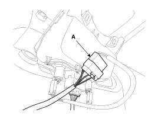

5. Remova a tampa lateral do console (A).

   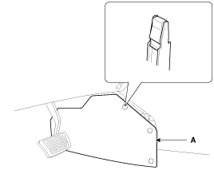

6. Depois de soltar os parafusos e parafusos de montagem, remova a montagem do console do piso (A).

   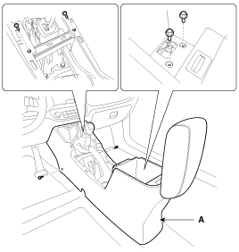

7. A instalação é o inverso da remoção.

   > **Nota**
   >
   > - Certifique-se de que os conectores estão conectados corretamente.
   > - Substitua quaisquer ganchos danificados.

[A/T]

> **Cuidado**
>
> - Ao arrebentar com uma régua plana, embrulhe-a com
fita protetora, e aplique fita protetora nas partes relacionadas, para
prevenir danos.
> - Use luvas para proteger as mãos.

1. Usando uma régua ou removedor, remova as coberturas do câmbio (B) e o botão do câmbio (A).

   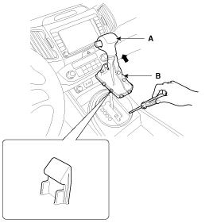

2. Usando uma régua ou removedor, remova a tampa superior do console (A).

   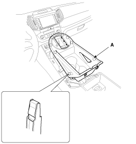

3. Desconecte o conector (A).

   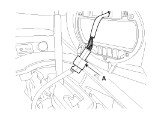

4. Depois de soltar os parafusos de montagem, remova a bandeja do console do piso (A).

   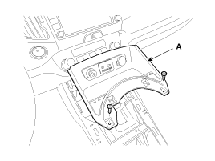

5. Desconecte o conector (A).

   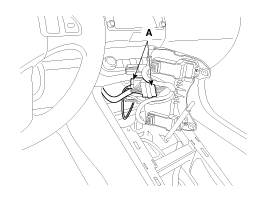

6. Remova a tampa lateral do console (A).

   

7. Depois de soltar os parafusos e parafusos de montagem, remova a montagem do console do piso (A).

   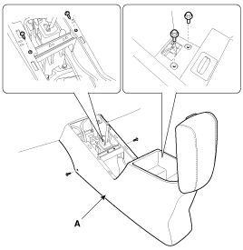

8. Desconecte o conector principal do console do piso (A).

   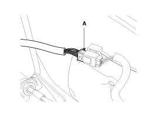

9. A instalação é o inverso da remoção.

   > **Nota**
   >
   > - Certifique-se de que os conectores estão conectados corretamente.
   > - Substitua quaisquer ganchos danificados.

Troca do Perno

> **Cuidado**
>
> - Ao arrebentar com uma régua plana, embrulhe-a com
fita protetora, e aplique fita protetora nas partes relacionadas, para
prevenir danos.
> - Use luvas para proteger as mãos.

1. Usando uma régua ou removedor, remova a tampa do console traseiro (A).

   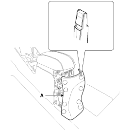

2. Depois de soltar os parafusos de montagem, remova a tampa do perno (A).

   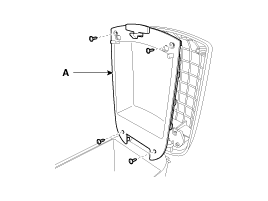

3. Depois de soltar os parafusos de montagem, remova a montagem do perno (A).

   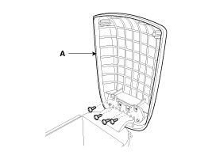

4. A instalação é o inverso da remoção.

   > **Nota**
   >
   > - Substitua quaisquer ganchos danificados.
