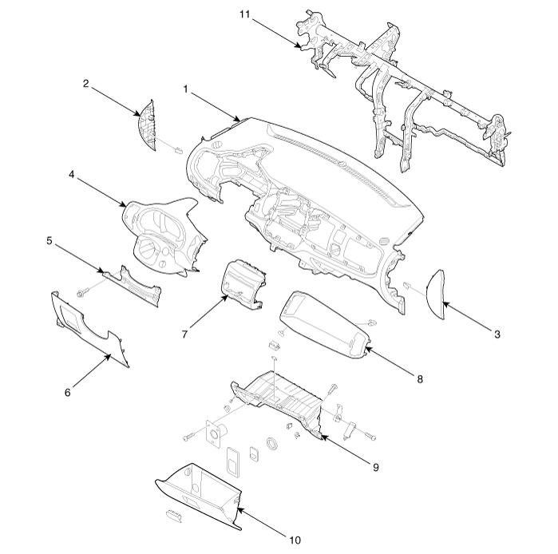

# Pad de Colisão — Componentes e localização

[Home](../../index.md) / [Manual de Serviço e Reparo](../sportage-482.md) / [Corpo (Interior e Exterior)](sportage-934.md) / [Interior](sportage-959.md) / Componentes e localização

## Diagrama

## Legenda

| Nº | Componente |
| --- | --- |
| 1 | Montagem principal do pad de colisão |
| 2 | Cobertura do pad de colisão [LH] |
| 3 | Cobertura do pad de colisão [RH] |
| 4 | Painel da fascia do cluster |
| 5 | Painel de reforço |
| 6 | Painel inferior do pad de colisão |
| 7 | Painel da fascia central |
| 8 | Adorno do pad de colisão |
| 9 | Caixa de ferramentas |
| 10 | Caixa de ferramentas |
| 11 | Montagem da barra transversal do cowl |

---

Note: The term "Caixa de ferramentas" is used for both "Glove box housing" and "Glove box" as they refer to the same component in Portuguese.
