# Kia Sportage: Pad de Colisão: Procedimentos de Reparo

[Início](../../index.md) / [Manual de Serviço e Reparo do Kia Sportage SL](../sportage-482.md) / [Corpo (Interior e Exterior)](sportage-934.md) / [Interior](sportage-959.md) / Procedimentos de Reparo do Pad de Colisão

## Troca

Troca do Cluster

> **Cuidado**
>
> - Ao arrebentar com uma régua plana, embrulhe-a com fita protetiva e aplique fita protetiva nas partes relacionadas para prevenir danos.
> - Use luvas para proteger as mãos.

1. Remova a tampa do fascia do cluster (B) e, em seguida, solte o parafuso de montagem.

2. Usando uma régua ou removível, remova o fascia do cluster (A).

   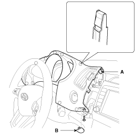

3. Desconecte o conectador (A).

   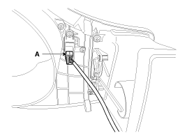

4. Após soltar os parafusos de montagem, remova a montagem do cluster (A).

   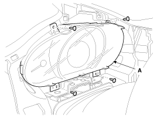

5. Desconecte o conectador (A).

   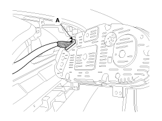

6. A instalação é o inverso da remoção.

   > **Nota**
   >
   > - Certifique-se de que o conectador esteja conectado corretamente.
   > - Substitua qualquer clip danificado.

Troca da Tampa Central do Fascia

> **Cuidado**
>
> - Ao arrebentar com uma régua plana, embrulhe-a com fita protetiva e aplique fita protetiva nas partes relacionadas para prevenir danos.
> - Use luvas para proteger as mãos.

1. Remova a tampa do fascia do cluster (B) e, em seguida, solte o parafuso de montagem.

2. Usando uma régua ou removível, remova o fascia do cluster (A).

   

3. Desconecte o conectador (A).

   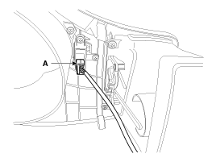

4. Remova a tampa do garnish do crash pad (B) e, em seguida, solte o parafuso de montagem.

5. Usando uma régua ou removível, remova o garnish do crash pad (A).

   

6. Após soltar os parafusos de montagem, remova a tampa central do fascia (A).

   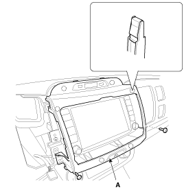

7. Desconecte os conectores (A).

   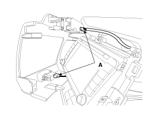

8. A instalação é o inverso da remoção.

   > **Nota**
   >
   > - Certifique-se de que os conectores estejam conectados corretamente.
   > - Substitua qualquer clip danificado.

Troca da Tampa Inferior do Crash Pad

> **Cuidado**
>
> - Ao arrebentar com uma régua plana, embrulhe-a com fita protetiva e aplique fita protetiva nas partes relacionadas para prevenir danos.
> - Use luvas para proteger as mãos.

1. Usando uma régua ou removível, remova a tampa do lado do crash pad (A).

   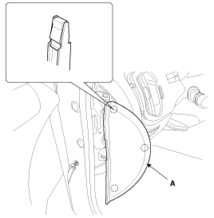

2. Após soltar os parafusos de montagem, remova a tampa inferior do crash pad (A).

   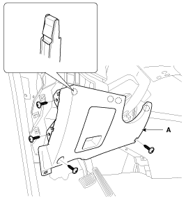

3. Desconecte o conectador de diagnóstico (A).

   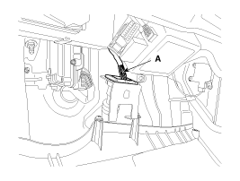

4. Após soltar as varetas de montagem, remova a tampa de reforço (A).

   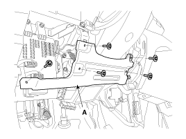

5. A instalação é o inverso da remoção.

   > **Nota**
   >
   > - Certifique-se de que os conectores estejam conectados corretamente.
   > - Substitua qualquer clip danificado.

Troca da Montagem do Som

> **Cuidado**
>
> - Ao arrebentar com uma régua plana, embrulhe-a com fita protetiva e aplique fita protetiva nas partes relacionadas para prevenir danos.
> - Use luvas para proteger as mãos.

1. Remova a capa do painel do farol (B) e, em seguida, solte a viga de montagem.

2. Usando uma régua ou removível, remova o painel do farol (A).

   

3. Desconecte o conector (A).

   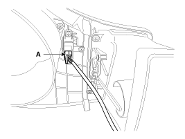

4. Remova a capa do revestimento do painel de impacto (B) e, em seguida, solte a viga de montagem.

5. Usando uma régua ou removível, remova o revestimento do painel de impacto (A).

   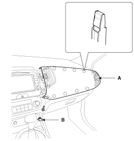

6. Após soltar as viga de montagem, remova o painel central (A).

   

7. Desconecte os conectores (A).

   

8. Após soltar as viga de montagem, remova a montagem do áudio (A).

   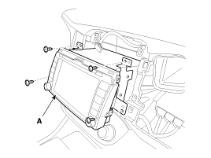

9. Desconecte os conectores (A).

   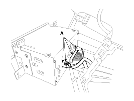

10. A instalação é o contrário da remoção.

    > **Nota**
    >
    > - Certifique-se de que os conectores estejam conectados corretamente.
    > - Substitua quaisquer ganchos danificados.

Substituição do Unidade de Controle do Aquecedor

> **Cuidado**
    >
    > - Ao arrebentar com uma régua de ponta plana, embrulhe-a com
    > fita protetiva, e aplique fita protetiva nas partes relacionadas, para
    > prevenir danos.
    > - Use luvas para proteger suas mãos.

1. Remova a capa do painel do farol (B) e, em seguida, solte a viga de montagem.

2. Usando uma régua ou removível, remova o painel do farol (A).

   

3. Desconecte o conector (A).

   

4. Remova a capa do revestimento do painel de impacto (B) e, em seguida, solte a viga de montagem.

5. Usando uma régua ou removível, remova o revestimento do painel de impacto (A).

   

6. Após soltar as viga de montagem, remova a unidade de controle do aquecedor (A).

   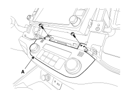

7. Desconecte o conector (A).

   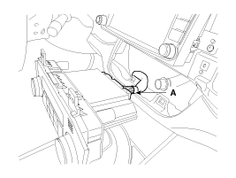

8. A instalação é o contrário da remoção.

    > **Nota**
    >
    > - Certifique-se de que os conectores estejam conectados corretamente.
    > - Substitua quaisquer ganchos danificados.

Substituição do Box do Luvas

> **Cuidado**
    >
    > - Ao arrebentar com uma régua de ponta plana, embrulhe-a com
    > fita protetiva, e aplique fita protetiva nas partes relacionadas, para
    > prevenir danos.
    > - Use luvas para proteger suas mãos.

1. Usando uma régua ou removível, remova a capa do revestimento do painel de impacto lateral (A).

   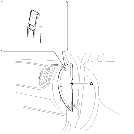

2. Desconecte o guia (B) do box do luvas (A).

   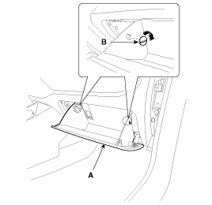

3. Desconecte o fio (A) do box do luvas (B).

   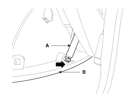

4. Desconecte o gancho (A) e, em seguida, remova o box do luvas (B).

   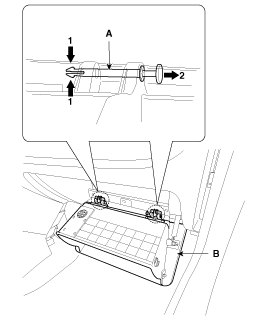

5. A instalação é o contrário da remoção.

    > **Nota**
    >
    > - Substitua quaisquer ganchos danificados.

Troca da Envolvente

1. Depois de soltar as parafusos de montagem, remova a enlevante (A).

   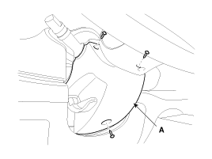

2. A instalação é o inverso da remoção.

Troca da Cobertura Lateral do Pano de Prateleira

> **Cuidado**
>
> - Ao arrebentar com uma régua plana, embrulhe-a com
fita protetiva, e aplique fita protetiva nas partes relacionadas, para
prevenir danos.
> - Use luvas para proteger as mãos.

1. Use uma régua ou removedor para remover a cobertura lateral do pano de prateleira (A).

   [Motorista]

   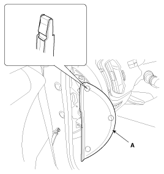

   [Passageiro]

   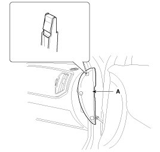

2. A instalação é o inverso da remoção.

Troca do Pano de Prateleira Principal

> **Cuidado**
>
> - Ao arrebentar com uma régua plana, embrulhe-a com
fita protetiva, e aplique fita protetiva nas partes relacionadas, para
prevenir danos.
> - Use luvas para proteger as mãos.

1. Remova os seguintes itens.

   | • | Assento dianteiro (Consulte o grupo BD – "Assento Dianteiro") |
   | --- | --- |

   | • | Trimmagem do pilar dianteiro (Consulte o grupo BD – "Trimagem Interna") |
   | --- | --- |

   | • | Assento central (Consulte o grupo BD – "Console") |
   | --- | --- |

   | • | Painel de cluster & Assento de cluster |
   | --- | --- |

   | • | Enlevante de decoração |
   | --- | --- |

   | • | Caixa de ferramentas |
   | --- | --- |

   | • | Painel de centro |
   | --- | --- |

   | • | Montagem de som |
   | --- | --- |

   | • | Unidade de controle do aquecedor |
   | --- | --- |

   | • | Cobertura lateral do pano de prateleira |
   | --- | --- |

   | • | Coluna do volante (Consulte o grupo ST - "Coluna e Eixo do Volante") |
   | --- | --- |

2. Depois de soltar os parafusos de montagem, remova a montagem do pano de prateleira (A).

   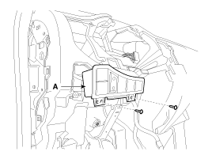

3. Desconecte o conector (A).

   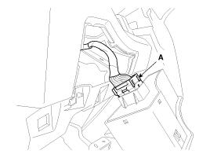

4. Desconecte o conector do airbag do passageiro (A).

5. Solte os parafusos de montagem.

   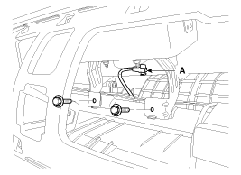

6. Use uma régua para remover o sensor de foto (A).

7. Desconecte o conector do sensor de foto (B).

   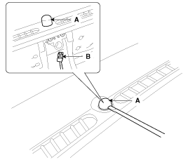

8. Depois de soltar os parafusos de montagem e parafusos, remova a montagem principal do pano de prateleira (A).

   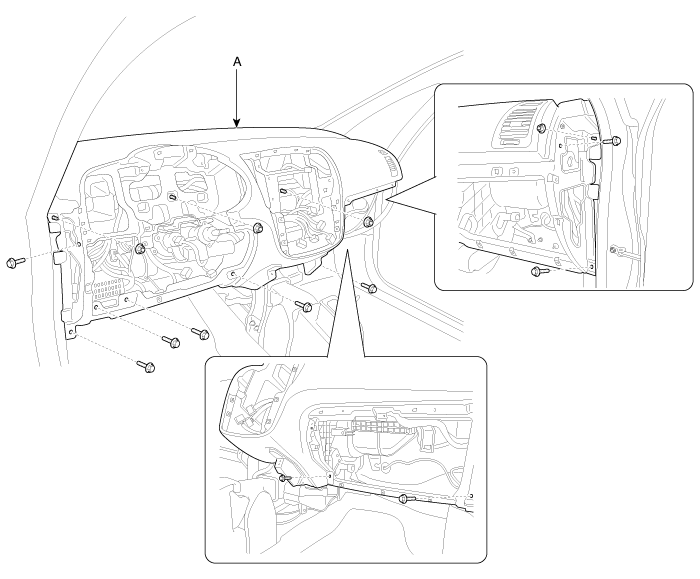

9. A instalação é o inverso da remoção.

   > **Nota**
   >
   > - Certifique-se de que o pano de prateleira se encaixa corretamente nos pinos de guia.
   > - Antes de apertar os parafusos, certifique-se de que os cabos do pano de prateleira não estão entalhados.
   > - Certifique-se de que os conectores estão conectados corretamente, e o cabo do antena está conectado corretamente.
   > - Entre o código antifurto do rádio, então entre as estações de rádio do cliente.

Troca do Barra-Cruz do Cowl

> **Cuidado**
>
> - Ao arrebentar com uma régua plana, embrulhe-a com
fita protetiva, e aplique fita protetiva nas partes relacionadas, para
prevenir danos.

> - Coloque luvas para proteger as mãos.

1. Remova os seguintes itens.

   | • | Assento dianteiro (Consulte o grupo BD - "Assento Dianteiro") |
   | --- | --- |

   | • | Montagem do painel central (Consulte o grupo BD - "Console") |
   | --- | --- |

   | • | Cobertura superior do cowl (Consulte o grupo BD - "Cowl Top Cover") |
   | --- | --- |

   | • | Trim lateral do cowl (Consulte o grupo BD - "Interior Trim") |
   | --- | --- |

   | • | Pano principal de impacto |
   | --- | --- |

2. Desconecte os conectores do unitário do ventilador.

   (Consulte o grupo HA - "Sistema de ar condicionado, Aquecimento, Ventilador")

3. Desconecte os conectores elétricos.

4. Usando uma furadeira ou removedor, remova a caixa multifunções (A).

   [Motorista]

   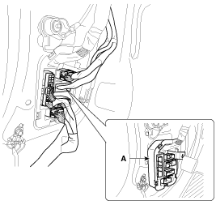

5. Desconecte os conectores elétricos.

6. Usando uma furadeira ou removedor, remova a caixa multifunções (A).

   [Passageiro]

   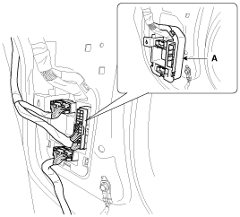

7. Desconecte os conectores (A).

   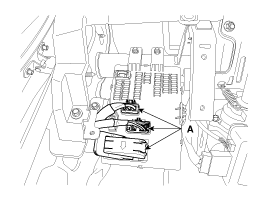

8. Desconecte o conector do módulo de controle do airbag (SRSCM) (A).

   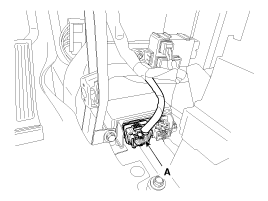

9. Desconecte o conector (A) e as pinças de montagem no pilar do motorista.

   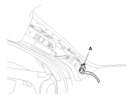

10. Depois de soltar as varetas de fixação, remova o barra do cowl (A).

    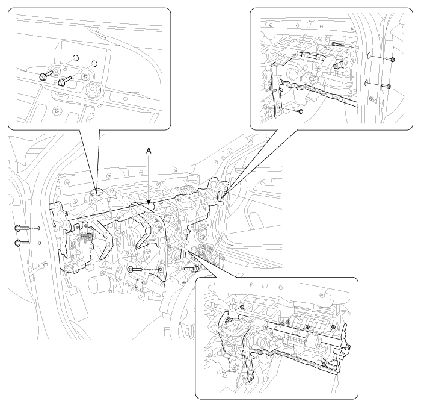

11. A instalação é o inverso da remoção.

    > **Nota**
    >
    > - Substitua as pinças danificadas.
    > - Certifique-se de que os conectores estejam conectados corretamente.
