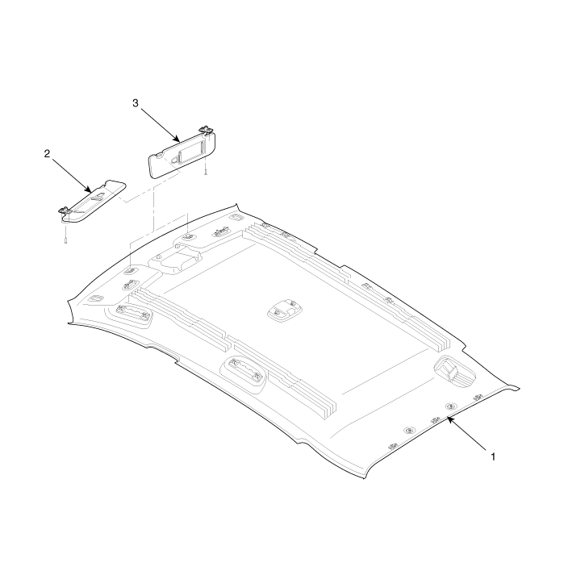
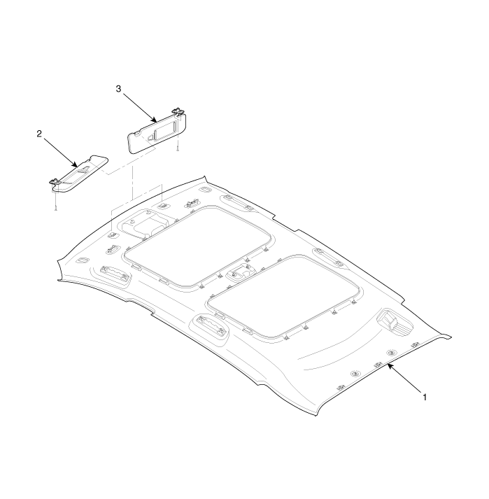

# Roof Trim — Componentes e localização

[Home](../../index.md) / [Manual de Serviço e Reparo](../sportage-482.md) / [Corpo (Interior e Exterior)](sportage-934.md) / [Interior](sportage-959.md) / Componentes e localização

## Diagrama — Componentes

## Legenda — Componentes

| Nº | Componente |
| --- | --- |
| 1 | Roof trim |
| 2 | Visor solar [Motorista] |
| 3 | Visor solar [Passageiro] |

## Diagrama (2)

## Legenda (2)

| Nº | Componente |
| --- | --- |
| 1 | Roof trim |
| 2 | Visor solar [Motorista] |
| 3 | Visor solar [Passageiro] |
