# Kia Sportage: Roof Trim: Procedimentos de Reparo

[Início](../../index.md) / [Manual de Serviço e Reparo do Kia Sportage SL](../sportage-482.md) / [Corpo (Interior e Exterior)](sportage-934.md) / [Interior](sportage-959.md) / Procedimentos de Reparo do Roof Trim

## Troca

Troca do Visor Solar

> **Cuidado**
>
> - Use uma ferramenta de remoção de painel de plástico para remover as peças de viagem internas sem arranhá-las.
> - Use luvas para proteger as mãos.

1. Depois de soltar as engrenagens de fixação, remova o visor solar (A) e o mantenedor (B).

   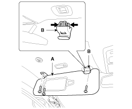

2. A instalação é o inverso da remoção.

Troca do Manípulo de Assistência

> **Cuidado**
>
> - Use uma ferramenta de remoção de painel de plástico para remover as peças de viagem internas sem arranhá-las.
> - Use luvas para proteger as mãos.

1. Remova as coberturas (A).

2. Depois de soltar as engrenagens de fixação, remova o manípulo de assistência (B).

   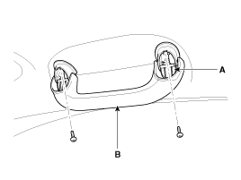

3. A instalação é o inverso da remoção.

Troca do Painel de Instrumentos

> **Cuidado**
>
> - Use uma ferramenta de remoção de painel de plástico para remover as peças de viagem internas sem arranhá-las.
> - Use luvas para proteger as mãos.

1. Depois de soltar as engrenagens de fixação, remova a montagem do painel de instrumentos (A).

   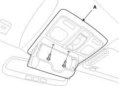

2. Desconecte os conectores (A).

   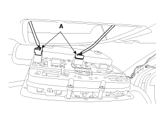

3. A instalação é o inverso da remoção.

   > **Observação**
   >
   > - Certifique-se de que o conectores estejam conectados corretamente.

Troca da Luz do Teto

> **Cuidado**
>
> - Use uma ferramenta de remoção de painel de plástico para remover as peças de viagem internas sem arranhá-las.
> - Use luvas para proteger as mãos.

1. Use uma chave de fenda ou um removedor para remover a cobertura da luz do teto (B).

2. Depois de soltar as engrenagens de fixação, remova a luz do teto (A).

   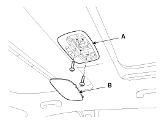

3. Desconecte o conectores (A).

   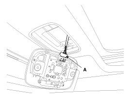

4. A instalação é o inverso da remoção.

   > **Observação**
   >
   > - Certifique-se de que os conectores estejam conectados corretamente.

Troca da Luz do Pente

> **Cuidado**
>
> - Use uma ferramenta de remoção de painel de plástico para remover as peças de viagem internas sem arranhá-las.
> - Use luvas para proteger as mãos.

1. Use uma chave de fenda ou um removedor para remover a luz do pente (A).

2. Desconecte o conectores (B).

   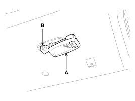

3. A instalação é o inverso da remoção.

   > **Observação**
   >
   > - Certifique-se de que o conectores estejam conectados corretamente.

Troca do Trim do Teto

> **Cuidado**
>
> - Ao empurrar com uma furadeira plana, embrulhe-a com
> fita protetiva, e aplique fita protetiva nas partes relacionadas, para
> prevenir danos.
> - Use luvas para proteger as mãos.

1. Remova os seguintes itens.

   | • | Assento dianteiro (Consulte o grupo BD - "Assento Dianteiro") |
   | --- | --- |

   | • | Assento traseiro (Consulte o grupo BD - "Assento Traseiro") |
   | --- | --- |

   | • | Visor solar |
   | --- | --- |

   | • | Painel de instrumentos |
   | --- | --- |

   | • | Luz do teto |
   | --- | --- |

   | • | Manípulo de assistência |
   | --- | --- |

   | • | Trimmagem do pilar dianteiro (Consulte o grupo BD - " Trim Interno") |
   | --- | --- |

| • | Trim da porta dianteira e Trim da porta traseira (Consulte o grupo BD - "Interior Trim") |
   | --- | --- |

   | • | Trim do pilar central inferior e Trim do pilar central superior (Consulte o grupo BD - "Interior Trim") |
   | --- | --- |

   | • | Trim do pilar traseiro (Consulte o grupo BD - "Interior Trim") |
   | --- | --- |

2. Remova a capa do espelho do ECM (A).

3. Desconecte o conector do espelho do ECM (B).

   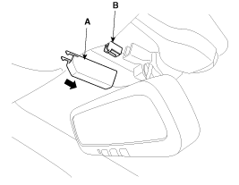

4. Remova a capa do sensor de chuva (A).

5. Desconecte o conector do sensor de chuva (B).

   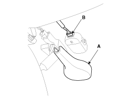

6. Desconecte o conector principal do trim do teto (A).

   [Motorista]

   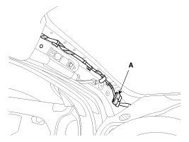

   [Passageiro]

   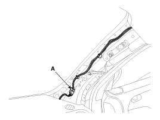

7. Desconecte o conector da antena (A).

   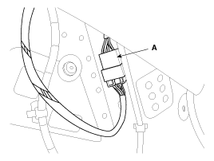

   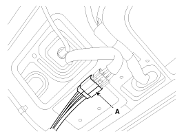

8. Remova as pinças e o trim do teto (A).

   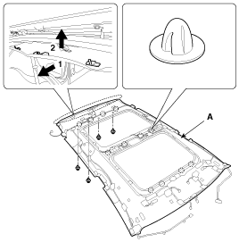

9. A instalação é o contrário da remoção.

   > **Nota**
   >
   > - Certifique-se de que os conectores estejam conectados corretamente.
   > - Substitua as pinças danificadas.
