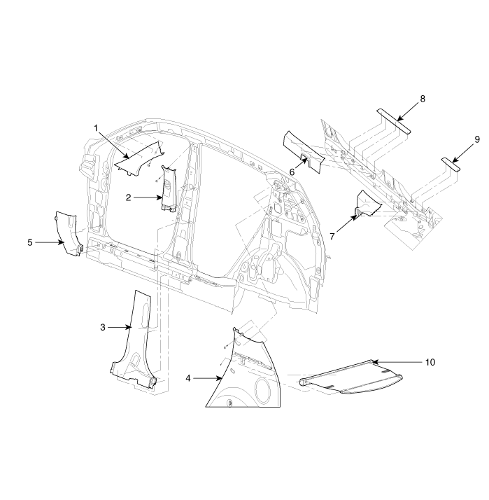

# Kia Sportage: Trim Interno: Componentes e Localização dos Componentes

[Home](../../index.md) / [Manual de Serviço e Reparo do Kia Sportage SL](../sportage-482.md) / [Corpo (Interior e Exterior)](sportage-934.md) / [Interior](sportage-959.md) / Componentes de Trim Interno: Componentes e Localização dos Componentes

## Componentes

| 1. Trimmagem do pilar frontal 2. Trimmagem superior do pilar central 3. Trimmagem inferior do pilar central 4. Trimmagem do lado do bagageiro 5. Trimmagem do lado do cowl | 6. Trimmagem do para-choque do lado da porta frontal 7. Trimmagem do para-choque do lado da porta traseira 8. Trimmagem do degrau frontal 9. Trimmagem do degrau traseiro 10. Pano de fundo do porta-malas |
| --- | --- |
