# Kia Sportage: Trim Interno: Procedimentos de Reparo

[Início](../../index.md) / [Manual de Serviço e Reparo do Kia Sportage SL](../sportage-482.md) / [Corpo (Internos e Externos)](sportage-934.md) / [Interno](sportage-959.md) / Procedimentos de Reparo do Trim Interno

## Troca

Troca da Trimmagem do Para-choque da Porta

> **Cuidado**
>
> - Use luvas para proteger as mãos.
> - Use uma ferramenta de remoção de painel de plástico para remover as peças de viagem internas sem arranhá-las.
> - Cuide para não dobrar ou arranhar a trimmagem e os painéis.

1. Usando um secador de parafuso ou removível, remova a trimmagem do para-choque da porta dianteira (A).

   [Dianteira]

   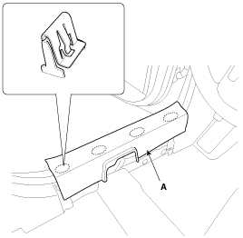

2. Remova o assento traseiro

   (Consulte o grupo BD - "Assento Traseiro")

3. Usando um secador de parafuso ou removível, remova a trimmagem do para-choque da porta traseira (A).

   [Traseira]

   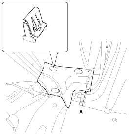

4. A instalação é o inverso da remoção.

   > **Observação**
   >
   > - Substitua quaisquer ganchos danificados.

Troca da Trimmagem do Pilar Frontal

> **Cuidado**
>
> - Use luvas para proteger as mãos.
> - Use uma ferramenta de remoção de painel de plástico para remover as peças de viagem internas sem arranhá-las.
> - Cuide para não dobrar ou arranhar a trimmagem e os painéis.

1. Depois de desafinar o parafuso de montagem, remova o pilar frontal (A).

   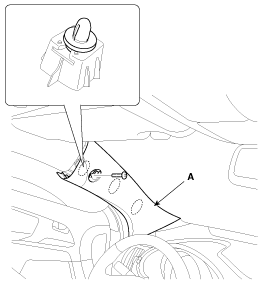

2. A instalação é o inverso da remoção.

   > **Observação**
   >
   > - Substitua quaisquer ganchos danificados.

Troca da Trimmagem do Lado do Cão

> **Cuidado**
>
> - Use luvas para proteger as mãos.
> - Use uma ferramenta de remoção de painel de plástico para remover as peças de viagem internas sem arranhá-las.
> - Cuide para não dobrar ou arranhar a trimmagem e os painéis.

1. Remova a trimmagem do para-choque da porta dianteira.

2. Remova o botão de liberação do capô.

   (Consulte o grupo BD – “Capô”)

3. Usando um secador de parafuso ou removível, remova a trimmagem do lado do cão (A).

   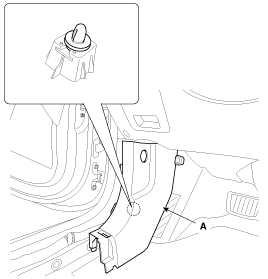

4. A instalação é o inverso da remoção.

   > **Observação**
   >
   > - Substitua quaisquer ganchos danificados.

Troca da Trimmagem do Pilar Central

> **Cuidado**
>
> - Use luvas para proteger as mãos.
> - Use uma ferramenta de remoção de painel de plástico para remover as peças de viagem internas sem arranhá-las.
> - Cuide para não dobrar ou arranhar a trimmagem e os painéis.

1. Remova a trimmagem do para-choque da porta dianteira e traseira.

2. Para remover o anel de ancoragem do cinto de segurança (C), mantenha pressionados os pinos de bloqueio (A) na direção indicada.

   Em seguida, remova o cinto de segurança após pressionar o pino de bloqueio (B).

   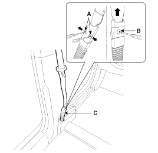

3. Usando um secador de parafuso ou removível, remova a trimmagem do pilar central inferior (A).

   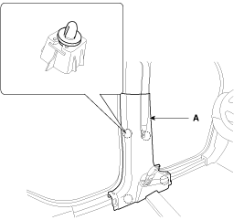

4. Depois de desafinar o parafuso de montagem, remova a trimmagem do pilar central superior (A).

   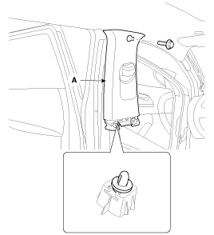

5. A instalação é o inverso da remoção.

   > **Observação**
   >
   > - Substitua quaisquer ganchos danificados.

Troca da Trimmagem do Pilar Traseiro

> **Cuidado**
>
> - Use luvas para proteger as mãos.
> - Use uma ferramenta de remoção de painel de plástico para remover as peças de viagem internas sem arranhá-las.
> - Cuide para não dobrar ou arranhar a trimmagem e os painéis.

1. Remova o assento traseiro

   (Consulte o grupo BD – “Assento Traseiro”)

2. Remova a trimmagem do para-choque da porta traseira.

3. Desafine as pinças de montagem e remova a trimmagem transversal (A).

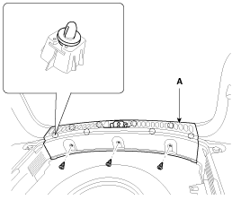

4. Após soltar o parafuso de montagem, remova o anclagem inferior do cinto de segurança traseiro (A).

   ```
   Torque de aperto :
   39,2 ~ 53,9 N.m (4,0 ~ 5,5 kgf.m, 28,9 ~ 39,8 lb-ft)
   ```

   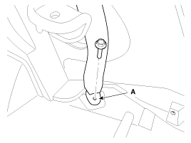

5. Após soltar os parafusos de montagem, remova o suporte do cinto de segurança traseiro (A).

   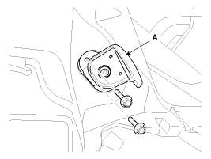

6. Usando uma régua ou removedor, remova a lâmpada (A).

7. Desconecte o conectador (B).

8. Após soltar as engrenagens de montagem, remova o acabamento lateral do porta-malas (C).

   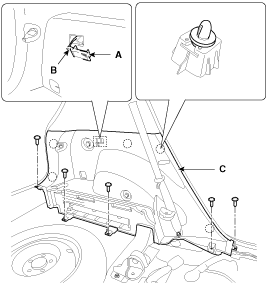

9. Desconecte o conectador (A).

   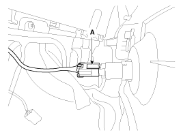

10. Após soltar as engrenagens de montagem e o parafuso, remova o acabamento do pilar traseiro (A).

   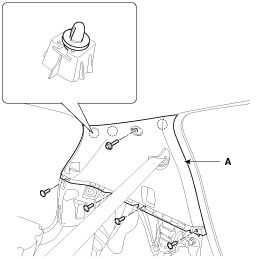

11. A instalação é o contrário da remoção.

   > **Nota**
   >
   > - Substitua qualquer ganchinho danificado.
   > - Certifique-se de que o conectador esteja conectado corretamente.

Substituição do Acabamento Lateral do Porta-Malas

> **Cuidado**
   >
   > - Use luvas para proteger as mãos.
   > - Use uma ferramenta de remoção de painel plástica para remover as peças de viagem internas sem arranhões na superfície.
   > - Cuide para não dobrar ou arranhar o acabamento e os painéis.

1. Remova o assento traseiro.

   (Consulte o grupo BD – “Assento Traseiro”)

2. Remova o acabamento transversal.

3. Remova o acabamento do para-choque traseiro.

4. Após soltar as engrenagens de montagem, remova o acabamento lateral do porta-malas.

5. A instalação é o contrário da remoção.

   > **Nota**
   >
   > - Substitua qualquer ganchinho danificado.

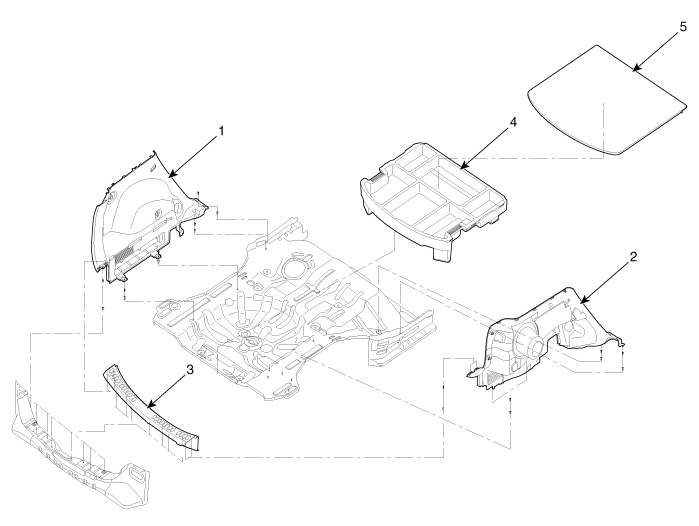

| 1. Acabamento lateral do porta-malas [LH] 2. Acabamento lateral do porta-malas [RH] 3. Acabamento transversal traseiro | 4. Prato central do porta-malas 5. Cobertura do porta-malas |
| --- | --- |
