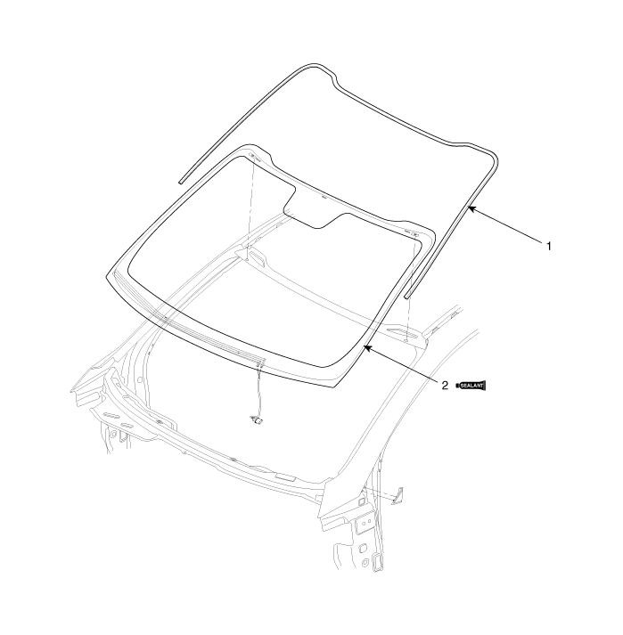

# Kia Sportage: Vidro da Capota: Componentes e Localização dos Componentes

[Home](../../index.md) / [Manual de Serviço e Reparo do Kia Sportage SL](../sportage-482.md) / [Corpo (Interior e Exterior)](sportage-934.md) / [Interior](sportage-959.md) / Vidro da Capota: Componentes e Localização dos Componentes

## Componentes

| 1. Moldura latera do vidro da capota | 2. Vidro da capota |
| --- | --- |
