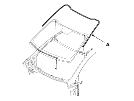
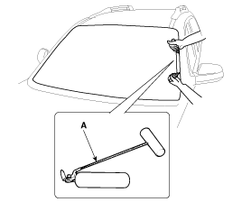
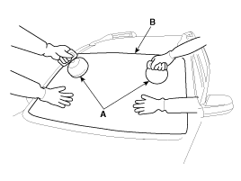
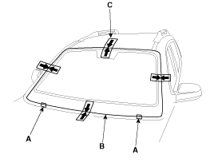
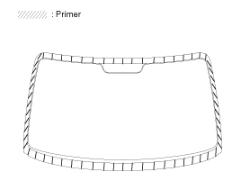
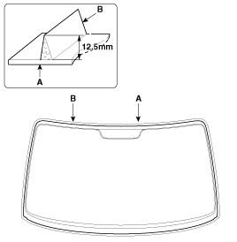
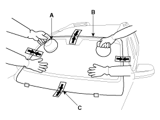

# Kia Sportage: Vidro da Capota: Procedimentos de Reparo

[Home](../../index.md) / [Manual de Serviço e Reparo do Kia Sportage SL](../sportage-482.md) / [Corpo (Interior e Exterior)](sportage-934.md) / [Interior](sportage-959.md) / Procedimentos de Reparo do Vidro da Capota

## Troca

Remoção

> **Cuidado**
>
> - Use luvas para proteger as mãos.
> - Use cobertores de assento para evitar danos a superfícies.

1. Remova os seguintes itens.

   | • | Trimm da coluna frontal (Consulte o grupo BD – "Interior Trim") |
   | --- | --- |

   | • | Retrovisor interno (Consulte o grupo BD – "Mirror") |
   | --- | --- |

   | • | Sensor de chuva (Consulte o grupo BE – "Rain Sensor") |
   | --- | --- |

   | • | Braço do limpador de vidro (Consulte o grupo BD – "Cowl Top Cover") |
   | --- | --- |

   | • | Cobertura superior do cowl (Consulte o grupo BD – "Cowl Top Cover") |
   | --- | --- |

   | • | Conector do descongelador do vidro (Consulte o grupo BE – "Windshield Deicer") |
   | --- | --- |

2. Usando uma furadeira ou removedor, remova a moldura do vidro lateral (A).

   

3. Corte o selante usando a ferramenta de corte de selante (A) (09861-31100).

   

4. Remova o vidro do para-brisa (B) cuidadosamente usando o suporte do vidro (A).

   

Instalação

1. Com uma faca, esfregue o adesivo antigo até uma espessura de cerca de 2mm (0,08 polegadas) em toda a superfície de adesivagem ao redor do abertura do para-brisa:

   | • | Não esfregue até a superfície pintada do corpo; pintura danificada pode interferir no adesivo adequado. |
   | --- | --- |

   | • | Remova o damper de borracha e as parafusagens do corpo. |
   | --- | --- |

   | • | Proteja as superfícies adjacentes antes de pintar |
   | --- | --- |

2. Limpe a superfície de adesivagem com um esfregão umedecido com álcool. Após a limpeza, evite que óleo, graxa e água entrem em contato com a superfície limpa.

3. Instale a moldura do vidro lateral (A) e as parafusagens. Não permita que haja gaps.

   

4. Instale o espaçador (A), instale o vidro do para-brisa (B) temporariamente, certificando-se de posicionar corretamente, e então coloque o marco de alinhamento (C).

   

5. Com um esfregão, aplique uma camada leve de preparador de corpo na superfície de adesivagem restante ao redor da abertura do para-brisa. Deixe o preparador de corpo secar por pelo menos 10 minutos.

   | • | Não aplique preparador de vidro ao corpo, e tenha cuidado para não confundir os preparadores de vidro e corpo. |
   | --- | --- |

   | • | Nunca toque nas superfícies preparadas com as mãos. |
   | --- | --- |

   | • | Proteja o painel de instrumentos antes de pintar a abertura. |
   | --- | --- |

6. Aplique uma camada leve de preparador de vidro ao lado externo das parafusagens.

   > **Observação**
   >
   > - Nunca toque na superfície preparada com as mãos. Se fizer, o adesivo pode não se ligar corretamente ao vidro, causando uma fuga após a instalação do vidro do para-brisa.
   > - Não aplique preparador de corpo ao vidro.
   > - Mantenha água, poeira e materiais abrasivos longe do preparador.

   

7. Preencha o carregador com adesivo sem bolhas de ar.

assegure a entrega contínua. Coloque a cartucho em uma pistola de selante, e faça uma linha de adesivo (B) ao redor do perímetro da janela de vidro (A) entre o parafuso e a moldura, conforme mostrado. Aplicar o adesivo dentro de 30 minutos após a aplicação do primário de vidro.

   Faça uma linha de adesivo ligeiramente mais grossa em cada canto.

   

8. Use pinças de sucção (A) para segurar a janela de vidro (B) sobre a
   abertura, alinhe-a com as marcas de alinhamento (C) feitas no passo 15, e coloque-a sobre o adesivo. Pressione suavemente a janela de vidro até que seus bordos estejam completamente encaixados no adesivo ao redor de todo o perímetro. Não abra ou feche as portas até que o adesivo seque.

   

9. Retire o excesso de adesivo com uma espátula ou toalha. Para remover adesivo de uma superfície pintada ou da janela de vidro, limpe com uma toalha de oficina úmida com álcool.

10. Deixe o adesivo secar pelo menos por uma hora, depois regue a janela de vidro com água e verifique se há vazamentos. Repare as áreas que vazam, e deixe a janela de vidro secar, então selar com selante:

   | • | Deixe o veículo parado pelo menos quatro horas após a instalação da janela de vidro. Se o veículo tiver que ser usado nas primeiras quatro horas, ele deve ser conduzido lentamente. |
   | --- | --- |

   | • | Manter a janela de vidro seca nas primeiras horas após a instalação. |
   | --- | --- |

11. Reinstale todas as partes removidas restantes. Instale o espelho retrovisor após o adesivo ter secado completamente. Aconselhe o cliente a não fazer as seguintes coisas nos dois ou três dias seguintes:

   | • | Bater a porta com todas as janelas fechadas. |
   | --- | --- |

   | • | Twistar o corpo excessivamente (como quando entrar e sair de garagens de ângulo ou dirigir por estradas irregulares e desníveis) |
   | --- | --- |

12. Instale os seguintes itens.

   | • | Conector do desgelador de vidro (Consulte o grupo BE – "Desgelador de Vidro") |
   | --- | --- |

   | • | Cobertura do topo do canto (Consulte o grupo BD – "Cobertura do Topo do Canto") |
   | --- | --- |

   | • | Braço do limpador de vidro (Consulte o grupo BD – "Cobertura do Topo do Canto") |
   | --- | --- |

   | • | Sensor de chuva (Consulte o grupo BE – "Sensor de Chuva") |
   | --- | --- |

   | • | Espelho interno do retrovisor (Consulte o grupo BD – "Espelho") |
   | --- | --- |

   | • | Trimmagem do pilar frontal (Consulte o grupo BD – "Trimagem Interna") |
   | --- | --- |
