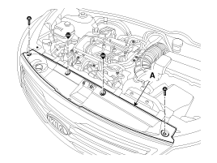
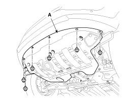
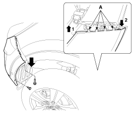
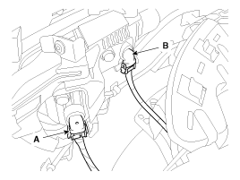
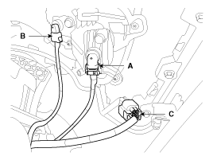

# Kia Sportage: Bumpante Frente: Procedimentos de Reparo

[Home](../../index.md) / [Manual de Serviço e Reparo do Kia Sportage SL](../sportage-482.md) / [Corpo (Interior e Exterior)](sportage-934.md) / [Bumpante](sportage-970.md) / Procedimentos de Reparo

## Troca

> **Cuidado**
>
> - Use luvas para proteger as mãos.
> - Use uma ferramenta de remoção de painel de plástico para remover as peças de viagem internas sem arranhões na superfície.
> - Cuide para não dobrar ou arranhar a capa e outras partes.

1. Desengate as pinças e parafusos de fixação do capot superior do radiador (A).

   

2. Remova as pinças de fixação da capa inferior (A).

   

3. Depois de desengatar os parafusos de fixação do lado do bumpante frontal, desconecte o lado.

   > **Cuidado**
   >
   > - Ao puxar o bumpante frontal, ele pode ser danificado pela projeção (A).

   

4. Desconecte a luz de neblina (A), a luz de sinalização de direção (B), o sensor frontal (C).

5. Remova o bumpante frontal.

   [LH]

   

   [RH]

   

6. A instalação é o inverso da remoção.

   > **Nota**
   >
   > - Certifique-se de que a conexão esteja conectada corretamente.
   > - Substitua qualquer pinça danificada.
