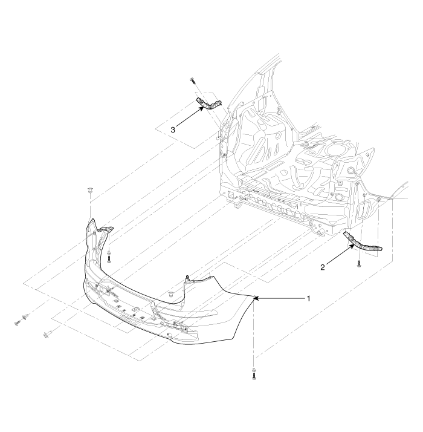

# Kia Sportage: Bumper Traseiro: Componentes e Localização dos Componentes

[Home](../../index.md) / [Manual de Serviço e Reparo do Kia Sportage SL](../sportage-482.md) / [Corpo (Interior e Exterior)](sportage-934.md) / [Bumper](sportage-970.md) / Bumper Traseiro: Componentes e Localização dos Componentes

## Componentes

| 1. Capa do bummere dianteiro 2. Aro laterai do bummere dianteiro [RH] | 3. Aro laterai do bummere dianteiro [LH] |
| --- | --- |
