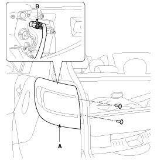
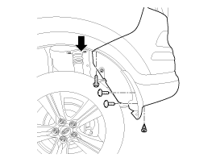
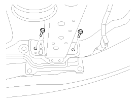
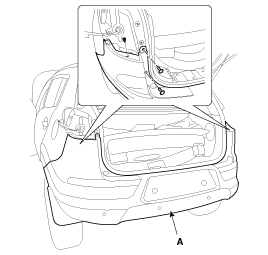
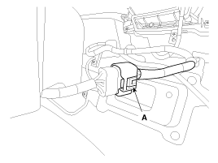

# Kia Sportage: Bumper Traseiro: Procedimentos de Reparo

[Home](../../index.md) / [Manual de Serviço e Reparo do Kia Sportage SL](../sportage-482.md) / [Corpo (Interior e Exterior)](sportage-934.md) / [Bumper](sportage-970.md) / Procedimentos de Reparo do Bumper Traseiro

## Troca

> **Cuidado**
>
> - Use luvas para proteger as mãos.
> - Use uma ferramenta de remoção de painel de plástico para remover as peças de viagem internas sem arranhar a superfície.
> - Cuide para não dobrar ou arranhar a capa e outras partes.

1. Depois de soltar as varetas de fixação, remova o farol traseiro combinado (A).

2. Empurre a vareta de bloqueio, desconecte o conector (B).

   

3. Depois de soltar as varetas de fixação e a vareta do bumper lateral, desconecte o bumper lateral.

   

4. Solte as varetas de fixação.

   

5. Depois de soltar as varetas de fixação e a vareta, remova o bumper traseiro (A).

   

6. Empurre a vareta de bloqueio, desconecte o conector principal do bumper traseiro (A).

   

7. A instalação é o inverso da remoção.

   > **Nota**
   >
   > - Certifique-se de que o conector esteja conectado corretamente.
   > - Substitua quaisquer ganchos danificados.
