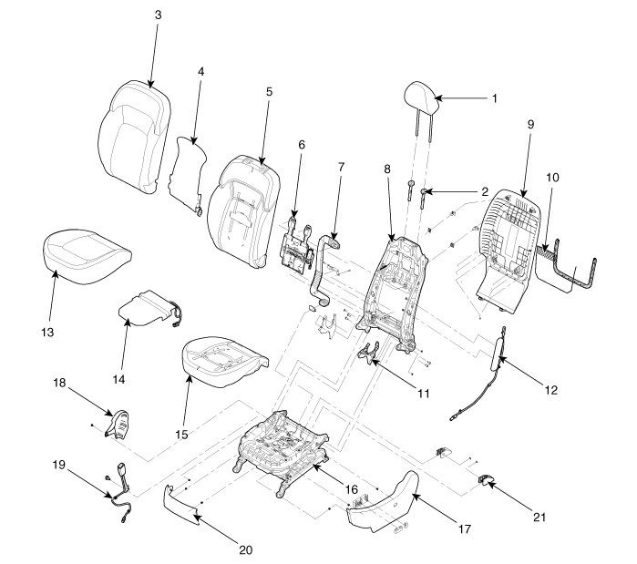

# Assento Dianteiro — Componentes e localização

[Home](../../index.md) / [Manual de Serviço e Reparo](../sportage-482.md) / [Corpo (Interior e Exterior)](sportage-934.md) / [Assento e Assento Elétrico](sportage-975.md) / Componentes e localização

## Diagrama

## Legenda

| Nº | Componente |
| --- | --- |
| 1 | Travesseiro de cabeça |
| 2 | Guiador do travesseiro de cabeça |
| 3 | Cobertura traseira do assento dianteiro |
| 4 | Quentador da traseira do assento dianteiro |
| 5 | Aquecedor do assento traseiro |
| 6 | Aquecedor do travesseiro de cabeça do assento traseiro |
| 7 | Duto do assento traseiro |
| 8 | Estrutura do assento traseiro |
| 9 | Cobertura do assento traseiro |
| 10 | Bolsa com mapas do assento dianteiro |
| 11 | Cobertura interna do assento dianteiro |
| 12 | Módulo do airbag do assento dianteiro |
| 13 | Cobertura do assento dianteiro |
| 14 | Quentador do assento dianteiro |
| 15 | Aquecedor do travesseiro de baixo do assento dianteiro |
| 16 | Estrutura do travesseiro de baixo do assento dianteiro |
| 17 | Cobertura externa do escudo do assento dianteiro |
| 18 | Cobertura interna do escudo do assento dianteiro |
| 19 | Cinto do assento dianteiro |
| 20 | Cobertura do escudo do assento dianteiro |
| 21 | Cobertura do tapete do pé do assento dianteiro |
