# Kia Sportage: Assento Dianteiro: Procedimentos de Reparo

[Início](../../index.md) / [Manual de Serviço e Reparo do Kia Sportage SL](../sportage-482.md) / [Corpo (Interior e Exterior)](sportage-934.md) / [Assentos e Assentos com Motor Elétrico](sportage-975.md) / Procedimentos de Reparo do Assento Dianteiro

## Troca

> **Aviso**
>
> - Ao remover ou instalar o assento do passageiro dianteiro, certifique-se de inicializar o Sistema de Detecção de Passageiro Ativo (PODS)
> - (Se o processo de inicialização não for realizado, o PODS pode não detectar corretamente uma pessoa.)
> - (Consulte Restrição - "Sistema de Detecção de Passageiro Ativo (PODS)")
> - Ao trocar o PODS, verifique o conjunto de peças.
> - Conjunto de peças do PODS : conjunto do encosto (incluindo a guia do assento)

> **Cuidado**
>
> - Se o PODS estiver instalado no assento, não separe a capa do assento do revestimento.
> - (Se a capa do assento e o revestimento forem separados, a posição inicial do PODS pode ser alterada)

Troca do Conjunto do Assento

1. Remova a capa do pé do assento dianteiro.

2. Depois de soltar os parafusos de montagem do conjunto do assento dianteiro (A), remova o conjunto do assento dianteiro (A).

   ```
   Torque de aperto :
   49,0 ~ 63,7 N.m (5,0 ~ 6,5 kgf.m, 36,2 ~ 47,0 lb-ft)
   ```

   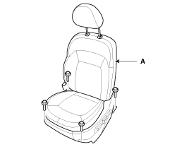

3. Desconecte os conectores do assento elétrico (A), conectores do airbag (B).

   [Motorista]

   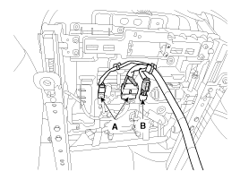

   [Passageiro]

   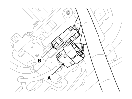

4. A instalação é o inverso da remoção.

   > **Nota**
   >
   > - Certifique-se de realizar a re-zero do PODS com o GDS após a troca de peças (passageiro)
   > - (Consulte a página RT - "Airbag")

   > **Cuidado**
   >
   > - Procedimento de Montagem dos Parafusos do Assento
   > - Coloque o assento na posição mais recuada. Verifique se cada guia está bloqueada, e então aperte temporariamente o parafuso de montagem frontal.
   > - Coloque o assento na posição mais avançada. Verifique se cada guia está bloqueada, e então aperte o parafuso de montagem traseiro completamente.
   > - Coloque o assento na posição mais recuada. Verifique o parafuso de montagem frontal completamente.
   > - Verifique se o assento opera de frente e para trás suavemente e se a parte de bloqueio está bloqueada corretamente.

Troca da Cobertura Externa do Escudo Frontal

> **Cuidado**
>
> - Ao arrebentar com uma furadeira plana, embrulhe-a com fita isolante, e aplique fita isolante nas partes relacionadas.
> - Use luvas para proteger as mãos.

1. Remova o interruptor do reclinador (A) e o interruptor de altura (B).

   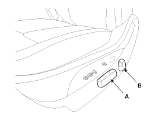

2. Usando uma furadeira ou removedor, remova a capa do escudo frontal (A).

   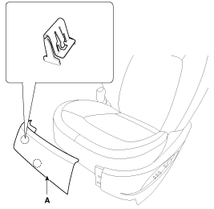

3. Usando uma furadeira ou removedor, remova a cobertura externa do escudo frontal (A).

   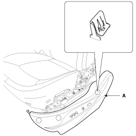

4. Desconecte o conector (A).

   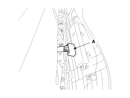

5. A instalação é o inverso da remoção.

   > **Nota**
   >
   > - Certifique-se de que os conectores estejam conectados corretamente.
   > - Substitua as pinças danificadas.
   > - Certifique-se de realizar a re-zero do PODS com o GDS após a troca de peças (passageiro)
   > - (Consulte a página RT - "Airbag")

Troca da Cobertura do Encosto

> **Cuidado**
>
> - Ao arrebentar com uma furadeira plana, embrulhe-a com fita isolante, e aplique fita isolante nas partes relacionadas.
> - Use luvas para proteger as mãos.

1. Remova a montagem do assento dianteiro.

2. Empurre o pincoil (B), remova o respaldo (A).

   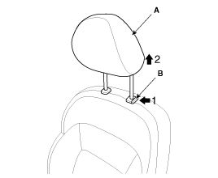

3. Desconecte os conectores (A).

   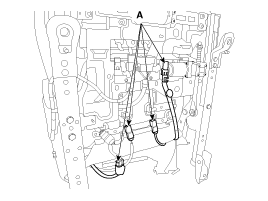

4. Empurre as ganchos (B), do revestimento do respaldo do assento (A).

   > **Cuidado**
   >
   > - Empurre a área central do gancho usando uma régua plana.
   > - Cuide para não danificar os ganchos.

   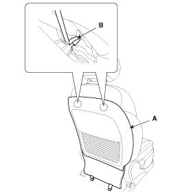

5. Empurre o protetor (A) pelo quadro do respaldo do assento.

   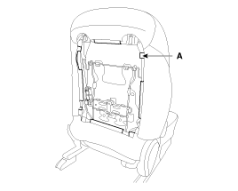

6. Comprenda o final dos guias do respaldo do assento (A) e remova-os, puxando-os.

   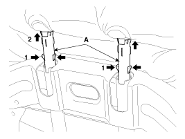

7. Remova o revestimento do respaldo do assento (A) do quadro.

   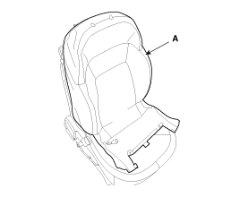

8. Após remover os ganchos de anel de porco (B) na frente do respaldo do assento, remova o revestimento do respaldo do assento (A).

   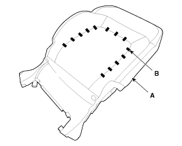

9. A instalação é o inverso da remoção.

   > **Nota**
   >
   > - Para prevenir rugas, certifique-se de esticar o material uniformemente sobre o revestimento (B) antes de fixar os ganchos de anel de porco (A).
   > - Substitua os ganchos de anel de porco por novos usando uma ferramenta especial (C) (09880-4F000).

   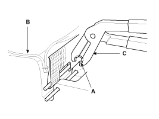

   > **Nota**
   >
   > - Certifique-se de re-alinhar o sistema de detecção de ocupante (PODS) com o GDS após substituir as peças (Passageiro).
   > - (Consulte a página RT - "Airbag")

Substituição do Revestimento do Assento

1. Remova a montagem do assento dianteiro.

2. Remova a capa externa do escudo frontal.

3. Depois de soltar a viga de montagem, remova a capa interna do escudo frontal (A).

   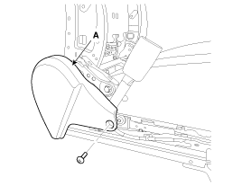

4. Desconecte o conector (A).

   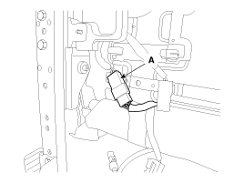

5. Empurre o protetor (A) e então o revestimento do assento (C) do quadro (B).

   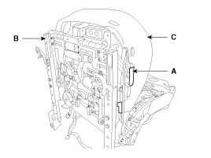

6. Remova o revestimento do assento (A) do quadro.

   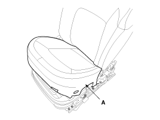

7. Após remover os ganchos de anel de porco (B) na frente do assento, remova o revestimento do assento (A).

   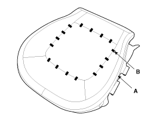

8. A instalação é o inverso da remoção.

   > **Nota**
   >
   > - Para prevenir rugas, certifique-se de esticar o material uniformemente sobre o revestimento (B) antes de fixar os ganchos de anel de porco (A).
   > - Substitua os ganchos de anel de porco por novos usando uma ferramenta especial (C) (09880-4F000).

   

   > **Nota**
   >
   > - Certifique-se de re-alinhar o sistema de detecção de ocupante (PODS) com o GDS após substituir as peças (Passageiro).
   > - (Consulte a página RT - "Airbag")

Substituição do Quadro do Assento

1. Remova os seguintes itens.

   | • | Assento dianteiro |
   | --- | --- |

   | • | Revestimento do respaldo do assento |
   | --- | --- |

   | • | Revestimento do assento |
   | --- | --- |

2. Depois de soltar a viga de montagem, remova a capa interna do escudo frontal (A).

   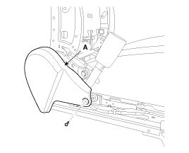

3. Desconecte o conector (C).

4. Depois de soltar as viga de montagem, desconecte o quadro do respaldo do assento (A) e o quadro do assento (B).

   > **Nota**
   >

> - Remova o airbag lateral para a substituição do assento de instalação do airbag lateral.
> - Antes do serviço, tenha plena consciência das precauções e do procedimento de serviço relacionados ao airbag.
> - (Consulte o grupo RT - "Airbag")

   ```
   Torque de aperto :
   49,0 ~ 63,7 N.m (5,0 ~ 6,5 kgf.m, 36,2 ~ 47,0 lb-ft)
   ```

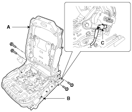

5. A instalação é o inverso da remoção.

   > **Nota**
   >
   > - Certifique-se de realizar a re-zeração do PODS com o GDS após a substituição de peças (Passageiro)
   > - (Consulte a página RT - "Airbag")
