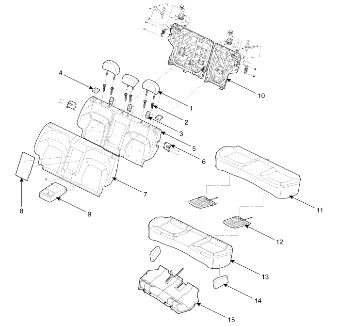

# Assento Traseiro — Componentes e localização

[Home](../../index.md) / [Manual de Serviço e Reparo](../sportage-482.md) / [Corpo (Interior e Exterior)](sportage-934.md) / [Assento e Assento Elétrico](sportage-975.md) / Componentes e localização

## Diagrama

## Legenda

| Nº | Componente |
| --- | --- |
| 1 | Suporte Cabeça |
| 2 | Guiador do Suporte Cabeça |
| 3 | Aro de Anilha Acessório |
| 4 | Beziel Superior |
| 5 | Pano do Assento Traseiro |
| 6 | Cobertura do Puxador |
| 7 | Cobertura do Pano do Assento Traseiro |
| 8 | Placa do Puxador |
| 9 | Puxador Traseiro |
| 10 | Estrutura do Pano do Assento Traseiro |
| 11 | Cobertura do Pano do Assento Traseiro |
| 12 | Aquecedor do Pano do Assento Traseiro |
| 13 | Pano do Assento Traseiro |
| 14 | Pano de Inserção do Pano do Assento Traseiro |
| 15 | Estrutura do Pano do Assento Traseiro |
