# Kia Sportage: Assento Traseiro: Procedimentos de Reparo

[Início](../../index.md) / [Manual de Serviço e Reparo do Kia Sportage SL](../sportage-482.md) / [Corpo (Interior e Exterior)](sportage-934.md) / [Assento e Assento com Motor Elétrico](sportage-975.md) / Procedimentos de Reparo do Assento Traseiro

## Troca

Troca do Conjunto de Assento

1. Depois de soltar o parafuso de montagem, remova o encosto traseiro (A).

   ```
   Torque de aperto :
   49,0 ~ 63,7 N.m (5,0 ~ 6,5 kgf.m, 36,2 ~ 47,0 lb-ft)
   ```

   > **Cuidado**
   >
   > - Remova o encosto traseiro na direção do seta.

   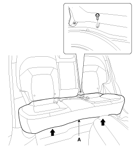

2. Desconecte os conectores do aquecedor do encosto traseiro (A).

   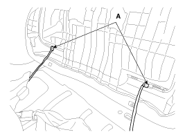

3. Depois de soltar os parafusos de montagem, remova o encosto traseiro (A).

   ```
   Torque de aperto :
   49,0 ~ 63,7 N.m (5,0 ~ 6,5 kgf.m, 36,2 ~ 47,0 lb-ft)
   ```

   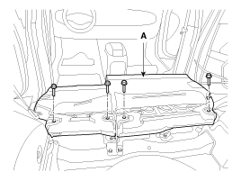

4. A instalação é o contrário da remoção.

   > **Nota**
   >
   > - Certifique-se de que o conector esteja conectado corretamente.

Troca da Cobertura do Encosto [RH]

> **Cuidado**
>
> - Ao arrebentar com uma espátula plana, embrulhe-a com
fita adesiva protetora, e aplique fita adesiva em torno das partes relacionadas, para
prevenir danos.
> - Use luvas para proteger as mãos.

1. Remova o conjunto de assento traseiro.

2. Empurre o pincoleta (B) e, em seguida, remova o respaldo (A).

   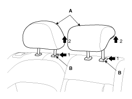

3. Empurre a gaiola (B) e, em seguida, remova o cinto de segurança (A).

   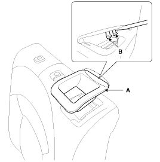

4. Usando uma espátula ou removível, remova o adorno do gancho do cinto de segurança (A).

   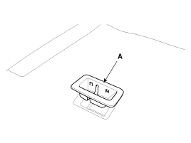

5. Depois de soltar as parafusos de montagem, remova a capa do gatilho (A).

   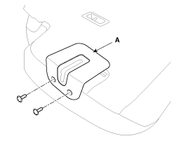

6. Usando um pincel longo, remova a pincoleta (B) e o apoio do braço (A).

   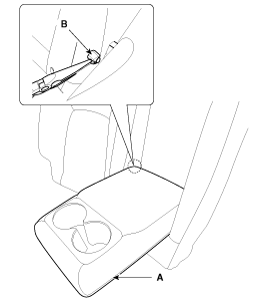

7. Desamele a cobertura do encosto (A), e depois a prenda.

   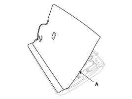

8. Desconecte o protetor (A).

   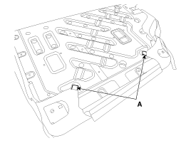

9. Desconecte os ganchos (A).

   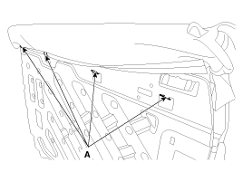

10. Empurre os guias do respaldo (A) enquanto segurando o final dos guias, e remova-os.

   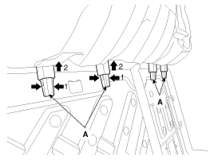

11. Remova a cobertura do encosto (A) do quadro do encosto (B).

   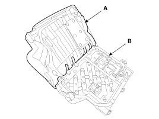

12. Depois de remover as pinças do gancho (B) na parte traseira do encosto, remova a cobertura do encosto (A).

   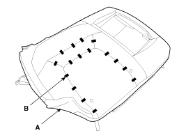

13. A instalação é o contrário da remoção.

   > **Nota**
   >
   > - Para prevenir rugas, certifique-se de que o material esteja esticado uniformemente sobre a cobertura (B) antes de fixar as pinças do gancho (A).
   > - Substitua as pinças do gancho com novas usando ferramenta especial [C (09880-4F000)].

   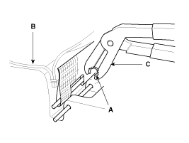

Troca do Gatilho do Encosto Traseiro

1. Remova a cobertura do encosto.

2. Depois de soltar os parafusos de montagem e, em seguida, desconecte o eixo (B).

3. Remova o gatilho traseiro (A).

   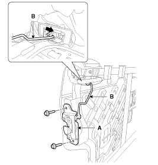

4. A instalação é o contrário da remoção.

Troca da Cobertura do Encosto [LH]

> **Cuidado**
>
> - Ao arrebentar com uma espátula plana, embrulhe-a com
fita adesiva protetora, e aplique fita adesiva em torno das partes relacionadas, para
prevenir danos.

> - Use luvas para proteger as mãos.

1. Remova a montagem do assento traseiro.

2. Empurre o pincoleta (B) e, em seguida, remova o respaldo (A).

   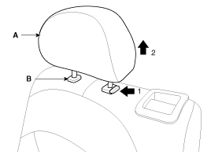

3. Empurre a gancha (B) e, em seguida, remova o capuz superior (A).

   

4. Usando uma régua ou removedor, remova a capa do gancho de amarração (A).

   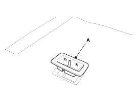

5. Depois de soltar as engrenagens de montagem, remova a capa do pêndulo (A).

   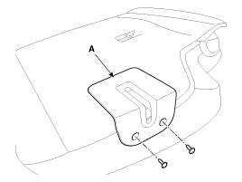

6. Desfie a capa do assento traseiro (A) e, em seguida, levante-a.

   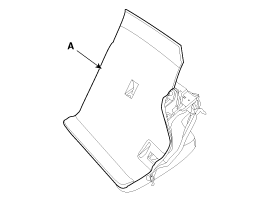

7. Desconecte o protetor (A).

   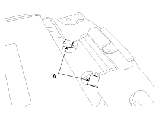

8. Desconecte as ganchas (A).

   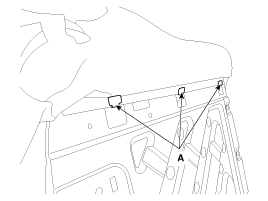

9. Retire os guias do respaldo do assento (A) enquanto segurando o final dos guias, e remova-os.

   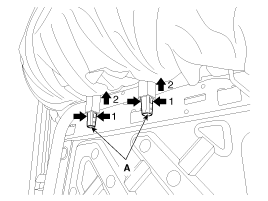

10. Remova a capa do assento traseiro (A) do quadro do respaldo do assento (B).

   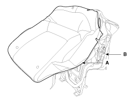

11. Após remover as pinças do gancho (B) na parte traseira do respaldo do assento, remova a capa do assento traseiro (A).

   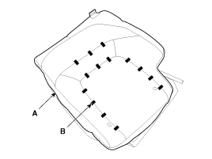

12. A instalação é o contrário da remoção.

   > **Nota**
   >
   > - Para prevenir rugas, assegure-se de que o material esteja esticado uniformemente sobre a capa (B) antes de fixar as pinças do gancho (A).
   > - Substitua as pinças do gancho por novas usando a ferramenta especial [C (09880-4F000)].

   

Substituição da Capa do Assento Traseiro

> **Cuidado**
>
> - Ao arrebentar com uma régua de ponta reta, embrulhe-a com
fita adesiva protetora, e aplique fita adesiva protetora nas partes relacionadas, para
evitar danos.
> - Use luvas para proteger as mãos.

1. Remova o assento traseiro.

2. Remova as pinças do gancho (A).

   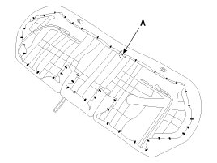

3. Após remover as pinças do gancho (B) na parte traseira do assento, remova a capa do assento (A).

   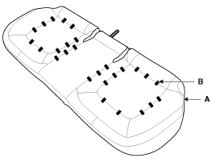

4. A instalação é o contrário da remoção.

   > **Nota**
   >
   > - Para prevenir rugas, assegure-se de que o material esteja esticado uniformemente sobre a capa (B) antes de fixar as pinças do gancho (A).
   > - Substitua as pinças do gancho por novas usando a ferramenta especial [C (09880-4F000)].

   
