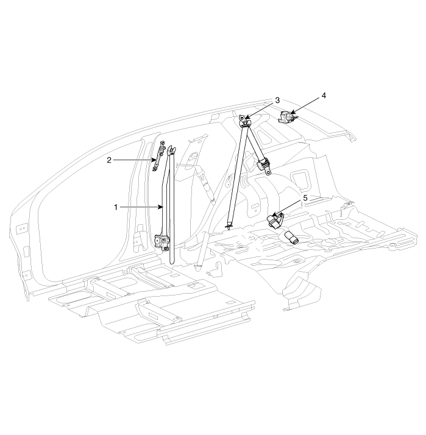

# Kia Sportage: Componentes e Localização dos Componentes

[Home](../../index.md) / [Manual de Serviço e Reparo do Kia Sportage SL](../sportage-482.md) / [Corpo (Interior e Exterior)](sportage-934.md) / [Cinto de Segurança](sportage-980.md) / Componentes e Localização dos Componentes

## Componentes

| 1. Cinto de segurança do assento frontal 2. Ajustador de altura 3. Cinto de segurança do assento traseiro | 4. Cinto de segurança do assento traseiro [Centro] 5. Presilha do cinto de segurança do assento traseiro |
| --- | --- |
