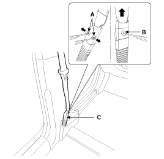
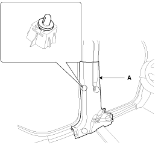
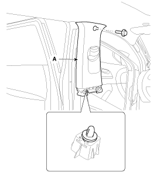
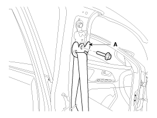
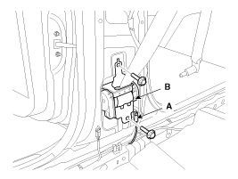
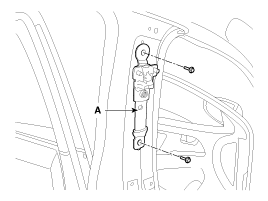
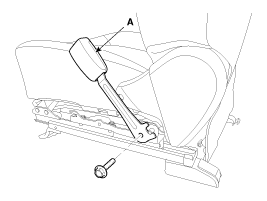

# Kia Sportage: Cinto de Segurança do Assento Frente: Procedimentos de Reparo

[Home](../../index.md) / [Manual de Serviço e Reparo do Kia Sportage SL](../sportage-482.md) / [Corpo (Interior e Exterior)](sportage-934.md) / [Cinto de Segurança](sportage-980.md) / Procedimentos de Reparo do Cinto de Segurança do Assento Frente

## Troca

Troca do Cinto de Segurança do Assento Frente

> **Cuidado**
>
> - Ao instalar o cinto, certifique-se de não danificar o pretensor.

1. Remova os seguintes itens primeiro:

   | • | Montagem do assento frontal (Consulte o grupo BD - "Assento Frontal") |
   | --- | --- |

   | • | Trim da porta dianteira e trim da porta traseira (Consulte o grupo BD - "Trim Interno") |
   | --- | --- |

2. Para remover o anel do cinto de segurança do pretensor (C), mantenha as lombadas (A) empurradas na direção do seta.

   Em seguida, remova o cinto de segurança após empurrar a lombada (B).

   

3. Remova o trim inferior do pilar central (A).

   

4. Depois de desafinar o parafuso de montagem, remova o trim superior do pilar central (A).

   

5. Depois de desafinar o parafuso de montagem, remova o anel superior do cinto de segurança do assento frontal (A).

   ```
   Torque de aperto:
   39,2 ~ 53,9 N.m (4,0 ~ 5,5 kgf.m, 28,9 ~ 39,8 lb-ft)
   ```

   

6. Depois de desconectar a lombada do pretensor, remova o conectador SIS (A), desafine o parafuso de montagem, e remova o pretensor (B).

   ```
   Torque de aperto:
   39,2 ~ 53,9 N.m (4,0 ~ 5,5 kgf.m, 28,9 ~ 39,8 lb-ft)
   ```

   

7. A instalação é o inverso da remoção.

Troca do Regulador de Altura

1. Remova os seguintes itens primeiro:

   | • | Montagem do assento frontal (Consulte o grupo BD - "Assento Frontal"). |
   | --- | --- |

   | • | Trim da porta dianteira e trim da porta traseira (Consulte o grupo BD - "Trim Interno") |
   | --- | --- |

   | • | Anel inferior do cinto de segurança do assento frontal |
   | --- | --- |

   | • | Trim inferior do pilar central (Consulte o grupo BD - "Trim Interno") |
   | --- | --- |

   | • | Trim superior do pilar central (Consulte o grupo BD - "Trim Interno") |
   | --- | --- |

   | • | Anel superior do cinto de segurança do assento frontal |
   | --- | --- |

2. Depois de desafinar os parafusos, remova o regulador de altura (A).

   ```
   Torque de aperto:
   39,2 ~ 53,9 N.m (4,0 ~ 5,5 kgf.m, 28,9 ~ 39,8 lb-ft)
   ```

   

3. A instalação é o inverso da remoção.

   > **Nota**
   >
   > - Substitua qualquer clip danificado.
   > - Certifique-se de que a altura esteja correta.

Troca do Cinto de Segurança do Assento Frente (Bocal)

1. Remova os seguintes itens primeiro:

   | • | Montagem do assento frontal (Consulte o grupo BD - "Assento Frontal") |
   | --- | --- |

2. Depois de desafinar o parafuso de montagem, remova o bocal do cinto de segurança do assento frontal (A).

   ```
   Torque de aperto:
   39,2 ~ 53,9 N.m (4,0 ~ 5,5 kgf.m, 28,9 ~ 39,8 lb-ft)
   ```

   

3. A instalação é o inverso da remoção.
