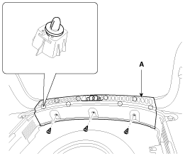
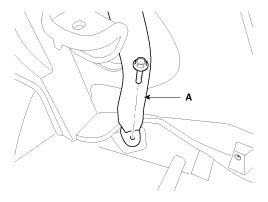
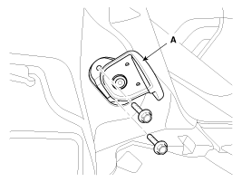
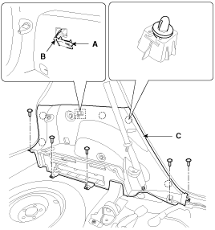
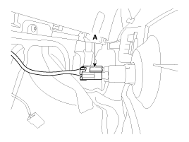
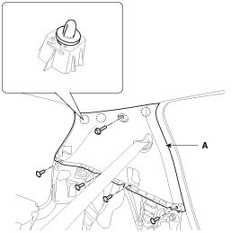
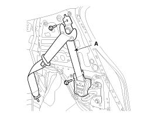
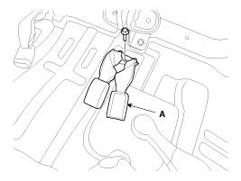
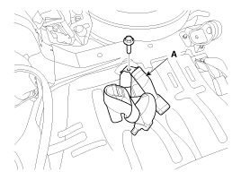

# Kia Sportage: Cinto de Segurança Traseiro: Procedimentos de Reparo

[Home](../../index.md) / [Manual de Serviço e Reparo do Kia Sportage SL](../sportage-482.md) / [Corpo (Interior e Exterior)](sportage-934.md) / [Cinto de Segurança](sportage-980.md) / Procedimentos de Reparo do Cinto de Segurança Traseiro

## Troca

Troca do Cinto de Segurança Traseiro

> **Cuidado**
>
> - Ao instalar o cinto, certifique-se de não danificar o retractor.

1. Remova os seguintes itens primeiro.

   | • | Montagem do assento traseiro (Consulte o grupo BD - "Assento Traseiro") |
   | --- | --- |

   | • | Trim de arranhão da porta dianteira & Trim de arranhão da porta traseira (Consulte o grupo BD - "Interior Trim") |
   | --- | --- |

2. Remova as pinças e o trim transversal traseiro (A).

   

3. Desloque o parafuso de montagem, depois remova o anclagem inferior do cinto de segurança traseiro (A).

   ```
   Torque de aperto :
   39,2 ~ 53,9 N.m (4,0 ~ 5,5 kgf.m, 28,9 ~ 39,8 lb-ft)
   ```

   

4. Desloque os parafusos de montagem, depois remova o suporte de montagem do assento traseiro (A).

   

5. Usando uma furadeira ou removedor, remova a lâmpada (A).

6. Desconecte o conectador (B).

7. Desloque os parafusos de montagem, depois remova o trim lateral do porta-malas (C).

   

8. Desconecte o conectador (A).

   

9. Desloque os parafusos de montagem e os parafusos, depois remova o trim do pilar traseiro (A).

   

10. Desloque os parafusos de montagem, depois remova o cinto de segurança traseiro (A).

    ```
    Torque de aperto :
    39,2 ~ 53,9 N.m (4,0 ~ 5,5 kgf.m, 28,9 ~ 39,8 lb-ft)
    ```

   

11. A instalação é o inverso da remoção.

    > **Nota**
    >
    > - Substitua qualquer pinça danificada.
    > - Certifique-se de que os conectores estejam conectados corretamente.

Troca do Cinto de Segurança Traseiro (Bocal)

1. Remova o assento traseiro.

   (Consulte o grupo BD - "Assento Traseiro")

2. Desloque o parafuso de montagem, depois remova o bocal do cinto de segurança traseiro (A).

   ```
   Torque de aperto :
   39,2 ~ 53,9 N.m (4,0 ~ 5,5 kgf.m, 28,9 ~ 39,8 lb-ft)
   ```

   [LH]

   

   [RH]

   ```
   Torque de aperto :
   39,2 ~ 53,9 N.m (4,0 ~ 5,5 kgf.m, 28,9 ~ 39,8 lb-ft)
   ```

   

3. A instalação é o inverso da remoção.
