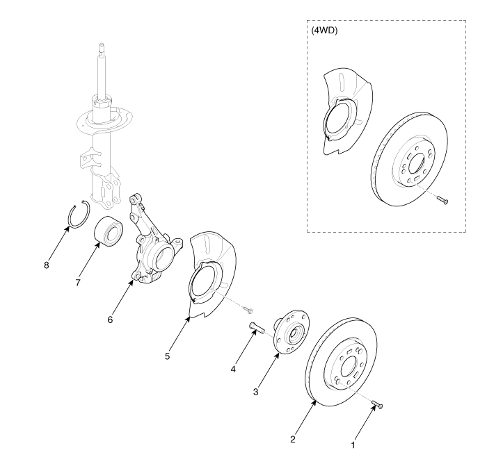

# Eixo Dianteiro / Cânula / Roda Dentada — Componentes e localização

[Home](../../index.md) / [Manual de Serviço e Reparo](../sportage-482.md) / [Eixo e Eixo-Diretor](sportage-791.md) / [Montagem do Eixo Dianteiro](sportage-795.md) / Eixo Dianteiro / Cânula / Componentes e localização

## Diagrama

## Legenda

| Nº | Componente |
| --- | --- |
| 1 | Parafuso do disco de freio |
| 2 | Disco de freio |
| 3 | Eixo dianteiro |
| 4 | Parafuso do eixo dianteiro |
| 5 | Cobertura antivazamento |
| 6 | Cânula |
| 7 | Rolamento da roda |
| 8 | Anel salto |
