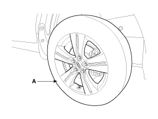
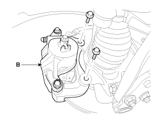
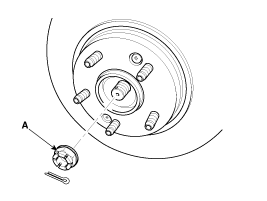
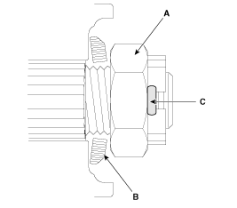
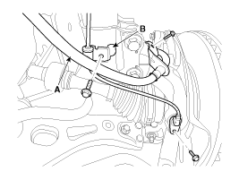
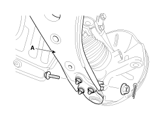
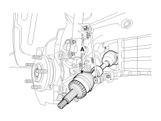
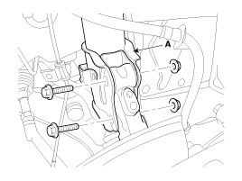
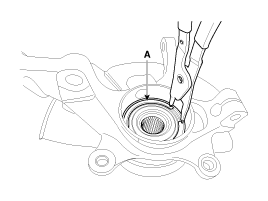
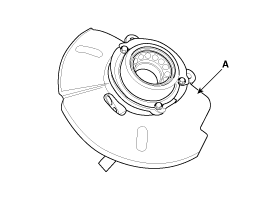

# Kia Sportage: Eixo Dianteiro / Cunha / Roda de Freqüência: Procedimentos de Reparo

[Início](../../index.md) / [Manual de Serviço e Reparo do Kia Sportage SL](../sportage-482.md) / [Shaftes e eixo](sportage-791.md) / [Eixo Dianteiro](sportage-795.md) / Eixo Dianteiro / Cunha / Roda de Freqüência: Procedimentos de Reparo

## Troca

1. Aos soltar os parafusos de roda (A) ligeiramente.

   Elevar o veículo e assegurar que este está suportado de forma segura.

2. Remova a roda e o pneu (A) do hub dianteiro.

   ```
   Torque de aperto :
   88,3 ~ 107,8N.m (9,0 ~ 11,0kgf.m, 65,0 ~ 79,5lb-ft)
   ```

   

   > **Cuidado**
   >
   > - Tenha cuidado para não danificar os parafusos do hub ao remover a roda e o pneu (A).

3. Remova os parafusos de montagem do calibro de freio (B), segurando o conjunto de calibro de freio (B) com fio.

   ```
   Torque de aperto :
   78,4 ~ 98,0N.m (8,0 ~ 10,0kgf.m, 57,8 ~ 72,3lb-ft)
   ```

   

4. Remova o parafuso de castelo (A) do hub dianteiro.

   ```
   Torque de aperto :
   196,1 ~ 274,5N.m (20,0 ~ 28,0kgf.m, 144,6 ~ 202,5lb-ft)
   ```

   

   > **Cuidado**
   >
   > - O anel de vedação (B) deve ser montado com a superfície convexa para fora quando for montar o parafuso de castelo (A) e o gancho (C). Além disso, não reutilize o gancho (C) ao reconstituir.

   

5. Remova o mangote de freio (A) e o sensor de velocidade do eixo giratório (B).

   ```
   Torque de aperto :
   6,8 ~ 10,8N.m (0,7 ~ 1,1kgf.m, 5,1 ~ 7,9lb-ft)
   ```

   

6. Remova o extremo do eixo de articulação do bico (C) do buço.

   | (1) | Remova o gancho (A). |
   | --- | --- |

   ```
   Remova o parafuso de castelo (B).
   Torque de aperto :
   34,3 ~ 44,1N.m (3,5 ~ 4,5kgf.m, 25,3 ~ 32,5lb-ft)
   ```

7. Remova o parafuso e o parafuso de montagem do braço inferior (A) do buço.

   ```
   Torque de aperto :
   98,0 ~ 117,6N.m (10,0 ~ 12,0kgf.m, 72,3 ~ 86,7lb-ft)
   ```

   

8. Remova o braço inferior do buço usando o SST (0K545-A9100).

   | (1) | Após remover os parafusos do buço, monte e aperte o parafuso do subcorpo (A). |
   | --- | --- |

   | (2) | Posicione o subcorpo (A) entre o buço e o parafuso do subcorpo. |
   | --- | --- |

   | (3) | Aos apertar o parafuso (B) do parafuso do subcorpo, alargue o espaço entre o buço. |
   | --- | --- |

   | (4) | Monte a fita de segurança (A). Monte a fita de segurança no buço frontal para prevenir a queda do SST e ferir os técnicos. |
   | --- | --- |
   | Monte a fita de segurança no buço frontal para prevenir a queda do SST e ferir os técnicos. | |

   | (5) | Monte o corpo principal entre o buço frontal e o braço inferior. |
   | --- | --- |

   | (6) | Para evitar que o corpo principal desça, monte um fecho (A) ao lado do corpo principal. |
   | --- | --- |

   | (7) | Após montar o fecho, rote o manípulo (B) no sentido horário até que o fecho esteja fixo no braço inferior. |
   | --- | --- |

   | (8) | Aos apertar o parafuso principal (A) do corpo principal, remova o braço inferior do buço frontal. |
   | --- | --- |

9. Desconecte o final do eixo de transmissão (A) do buço.

   

10. Desafine os parafusos de montagem do amortecedor e, em seguida, remova a montagem do eixo e do buixo do amortecedor (A).

```
Torque de aperto :
137,2 ~ 156,9N.m (14,0 ~ 16,0kgf.m, 101,2 ~ 115,7lb-ft)
```



> **Cuidado**
>
> - Tenha cuidado para não danificar a capa e os dentes do rotor.

1. Instale na ordem inversa do desmonte.

## Inspeção

1. Verifique o hub para rachaduras e as engrenagens para desgaste.

2. Verifique o disco de freio para marcas e danos.

3. Verifique o buxo para rachaduras.

4. Verifique o rolamento para rachaduras ou danos.

## Desmontagem

1. Usando pinças para anel de clicar, remova o anel de clicar (A).

   

2. Remova a montagem do hub da montagem do buxo.

   | (1) | Instale a montagem do buxo (A) na prensa. |
   | --- | --- |

   | (2) | Coloque um adaptador apropriado (B) sobre o eixo do hub (A). |
   | --- | --- |

3. Remova a capa de sujeira (A).

   

4. Remova a roda interna do rolamento do hub da montagem do hub

   | (1) | Instale uma ferramenta apropriada (A) para remover a roda interna do rolamento do hub na montagem do hub. |
   | --- | --- |

   | (2) | Coloque a montagem do hub (A) e a ferramenta (A) sobre um adaptador apropriado (B). |
   | --- | --- |

   | (3) | Coloque um adaptador apropriado (C) sobre o eixo do hub (A). |
   | --- | --- |

   | (4) | Remova a roda interna do rolamento (D) do hub da montagem do hub usando a prensa. |
   | --- | --- |

5. Remova a roda externa do rolamento do hub da montagem do buxo.

   | (1) | Coloque a montagem do hub (A) sobre um adaptador apropriado (B). |
   | --- | --- |

   | (2) | Coloque um adaptador apropriado (C) sobre a roda externa do rolamento. |
   | --- | --- |

   | (3) | Remova a roda externa do rolamento da montagem do buxo usando a prensa. |
   | --- | --- |

6. Substitua o rolamento do hub por um novo.

## Montagem

1. Instale a capa de sujeira (A).

   

2. Instale o rolamento do hub na montagem do buxo.

   | (1) | Coloque a montagem do buxo (A) na prensa. |
   | --- | --- |

   | (2) | Coloque um novo rolamento do hub sobre a montagem do buxo (A). |
   | --- | --- |

   | (3) | Coloque um adaptador apropriado (B) sobre o rolamento do hub. |
   | --- | --- |

   | (4) | Instale o rolamento do hub na montagem do buxo (A) usando a prensa. Não pressione contra a roda interna do rolamento do hub porque isso pode causar danos à montagem do rolamento. Sempre use uma nova montagem de rolamento do hub. |
   | --- | --- |
   | Não pressione contra a roda interna do rolamento do hub porque isso pode causar danos à montagem do rolamento. | |

3. Instale a montagem do hub na montagem do buxo.

   | (1) | Coloque a montagem do hub (A) sobre um adaptador apropriado (B). |
   | --- | --- |

   | (2) | Coloque a montagem do buxo (C) sobre a montagem do hub (A). |
   | --- | --- |

   | (3) | Coloque um adaptador apropriado (D) sobre o rolamento do hub. |
   | --- | --- |

   | (4) | Instale a montagem do hub (A) na montagem do buxo (C) usando a prensa. Não pressione contra a roda interna do rolamento do hub porque isso pode causar danos à montagem do rolamento. |
   | --- | --- |
   | Não pressione contra a roda interna do rolamento do hub porque isso pode causar danos à montagem do rolamento. | |

4. Instale o anel de clicar (A).

   
