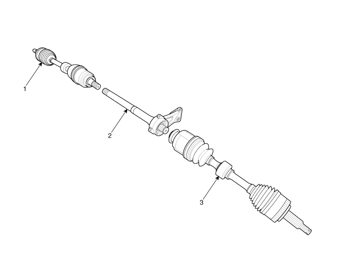

# Eixo Diferencial Frontal — Componentes e localização

[Home](../../index.md) / [Manual de Serviço e Reparo](../sportage-482.md) / [Eixo Diferencial e Eixo](sportage-791.md) / [Montagem do Eixo Diferencial](sportage-798.md) / Componentes e localização

## Diagrama — Componentes

## Legenda — Componentes

| Nº | Componente |
| --- | --- |
| 1 | Eixo Diferencial Frontal (LH) |
| 2 | Eixo Interno |
| 3 | Eixo Diferencial Frontal (RH) |

## Diagrama — Componentes

## Legenda — Componentes

| Nº | Componente |
| --- | --- |
| 1 | Alça |
| 2 | Parafuso de Castelo |
| 3 | Aro |
| 4 | Montagem BJ |
| 5 | Aro A |
| 6 | Cinto de Boot BJ |
| 7 | Boot BJ |
| 8 | Cinto de Amortecedor Dinâmico |
| 9 | Amortecedor Dinâmico |
| 10 | Eixo |
| 11 | Cinto de Boot VTJ |
| 12 | Boot VTJ |
| 13 | Montagem do Espider |
| 14 | Aro de Cisalhamento |
| 15 | Caixa VTJ |

## Diagrama — Componentes

## Legenda — Componentes

| Nº | Componente |
| --- | --- |
| 1 | Alça |
| 2 | Parafuso de Castelo |
| 3 | Aro |
| 4 | Montagem BJ |
| 5 | Aro A |
| 6 | Cinto de Boot BJ |
| 7 | Cinto de Boot BJ |
| 8 | Cinto de Amortecedor Dinâmico |
| 9 | Amortecedor Dinâmico |
| 10 | Eixo |
| 11 | Cinto de Boot VTJ |
| 12 | Boot VTJ |
| 13 | Montagem do Espider |
| 14 | Aro de Cisalhamento |
| 15 | Caixa VTJ |
