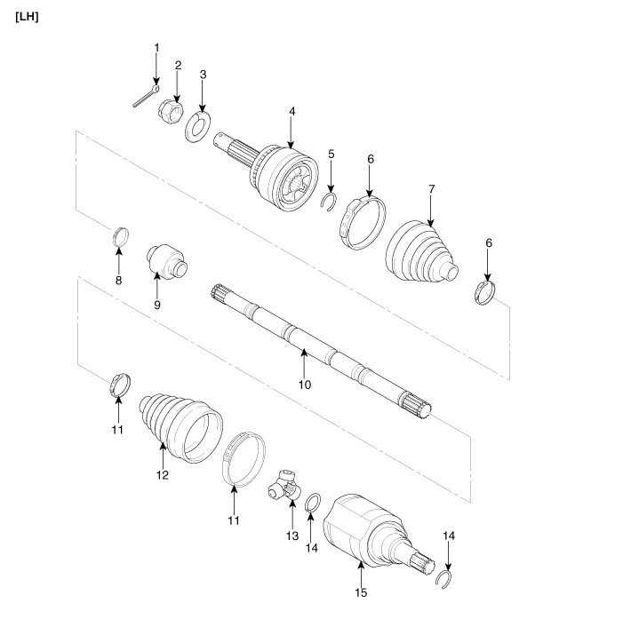
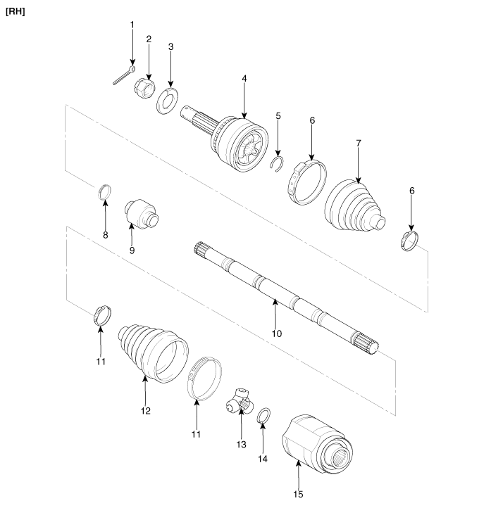

# Kia Sportage: Eixo Diferencial Frontal: Componentes e Localização

[Home](../../index.md) / [Manual de Serviço e Reparo do Kia Sportage SL](../sportage-482.md) / [Eixo Diferencial e Eixo](sportage-791.md) / [Montagem do Eixo Diferencial](sportage-798.md) / Eixo Diferencial Frontal: Componentes e Localização

## Componentes

| 1. Eixo Diferencial Frontal (LH) 2. Eixo Interno | 3. Eixo Diferencial Frontal (RH) |
| --- | --- |

| 1. Alça 2. Parafuso de Castelo 3. Aro 4. Montagem BJ 5. Aro A | 6. Cinto de Boot BJ 7. Boot BJ 8. Cinto de Amortecedor Dinâmico 9. Amortecedor Dinâmico 10. Eixo | 11. Cinto de Boot VTJ 12. Boot VTJ 13. Montagem do Espider 14. Aro de Cisalhamento 15. Caixa VTJ |
| --- | --- | --- |

| 1. Alça 2. Parafuso de Castelo 3. Aro 4. Montagem BJ 5. Aro A | 6. Cinto de Boot BJ 7. Cinto de Boot BJ 8. Cinto de Amortecedor Dinâmico 9. Amortecedor Dinâmico 10. Eixo | 11. Cinto de Boot VTJ 12. Boot VTJ 13. Montagem do Espider 14. Aro de Cisalhamento 15. Caixa VTJ |
| --- | --- | --- |
