# Kia Sportage: Travessão da frente: Procedimentos de reparo

[Início](../../index.md) / [Manual de Serviço e Reparo do Kia Sportage SL](../sportage-482.md) / [Travessão e eixo](sportage-791.md) / [Montagem do Travessão](sportage-798.md) / Procedimentos de Reparo do Travessão da Frente

## Troca

1. Desengate os parafusos de roda suavemente.

   Eleva o veículo e certifique-se de que ele está firmemente suportado.

2. Remova a roda e o pneu (A) do hub dianteiro.

   ```
   Torque de aperto :
   88,3 ~ 107,8N.m (9,0 ~ 11,0kgf.m, 65,0 ~ 79,5lb-ft)
   ```

   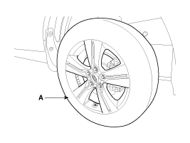

   > **Cuidado**
   >
   > - Tenha cuidado para não danificar os parafusos do hub ao remover a roda e o pneu (A).

3. Remova os parafusos de montagem do calibragem do freio (B), segurando a montagem do calibragem do freio (B) com fio.

   ```
   Torque de aperto :
   78,4 ~ 98,0N.m (8,0 ~ 10,0kgf.m, 57,8 ~ 72,3lb-ft)
   ```

   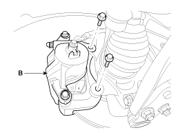

4. Remova o parafuso de castelo (A) do hub dianteiro.

   ```
   Torque de aperto :
   196,1 ~ 274,5N.m (20,0 ~ 28,0kgf.m, 144,6 ~ 202,5lb-ft)
   ```

   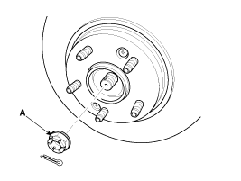

   > **Cuidado**
   >
   > - O anel (B) deve ser montado com a superfície convexa voltada para fora ao instalar o parafuso de castelo (A) e o gancho (C). Além disso, não reutilize o gancho (C) ao reconstituir.

   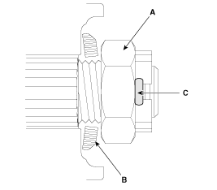

5. Remova o mangote de freio (A) e o sensor de velocidade do eixo giratório (B).

   ```
   Torque de aperto :
   6,8 ~ 10,8N.m (0,7 ~ 1,1kgf.m, 5,1 ~ 7,9lb-ft)
   ```

   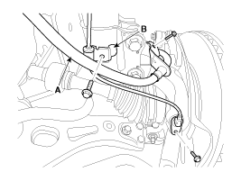

6. Remova o extremo do eixo de articulação do bico (C) do bocal.

   | (1) | Remova o gancho (A). |
   | --- | --- |

   ```
   Remova o parafuso de castelo (B).
   Torque de aperto :
   34,3 ~ 44,1N.m (3,5 ~ 4,5kgf.m, 25,3 ~ 32,5lb-ft)
   Aplicar algumas gotas de óleo ao utensílio especial. (Parte de contato do boot)
   ```

7. Remova o parafuso de montagem do braço inferior (A) do bocal.

   ```
   Torque de aperto :
   98,0 ~ 117,6N.m (10,0 ~ 12,0kgf.m, 72,3 ~ 86,7lb-ft)
   ```

   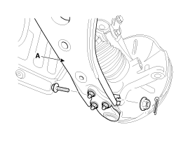

8. Remova o braço inferior do bocal do bocal dianteiro usando o SST (0K545-A9100).

   | (1) | Após remover os parafusos do bocal dianteiro, instale e aperte o parafuso do sub-corpo (A). |
   | --- | --- |

   | (2) | Insira o sub-corpo (A) entre o bocal dianteiro e o parafuso do sub-corpo. |
   | --- | --- |

   | (3) | Ajuste o parafuso (B) do parafuso do sub-corpo para ampliar o espaço entre o bocal dianteiro. |
   | --- | --- |

   | (4) | Instale a fita de segurança (A). Instale a fita de segurança no bocal dianteiro para prevenir a queda do SST e ferir os técnicos. |
   | --- | --- |
   | Instale a fita de segurança no bocal dianteiro para prevenir a queda do SST e ferir os técnicos. | |

   | (5) | Instale o corpo principal entre o bocal dianteiro e o braço inferior. |
   | --- | --- |

   | (6) | Para evitar que o corpo principal caia, instale um aperto fixador (A) ao lado do corpo principal. |
   | --- | --- |

   | (7) | Após instalar o aperto fixador, rote o manípulo (B) no sentido horário até que o aperto esteja fixado no braço inferior. |
   | --- | --- |

   | (8) | Ajuste lentamente o parafuso principal (A) do corpo principal e remova o braço inferior do bocal dianteiro. |
   | --- | --- |

9. Desconecte o final do eixo de transmissão (A) do bocal.

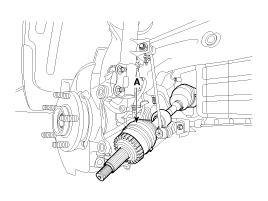

10. Remova a montagem do eixo tracionador (A) do eixo interno.

   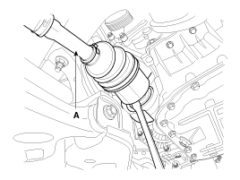

11. Remova as porcas de montagem do eixo interno e, em seguida, desconecte o eixo interno (A).

   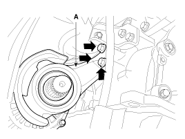

12. Insira um tacos (A) entre a caixa de transmissão e a caixa de articulação, e separe o eixo tracionador (B) da caixa de transmissão.

   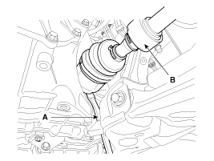

13. Instale na ordem inversa do remoção.

   > **Cuidado**
   >
   > - Use um tacos (A) com cuidado para não danificar a caixa de transmissão e a caixa de articulação.
   > - Não insira o tacos (A) muito fundo, pois isso pode danificar a tampinha do selo de óleo.
   > - Não puxe o eixo tracionador com força excessiva, pois isso pode causar a deslocação de componentes na caixa de articulação, resultando em uma gaiola danificada ou em uma gaiola danificada.
   > - Obstrua o orifício da caixa de transmissão com a tampinha do selo de óleo para prevenir contaminação.
   > - Suporte o eixo tracionador adequadamente.
   > - Substitua o anel de retenção sempre que o eixo tracionador for removido da caixa de transmissão.

## Inspeção

1. Verifique os cobertores do eixo drive para danos e deterioração.

2. Verifique o amortecedor de bola para desgaste e danos.

3. Verifique as engrenagens para desgaste e danos.

4. Verifique o amortecedor dinâmico para rachaduras, desgaste e posição.

   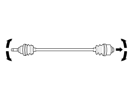

5. Verifique o eixo drive para rachaduras e desgastes.

## Desmontagem

> **Cuidado**
>
> - Não desmonte a montagem do amortecedor de bola.
> - É necessário aplicar uma manteiga especial na articulação do eixo drive. Não substitua por outro tipo de manteiga.
> - O anel do cobertor deve ser substituído por um novo.

1. Remova o círculo de vedação (B) das engrenagens do lado do transaxle VTJ do eixo drive (A).

   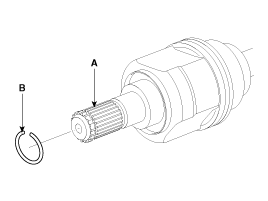

2. Remova os dois engates do cobertor do lado do transaxle VTJ. Usando uma ferraça plana (-), remova os dois engates do lado do transaxle.

   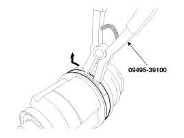

3. Remova o cobertor do lado do transaxle VTJ.

4. Ao dividir o cobertor do lado do transaxle VTJ (A), limpe a manteiga no caso VTJ (B) e colete-a separadamente.

   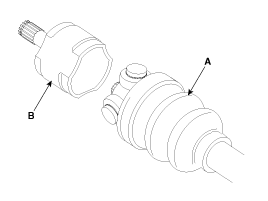

   > **Cuidado**
   >
   > - Cuide para não danificar o cobertor.
   > - Seguindo o ilustrado abaixo, faça marcas (D) no rolamento (A) da montagem do aracão, no caso VTJ (B) e na parte das engrenagens (C) para auxiliar na re-arranjo.

   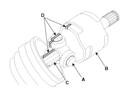

5. Remova o círculo de vedação (A) usando uma pinça de círculo ou uma ferraça plana (-).

   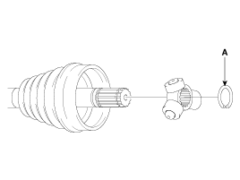

6. Limpe a montagem do aracão.

7. Remova o cobertor (A) do lado do transaxle VTJ.

   > **Cuidado**
   >
   > - Para reutilizar o cobertor (A), embrulhe fita (B) nas engrenagens do eixo drive (C) para proteger o cobertor (A).

   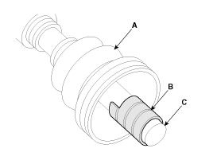

8. Remova o engate (B) do amortecedor dinâmico (A) usando uma pinça ou uma ferraça plana (-).

   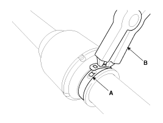

9. Fixe o eixo drive (A) com um parafuso (B) conforme ilustrado.

   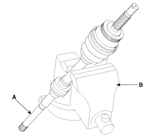

10. Aplicar farinha de sabão na haste para prevenir o desgaste entre a haste das engrenagens e o amortecedor dinâmico quando o amortecedor dinâmico for removido.

11. Remova cuidadosamente o amortecedor dinâmico (A) da haste (B) na direção do transaxle.

12. Remova o engate na lateral do pneu usando uma pinça ou uma ferraça plana (-).

   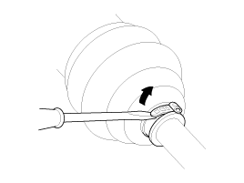

13. Remova o articulador (BJ) na lateral do pneu na direção do transaxle. Cuide para não danificar o cobertor.

## Reajuste

1. Enrole fita adesiva nas engrenagens do eixo driveshaft (lado VTJ) para prevenir danos às coberturas.

2. Aplicar manteiga no eixo driveshaft e instalar as coberturas BJ.

3. Instalar as mangueiras nas coberturas BJ.

   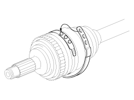

4. Para reajustar o amortecedor dinâmico (A), mantendo o eixo (B) na linha reta. Apertar o amortecedor dinâmico (A) com a mangueira da mangueira dinâmica (C), conforme a ilustração.

   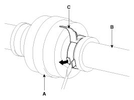

5. Instalar as mangueiras das mangueiras VTJ e a cobertura VTJ.

6. Instalar a montagem do aranha (A) e o cunha (E) na engrenagem (C) do eixo driveshaft.

   Neste momento alinhar as marcas (D) uma com a outra.

   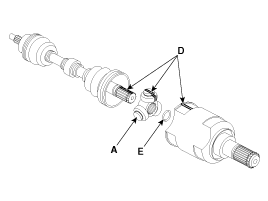

   

7. Instalar o cunha na caixa VTJ (B).

8. Adicionar a manteiga especificada ao VTJ até que seja removida a manteiga inspecionada.

9. Instalar as coberturas VTJ.

10. Instalar as mangueiras nas coberturas VTJ.

11. Usando o SST(09495-3K000), fixar as mangueiras das mangueiras.

   ```
   Clearance (A) : 2.0 mm (0.079 in.) or less
   ```

   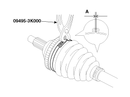

12. Para controlar o ar nas coberturas VTJ, manter a distância especificada entre as mangueiras quando elas estiverem apertadas.

   | Distância (A) | Lateral esquerda | Lateral direita |
   | --- | --- | --- |
   | 2.0/2.4 AT 2WD(mm) | 536,6 +26,8/-20,2 | 827,5 +26,8/-20,2 |
   | 2.0/2.4 AT 4WD(mm) | 531,6 +26,8/-20,2 | 511,4 +26,8/-20,2 |
   | 2.0 MT 2WD(mm) | 557,9 +26,8/-20,2 | 835,7 +26,8/-20,2 |
   | 2.0 MT 4WD(mm) | 511,4 +26,8/-20,2 | |
   | 2.4 MT 2WD(mm) | 542,0 +26,8/-20,2 | 855,4 +26,8/-20,2 |
   | 2.4 MT 4WD(mm) | 511,4 +26,8/-20,2 | |

   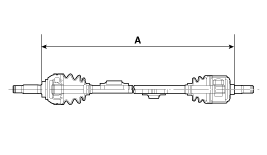
