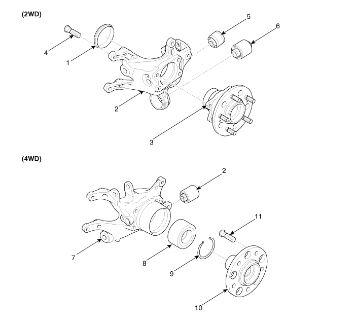

# Kia Sportage: Eixo Traseiro - Carregador: Componentes e Localização dos Componentes

[Home](../../index.md) / [Manual de Serviço e Reparo do Kia Sportage SL](../sportage-482.md) / [Shaft and axle](sportage-791.md) / [Traseira Axle Assembly](sportage-801.md) / Eixo Traseiro - Carregador: Componentes e Localização dos Componentes

## Componentes

| 1. Cobertura do eixo 2. Montagem do carregador 3. Montagem do eixo e rolamento 4. Parafuso de montagem do eixo 5. Aquecimento 6. Aquecimento | 7. Montagem do carregador 8. Rolamento 9. Anel de pressão 10. Montagem do eixo 11. Parafuso do eixo 12. Aquecimento |
