# Kia Sportage: Eixo Traseiro - Carregador: Procedimentos de Reparo

[Home](../../index.md) / [Manual de Serviço e Reparo do Kia Sportage SL](../sportage-482.md) / [Eixo eixo e eixo traseiro](sportage-791.md) / [Montagem do Eixo Traseiro](sportage-801.md) / Eixo Traseiro - Carregador: Procedimentos de Reparo

## Troca

1. Solte os parafusos de fixação do pneu ligeiramente. Eleva o veículo e assegure-se de que está suportado de forma segura.

2. Remova o pneu e a roda (A) do carregador traseiro.

   ```
   Torque de aperto :
   88,3 ~ 107,8N.m (9,0 ~ 11,0kgf.m, 65,0 ~ 79,5lb-ft)
   ```

   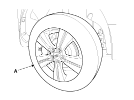

   > **Cuidado**
   >
   > - Cuide para não danificar os parafusos do carregador ao remover o pneu e a roda (A).

3. Remova os parafusos de montagem do calibragem de freio (B) e, em seguida, segure o conjunto do calibragem de freio (B) com fio.

   ```
   Torque de aperto :
   78,4 ~ 98,0N.m (8,0 ~ 10,0kgf.m, 57,8 ~ 72,3lb-ft)
   ```

   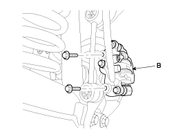

4. Remova o sensor de velocidade do eixo (A) do cônico.

   ```
   Torque de aperto :
   6,8 ~ 10,8N.m (0,7 ~ 1,1kgf.m, 5,1 ~ 7,9lb-ft)
   ```

   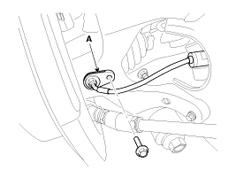

5. Remova o parafuso de castelo (A) do carregador traseiro.

   ```
   Torque de aperto :
   196,1 ~ 274,5N.m (20,0 ~ 28,0kgf.m, 144,6 ~ 202,5lb-ft)
   ```

   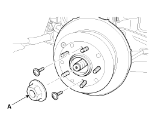

6. Remova o conjunto de amortiguador de freio traseiro (A). (Consulte o grupo BR - Sistema de freio de estacionamento)

   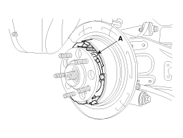

7. Remova o cabo de freio de estacionamento (B) do amortiguador de freio (A).

   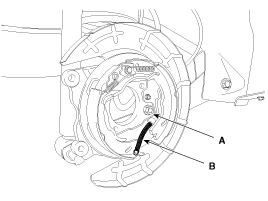

8. Remova o cabo de freio de estacionamento retentor (B) do cabo de freio de estacionamento (A).

   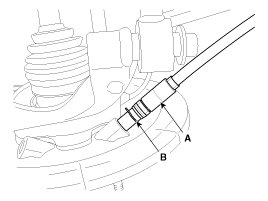

9. Remova o braço auxiliar (A) do carregador do eixo traseiro.

   ```
   Torque de aperto :
   137,2 ~ 156,9N.m (14,0 ~ 16,0kgf.m, 101,2 ~ 115,7lb-ft)
   ```

   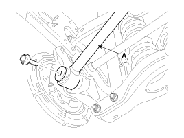

10. Remova o braço traseiro (B) do carregador do eixo traseiro.

    ```
    Torque de aperto :
    34,3 ~ 53,9N.m (3,5 ~ 5,5kgf.m, 25,3 ~ 39,7lb-ft)
    ```

    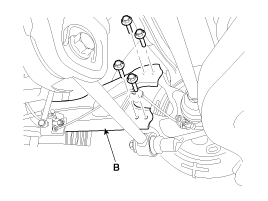

11. Remova o braço superior (A) do carregador do eixo traseiro.

    ```
    Torque de aperto :
    98,0 ~ 117,6N.m (10,0 ~ 12,0kgf.m, 72,3 ~ 86,7lb-ft)
    ```

    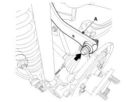

12. Empurre o carregador do eixo traseiro para fora e separe o eixo traseiro (A) do hub do eixo.

    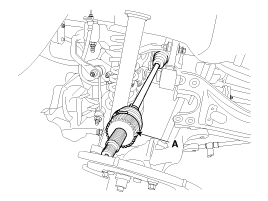

13. Remova o braço inferior (A) do carregador do eixo traseiro (B).

    ```
    Torque de aperto :
    137,2 ~ 156,9N.m (14,0 ~ 16,0kgf.m, 101,2 ~ 115,7lb-ft)
    ```

    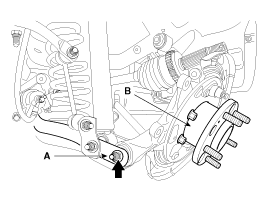

14. Instale na ordem inversa da remoção.

## Inspeção

1. Verifique o carregador para rachaduras e as engrenagens para desgaste.

2. Verifique o disco de freio para marcas e danos.

3. Verifique o carregador do eixo traseiro para rachaduras.

4. Verifique o rolamento para rachaduras ou danos.

## Desmontagem

1. Remova a montagem do eixo do hub do conjunto do joelho.

   | (1) | Instale o conjunto do joelho (A) no pressor. |
   | --- | --- |

   | (2) | Coloque um adaptador apropriado (B) sobre o eixo do hub. |
   | --- | --- |

2. Usando o pinça para remover anéis de pressão, remova o anel de pressão (A).

   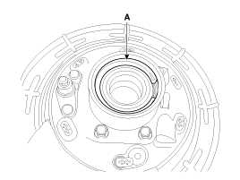

3. Remova a roda do rolamento externo do conjunto do hub.

   | (1) | Coloque o conjunto do joelho (A) sobre um adaptador apropriado (B). |
   | --- | --- |

   | (2) | Coloque um adaptador apropriado (C) sobre a roda do rolamento externo. |
   | --- | --- |

   | (3) | Remova a roda do rolamento externo do conjunto do joelho usando o pressor. |
   | --- | --- |

4. Substitua o rolamento do hub por um novo.

## Montagem

1. Instale o rolamento do hub no conjunto do joelho.

   | (1) | Coloque o conjunto do joelho (A) no pressor. |
   | --- | --- |

   | (2) | Coloque um novo rolamento do hub sobre o conjunto do joelho (A). |
   | --- | --- |

   | (3) | Coloque um adaptador apropriado (B) sobre o rolamento do hub. |
   | --- | --- |

   | (4) | Instale o rolamento do hub no conjunto do joelho usando o pressor. Não pressione contra a roda interna do rolamento do hub, pois isso pode causar danos à montagem do rolamento. Sempre use uma nova montagem de rolamento do hub. |
   | --- | --- |
   | Não pressione contra a roda interna do rolamento do hub, pois isso pode causar danos à montagem do rolamento. Sempre use uma nova montagem de rolamento do hub. | |

2. Instale o conjunto do hub no conjunto do joelho.

   | (1) | Coloque o conjunto do hub (A) sobre um adaptador apropriado (B). |
   | --- | --- |

   | (2) | Coloque o conjunto do joelho (C) sobre o conjunto do hub (A). |
   | --- | --- |

   | (3) | Coloque um adaptador apropriado (D) sobre a roda do rolamento. |
   | --- | --- |

   | (4) | Instale o conjunto do hub (A) no conjunto do joelho (C) usando o pressor. Não pressione contra a roda interna do rolamento do hub, pois isso pode causar danos à montagem do rolamento. |
   | --- | --- |
   | Não pressione contra a roda interna do rolamento do hub, pois isso pode causar danos à montagem do rolamento. | |

3. Instale o anel de pressão (A).

   
