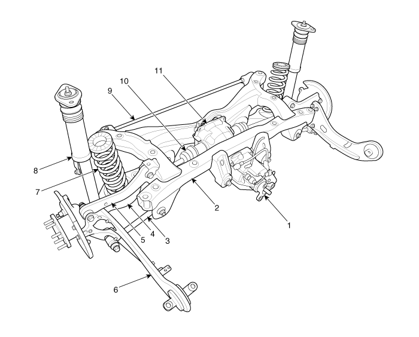
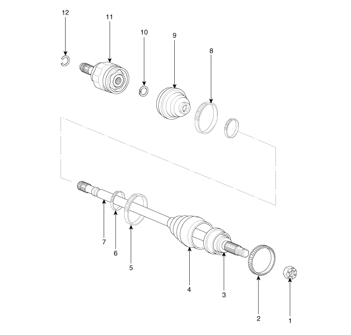

# Kia Sportage: Eixo Diferencial Traseiro: Componentes e Localização

[Home](../../index.md) / [Manual de Serviço e Reparo do Kia Sportage SL](../sportage-482.md) / [Eixo Diferencial e Eixo](sportage-791.md) / [Montagem do Eixo Diferencial Traseiro](sportage-804.md) / Componentes e Localização do Eixo Diferencial Traseiro

## Localização dos Componentes

| 1. Couplagem 2. Sub quadro 3. Braço auxiliar 4. Braço inferior 5. Braço superior | 6. Braço traseiro 7. Mola espiral 8. Amortecedor 9. Estabilizador 10. Eixo diferencial 11. Montagem do carreador diferencial |
| --- | --- |

## Componentes

| 1. Aro de fixação 2. Disco de sinalização 3. Montagem BJ 4. Cinto de proteção da montagem BJ | 5. Cinto de proteção da parte grande da montagem BJ 6. Cinto de proteção da parte pequena da montagem BJ 7. Eixo 8. Cinto de proteção da montagem TJ grande parte | 9. Cinto de proteção TJ 10. Anel de fixação 11. Montagem TJ 12. Círculo de fixação |
| --- | --- | --- |
