# Kia Sportage: Eixo Diferencial Traseiro: Procedimentos de Reparo

[Início](../../index.md) / [Manual de Serviço e Reparo do Kia Sportage SL](../sportage-482.md) / [Eixo Diferencial e Eixo](sportage-791.md) / [Montagem do Eixo Diferencial Traseiro](sportage-804.md) / Procedimentos de Reparo do Eixo Diferencial Traseiro

## Troca

1. Desengate os parafusos de roda suavemente.

   Eleva o veículo e certifique-se de que está suportado de forma segura.

2. Remova a roda e o pneu (A) do hub traseiro.

   ```
   Torque de aperto :
   88,3 ~ 107,8N.m (9,0 ~ 11,0kgf.m, 65,0 ~ 79,5lb-ft)
   ```

   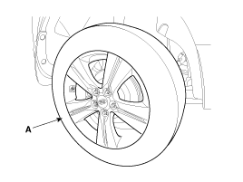

   > **Cuidado**
   >
   > - Cuide para não danificar os parafusos do hub ao remover a roda e o pneu (A).

3. Remova os parafusos de montagem do calibragem do freio (B) e, em seguida, segure o conjunto do calibragem do freio (B) com fio.

   ```
   Torque de aperto :
   78,4 ~ 98,0N.m (8,0 ~ 10,0kgf.m, 57,8 ~ 72,3lb-ft)
   ```

   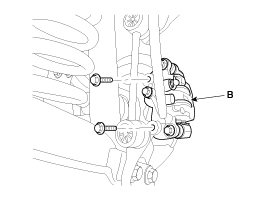

4. Remova o sensor de velocidade do eixo (A) do cônico.

   ```
   Torque de aperto :
   6,8 ~ 10,8N.m (0,7 ~ 1,1kgf.m, 5,1 ~ 7,9lb-ft)
   ```

   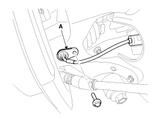

5. Remova o parafuso de castelo (A) do hub traseiro.

   ```
   Torque de aperto :
   196,1 ~ 274,5N.m (20,0 ~ 28,0kgf.m, 144,6 ~ 202,5lb-ft)
   ```

   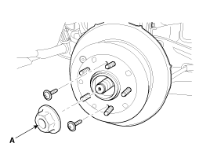

6. Remova o conjunto de amortiguador de freio traseiro (A). (Consulte o grupo BR - Sistema de freio de estacionamento)

   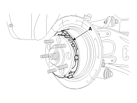

7. Remova o cabo do freio de estacionamento (B) do amortecedor de freio (A).

   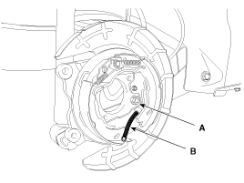

8. Remova o retentor do cabo do freio de estacionamento (B) do cabo do freio de estacionamento (A).

   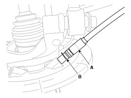

9. Remova o braço auxiliar (A) do carregador traseiro.

   ```
   Torque de aperto :
   137,2 ~ 156,9N.m (14,0 ~ 16,0kgf.m, 101,2 ~ 115,7lb-ft)
   ```

   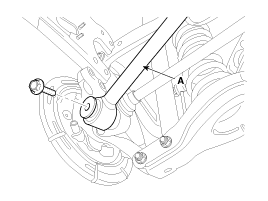

10. Remova o braço traseiro (B) do carregador traseiro.

   ```
   Torque de aperto :
   34,3 ~ 53,9N.m (3,5 ~ 5,5kgf.m, 25,3 ~ 39,7lb-ft)
   ```

   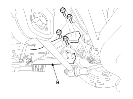

11. Remova o braço superior (A) do carregador traseiro.

   ```
   Torque de aperto :
   98,0 ~ 117,6N.m (10,0 ~ 12,0kgf.m, 72,3 ~ 86,7lb-ft)
   ```

   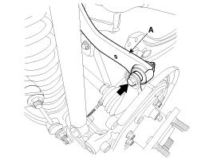

12. Empurre o carregador traseiro para fora e separe o eixo diferencial (A) do hub do carregador traseiro.

   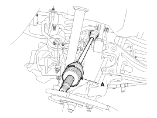

13. Insira um arado (A) entre a caixa diferencial e a caixa do articulador, e separe o eixo diferencial (B) da caixa diferencial.

   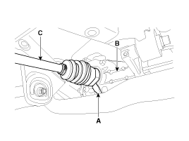

   > **Cuidado**
   >
   > - Use um arado (A) com cuidado para não danificar a caixa diferencial e o articulador.
   > - Não insira o arado (A) muito fundo, pois isso pode causar danos à tampa do selo.
   > - Não puxe o eixo diferencial com força excessiva, pois isso pode causar danos aos componentes dentro do conjunto do articulador, resultando em uma fenda na cobertura ou em um dano ao rolamento.
   > - Plugue a abertura da caixa diferencial com a tampa do selo para prevenir a contaminação.
   > - Suporte o eixo diferencial adequadamente.
   > - Substitua o anel retentor sempre que o eixo diferencial for removido da caixa diferencial.

## Inspeção

1. Verifique as coberturas do eixo diretor para danos e deterioração.

2. Verifique o amortecedor de bola para desgaste e danos.

3. Verifique as engrenagens para desgaste e danos.

   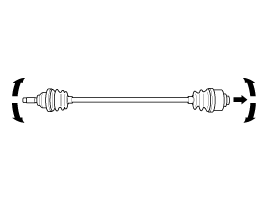

4. Verifique o eixo diretor para rachaduras e desgastes.

5. Verifique a roda externa (TJ), roda interna (TJ), garrafa (cage) e bolas (balls) para ferrugem ou danos.

6. Verifique a presença de água, matéria estranha ou ferrugem na cobertura do amortecedor de bola (BJ).

   > **Cuidado**
   >
   > - Quando a montagem do amortecedor de bola (A) for reutilizada, não retire a manteiga.
   > - Verifique se não há substâncias estranhas na manteiga. Se necessário, limpe a montagem do amortecedor de bola (A) e substitua a manteiga.

   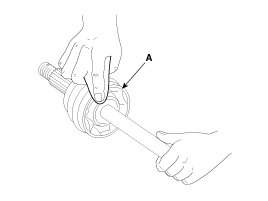

## Desmontagem

> **Cuidado**
>
> - Não desmonte a montagem do amortecedor de bola.
> - É necessário aplicar uma manteiga especial na junta do eixo diretor. Não substitua por outro tipo de manteiga.
> - A fita da cobertura deve ser substituída por uma nova.

1. Remova as fitas da cobertura do TJ e puxe a cobertura do TJ da roda externa (TJ).

   | (1) | Usando pinças ou uma furadeira plana (-), remova a fita da cobertura do lado esquerdo (LH) e a fita da cobertura do TJ do lado esquerdo (LH) do eixo diretor. |
   | --- | --- |

   | (2) | Remova a fita da cobertura do lado direito (RH) e a fita da cobertura do TJ do lado direito (RH) da mesma forma que o procedimento de remoção do lado esquerdo. Cuide para não danificar a cobertura. |
   | --- | --- |
   | Cuide para não danificar a cobertura. | |

2. Puxe o eixo diretor da roda externa (TJ).

3. Remova o anel de pressão (A) e extraia a roda interna (B), a garrafa (cage) e as bolas (D) como um conjunto.

   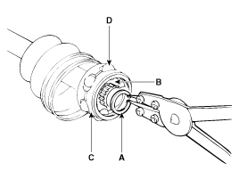

4. Limpe a roda interna, a garrafa e as bolas sem desmontá-las.

5. Remova as fitas da cobertura do amortecedor de bola (BJ) e puxe a cobertura do TJ e a cobertura do BJ.

   > **Cuidado**
   >
   > - Se a cobertura (A) for reutilizada, embrulhe fita (B) nas engrenagens (C) do eixo diretor para proteger a cobertura (A).

   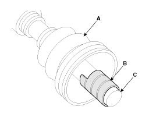

## Reajuste

1. Envolva fita adesiva nas engrenagens do eixo-diretor (lado TJ) para prevenir danos às coberturas.

2. Aplicar manteiga no eixo-diretor e instalar as coberturas.

3. Aplicar a manteiga especificada na roleta interna (A) e na garrafa (B). Instale a garrafa (B) de forma que ela esteja deslocada na roleta conforme indicado.

   > **Cuidado**
   >
   > - Use a manteiga incluída no kit de reparo.

   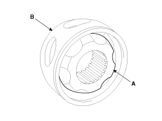

4. Aplicar a manteiga especificada na garrafa e encaixar as bolas na garrafa.

5. Posicione o lado com entalhe (A) conforme indicado na ilustração. Instale a roleta interna no eixo-diretor (B), e então a anilha de pressão.

   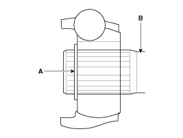

6. Aplicar a manteiga especificada na roleta externa e instalar a roleta externa BJ no eixo-diretor.

7. Aplicar a manteiga especificada na cobertura TJ e instalar a cobertura com um clip.

8. Ajustar as faixas da cobertura TJ.

9. Adicionar a manteiga especificada ao BJ, na quantidade retirada durante a inspeção.

10. Instalar as coberturas.

11. Ajustar as faixas da cobertura BJ.

12. Para controlar o ar na cobertura TJ, mantenha a distância especificada entre as faixas quando elas estiverem ajustadas.

   | Distância (mm) | ES | ED |
   | --- | --- | --- |
   | TOTAL | 699,5 +22,8/-19,3 | 680,3 +22,8/-19,3 |
