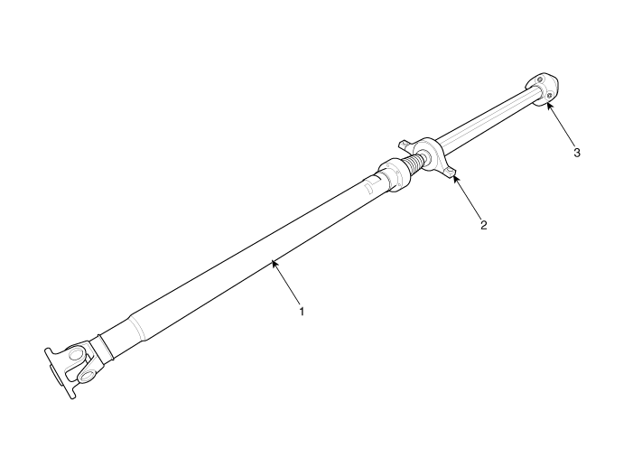

# Kia Sportage: Eixo de Transmissão: Componentes e Localização dos Componentes

[Home](../../index.md) / [Manual de Serviço e Reparo do Kia Sportage SL](../sportage-482.md) / [Eixo de Transmissão e Eixo](sportage-791.md) / [Montagem do Eixo de Transmissão](sportage-807.md) / Componentes e Localização dos Componentes do Eixo de Transmissão

## Componentes

| 1. Eixo de Transmissão da Frente 2. Mola de Suporte do Eixo Central | 3. Eixo de Transmissão Traseiro |
| --- | --- |
