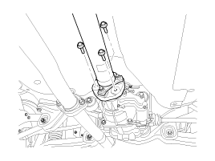
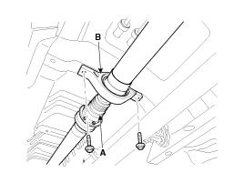
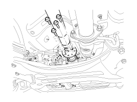
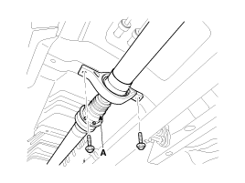
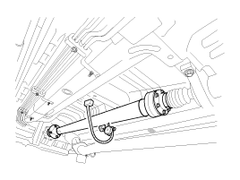
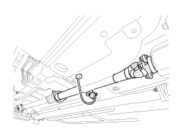

# Kia Sportage: Eixo de Transmissão: Procedimentos de Reparo

[Home](../../index.md) / [Manual de Serviço e Reparo do Kia Sportage SL](../sportage-482.md) / [Eixo de Transmissão e Eixo Diferencial](sportage-791.md) / [Montagem do Eixo de Transmissão](sportage-807.md) / Procedimentos de Reparo do Eixo de Transmissão

## Troca

1. Faça um marcador de alinhamento no yoke flange e no companheiro do transaxle. Em seguida, remova as parafusos de montagem do eixo de transmissão.

   ```
   Torque de aperto :
   49,0 ~ 68,6 N.m (5,0 ~ 7,0 kgf.m, 36,1 ~ 50,6 lb-ft)
   ```

   

2. Remova os parafusos de montagem do suporte do rolimão central (A).

   ```
   Torque de aperto :
   49,0 ~ 68,6 N.m (5,0 ~ 7,0 kgf.m, 36,1 ~ 50,6 lb-ft)
   ```

   

3. Faça um marcador de alinhamento no yoke flange e no companheiro do transaxle. Em seguida, remova as parafusos de montagem do eixo de transmissão.

   ```
   Torque de aperto :
   49,0 ~ 68,6 N.m (5,0 ~ 7,0 kgf.m, 36,1 ~ 50,6 lb-ft)
   ```

   

   > **Cautela**
   >
   > - Use a chave hexagonal para evitar danos na cabeça do parafuso ao removê-lo.

4. Instale em ordem inversa à remoção.

## Inspeção

Conjunto de articulação CV e capa

1. Coloque o manípede do câmbio em Neutral.

2. Eleva o veículo e apoie-o com travessas de segurança nas localizações corretas.

3. Verifique o rolimão central para a presença de movimento excessivo ou ronco e a borracha para danos. Se o rolimão central apresentar movimento excessivo ou ronco e a borracha estiver danificada, substitua o conjunto do eixo de transmissão.

   

4. Verifique a capa do conjunto de articulação CV para danos e deterioração. Se a capa estiver danificada ou deteriorada, substitua o conjunto do eixo de transmissão.

5. Verifique o conjunto de articulação CV para movimento excessivo ou ronco. Se o conjunto de articulação CV apresentar movimento excessivo ou ronco, substitua o conjunto do eixo de transmissão.

Desalinhamento do eixo de transmissão

1. Instale um indicador de dial com a agulha no centro do eixo de transmissão frontal ou traseiro.

2. Vire o eixo de transmissão lentamente e verifique o desalinhamento. Repita este procedimento para o outro eixo de transmissão.

   ```
   Desalinhamento do Eixo de Transmissão Frontal : 0,3 mm (0,012 in.)
   ```

   

   ```
   Desalinhamento do Eixo de Transmissão Traseiro : 0,3 mm (0,012 in.)
   ```

   

3. Se o desalinhamento em qualquer um dos eixos de transmissão exceder o limite de serviço, substitua o conjunto do eixo de transmissão.
