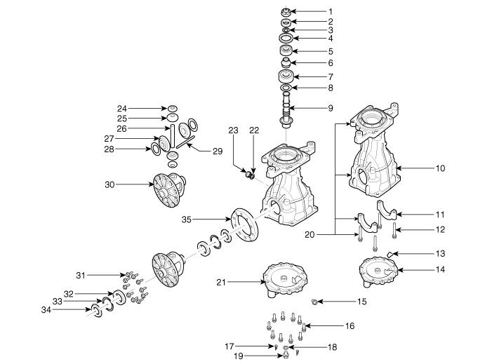

# Carcaça do diferencial traseiro — Componentes e localização

[Home](../../index.md) / [Manual de Serviço e Reparo](../sportage-482.md) / [Braço de transmissão e eixo](sportage-791.md) / [Montagem da carcaça do diferencial](sportage-810.md) / Componentes e localização

## Diagrama

## Legenda

| Nº | Componente |
| --- | --- |
| 1 | Parafuso do pinhão do motor |
| 2 | Selo de óleo |
| 3 | Anel elástico |
| 4 | Selo de óleo |
| 5 | Rolamento da frente |
| 6 | Espacador |
| 7 | Rolamento da traseira |
| 8 | Aro interno |
| 9 | Pinhão do motor |
| 10 | Carcaça do diferencial |
| 11 | Capa do rolamento |
| 12 | Parafuso do capacho do rolamento |
| 13 | Placa de proteção |
| 14 | Capa da carcaça |
| 15 | Fita de ventilação |
| 16 | Parafuso de fixação do capacho |
| 17 | Pinhão de ancoragem |
| 18 | Gasket de enchimento |
| 19 | Plano de enchimento |
| 20 | Sub-assembly da carcaça |
| 21 | Sub-assembly do capacho |
| 22 | Gasket do plano de drenagem |
| 23 | Plano de drenagem |
| 24 | Aro do pinhão do diferencial |
| 25 | Pinhão do diferencial |
| 26 | Eixo do diferencial |
| 27 | Aro do diferencial |
| 28 | Aro do diferencial |
| 29 | Pinhão de bloqueio |
| 30 | Caso do diferencial |
| 31 | Parafuso do aro do engrenagem |
| 32 | Rolamento do diferencial |
| 33 | Aro do diferencial |
| 34 | Selo de óleo do diferencial |
| 35 | Engrenagem motor/diferencial |
