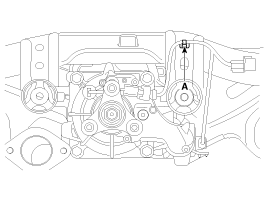
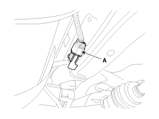
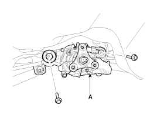
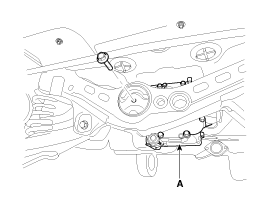
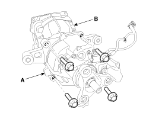
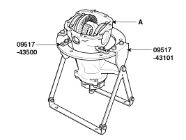

# Kia Sportage: Carcaça do diferencial traseiro: Procedimentos de reparo

[Home](../../index.md) / [Manual de Serviço e Reparo do Kia Sportage SL](../sportage-482.md) / [Shaft and axle](sportage-791.md) / [Assembly de carcaça do diferencial](sportage-810.md) / Procedimentos de reparo da carcaça do diferencial traseiro

## Troca

1. Drenar o óleo do diferencial.

   > **Nota**
   >
   > - Torque de aperto do plug de enchimento (A) & plug de drenagem (B).
   > - Torque de aperto
   > - Plug de enchimento (A): 39,2 ~ 58,8 N.m (4,0 ~ 6,0 kgf.m, 28,9 ~ 43 lb-ft)
   > - Plug de drenagem (B): 49,0 ~ 68,6 N.m (5,0 ~ 7,0 kgf.m, 36,2 ~ 50,6 lb-ft)

2. Remover o eixo traseiro de transmissão. (Consulte o eixo traseiro de transmissão.)

3. Remover o eixo propulsor. (Consulte o eixo propulsor.)

4. Desconectar o clip da correia do conectador do controle do casamento (A).

   

5. Desconectar o conectador do controle do casamento (A).

   

6. Ajustar a carcaça do diferencial (A) com o elevador.

   ```
   Torque de aperto :
   68,6 ~ 88,3 N.m (7,0 ~ 9,0 kgf.m, 50,6 ~ 65,1 lb-ft)
   ```

   

   

7. Depois de soltar a viga e então remover a carcaça do diferencial (B) do casamento (A).

   

8. Instalar na ordem inversa da remoção.

9. Adicionar fluido de óleo do diferencial na carcaça do diferencial.

   > **Nota**
   >
   > - Torque de aperto do plug de enchimento (A) & plug de drenagem (B).
   > - Torque de aperto
   > - Plug de enchimento (A): 39,2 ~ 58,8 N.m (4,0 ~ 6,0 kgf.m, 28,9 ~ 43 lb-ft)
   > - Plug de drenagem (B): 49,0 ~ 68,6 N.m (5,0 ~ 7,0 kgf.m, 36,2 ~ 50,6 lb-ft)

## Inspeção

Instale a montagem do carreador do diferencial (A) com as ferramentas especiais (09517-43401 & 09517-43500). Em seguida, realize a seguinte inspeção.



1. Verifique o desgaste do dentado final pelo procedimento a seguir.

   ```
   Posicione o pinhão de transmissão e mova o dentado para verificar se o desgaste está dentro do intervalo padrão.
   Medir em 4 pontos na periferia do dentado.
   Valor padrão :
   0,10 ~ 0,15mm (0,0039 ~ 0,0059 polegada)
   ```

2. Verifique o desgaste do retroalçado do dentado pelo procedimento a seguir.

   ```
   Posicione um indicador dial no retroalçado do dentado e medir o desvio radial.
   Limite : 0,05 mm (0,002 polegada)
   ```

   | (2) | Se o desvio radial estiver além do limite, verifique se não há
   partículas estranhas entre o dentado e a caixa do diferencial e, se os parafusos fixando o dentado não estiverem soltos. |
   | --- | --- |

3. Verifique o desgaste do dentado do diferencial pelo procedimento a seguir.

   ```
   Fixe o eixo lateral com um cunha para que não possa se mover e medir
   o desgaste do dentado com um indicador dial no pinhão do dentado.
   Valor padrão :
   0 ~ 0,05 mm (0 ~ 0,002 polegada)
   Realizar as medições em dois lugares no pinhão do dentado.
   ```

   | (2) | Se o desgaste exceder o limite, ajuste usando espacadores de suporte lateral. Se o ajuste não for possível, substitua o eixo lateral e o pinhão do dentado como um conjunto. |
   | --- | --- |
   | Se o ajuste não for possível, substitua o eixo lateral e o pinhão do dentado como um conjunto. | |

4. Verifique o contato dente a dente do dentado final pelo procedimento a seguir.

   | (1) | Aplicar uma quantidade igual de azul de máquina em ambas as superfícies dos dentes do dentado. |
   | --- | --- |

   | (2) | Insira um fio de latão entre o carreador do diferencial e a
   caixa do diferencial, e então, rote o flanco companheiro à mão (uma vez na direção normal, e depois uma vez na direção contrária) enquanto
   aplicar uma carga ao dentado para que uma torção (aproximadamente
   25~30Nm) seja aplicada ao pinhão do dentado. Se o dentado for girado demais, o padrão de contato dente a dente ficará confuso e difícil de verificar. |
   | --- | --- |
   | Se o dentado for girado demais, o padrão de contato dente a dente ficará confuso e difícil de verificar. | |

   | (3) | Verifique o padrão de contato dente a dente. Estado de contato dente a dente Solução Estado de contato dente a dente padrão 1. Contato de borda Aumentar
    a espessura do adutor de altura do pinhão, e posicione o pinhão do dentado mais próximo do centro do dentado. Também, para ajuste de desgaste, relocalize o dentado mais longe do pinhão do dentado. 2. Contato frontal 3. Contato de ponta Diminuir
    a espessura do adutor de altura do pinhão, e posicione o pinhão do dentado mais longe do centro do dentado. Também, para ajuste de desgaste, relocalize o dentado mais próximo do pinhão do dentado. 4. Contato de borda • O padrão de contato dente a dente é um método para julgar o resultado do |

ajuste da altura do pinhão de transmissão e do rebaixamento do engrenagem final. O
   ajuste da altura do pinhão de transmissão e do rebaixamento do engrenagem final deve
   ser repetido até que os padrões de contato dente a dente sejam semelhantes ao padrão
   de contato dente a dente padrão. • Quando não é possível obter um padrão correto, o engrenagem e
   pinhão de transmissão excederam seus limites. Ambas as engrenagens devem ser
   substituídas como um conjunto. | | |
   | --- | --- | --- | --- |
   | Padrão de contato dente a dente | Estado de contato | Solução | |
   | Padrão de contato dente a dente padrão | | | |
   | 1. Contato de cura | | Aumentar
   a espessura do adjuvante de altura do pinhão, e posicionar o
   pinhão de transmissão mais próximo do centro da engrenagem de transmissão. Também, para ajuste do rebaixamento, repositionar a engrenagem de transmissão mais longe do pinhão de transmissão. | |
   | 2. Contato facial | | | |
   | 3. Contato de ponta | | Diminuir
   a espessura do adjuvante de altura do pinhão, e posicionar o
   pinhão de transmissão mais longe do centro da engrenagem de transmissão. Também, para ajuste do rebaixamento, repositionar a engrenagem de transmissão mais próxima do pinhão de transmissão. | |
   | 4. Contato de flanco | | | |
   | • Padrão de contato dente a dente é um método para julgar o resultado
   do ajuste da altura do pinhão de transmissão e do rebaixamento do engrenagem final. O
   ajuste da altura do pinhão de transmissão e do rebaixamento do engrenagem final deve
   ser repetido até que os padrões de contato dente a dente sejam semelhantes ao padrão
   de contato dente a dente padrão. • Quando não é possível obter um padrão correto, o engrenagem e
   pinhão de transmissão excederam seus limites. Ambas as engrenagens devem ser
   substituídas como um conjunto. | | | |
   | • | Padrão de contato dente a dente é um método para julgar o resultado
   do ajuste da altura do pinhão de transmissão e do rebaixamento do engrenagem final. O
   ajuste da altura do pinhão de transmissão e do rebaixamento do engrenagem final deve
   ser repetido até que os padrões de contato dente a dente sejam semelhantes ao padrão
   de contato dente a dente padrão. | | |
   | • | Quando não é possível obter um padrão correto, o engrenagem e
   pinhão de transmissão excederam seus limites. Ambas as engrenagens devem ser
   substituídas como um conjunto. | | |

5. Verifique as fugas de óleo e a parte do lábio para danos ou desgaste.

6. Verifique as rolamentos para desgaste ou descoloração.

7. Verifique o carreador de engrenagens para rachaduras.

8. Verifique o pinhão de transmissão e a engrenagem de transmissão para desgaste ou rachaduras.

9. Verifique as engrenagens laterais, pinhão de engrenagens e eixo do pinhão para desgaste ou danos.

10. Verifique a engrenagem do eixo lateral para desgaste ou danos.
