# Kia Sportage: Diagnóstico

[Início](../../index.md) / [Manual de Serviço e Reparo do Kia Sportage SL](../sportage-482.md) / [Sistema Elétrico do Corpo](sportage-984.md) / [Som](sportage-987.md) / Diagnóstico

## Diagnóstico

## Análise de Reclamações do Cliente

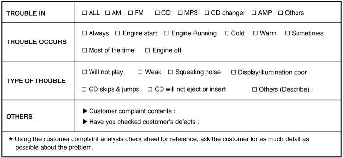

Existem seis áreas onde pode ocorrer um problema: fiação,
amplificador, gravador de CD e alto-falantes. O diagnóstico permite
que você localize o problema em uma área específica.

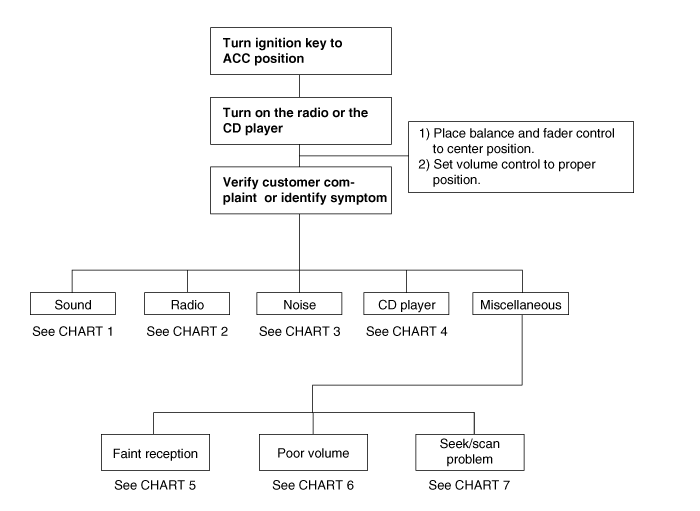

## Gráfico 1

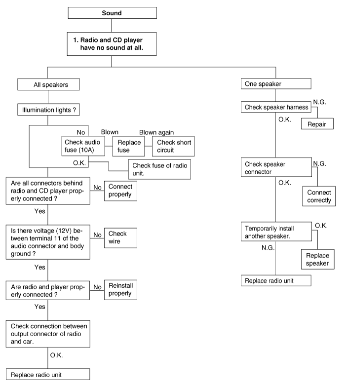

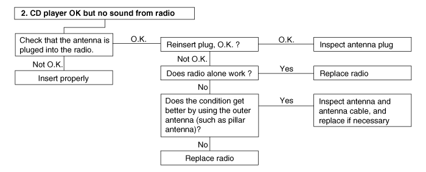

## Gráfico 2

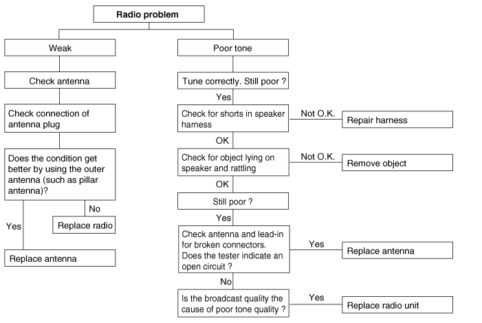

## Gráfico 3

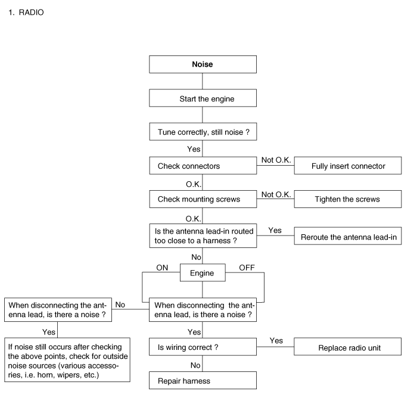

## Gráfico 4

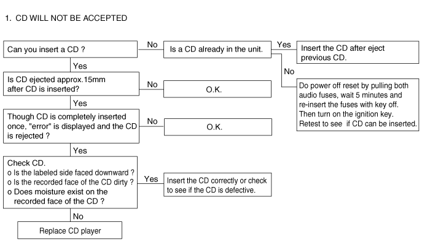

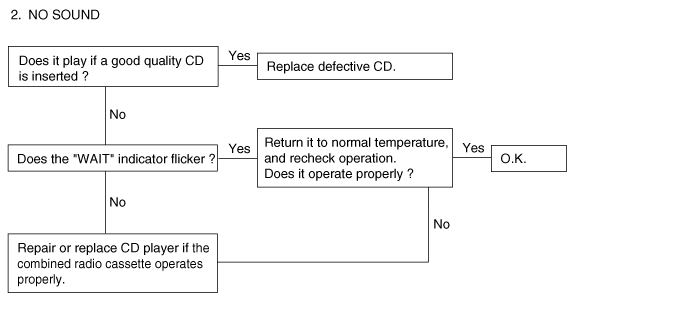

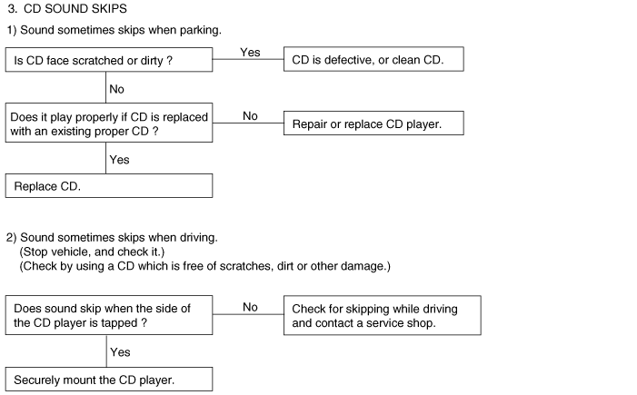

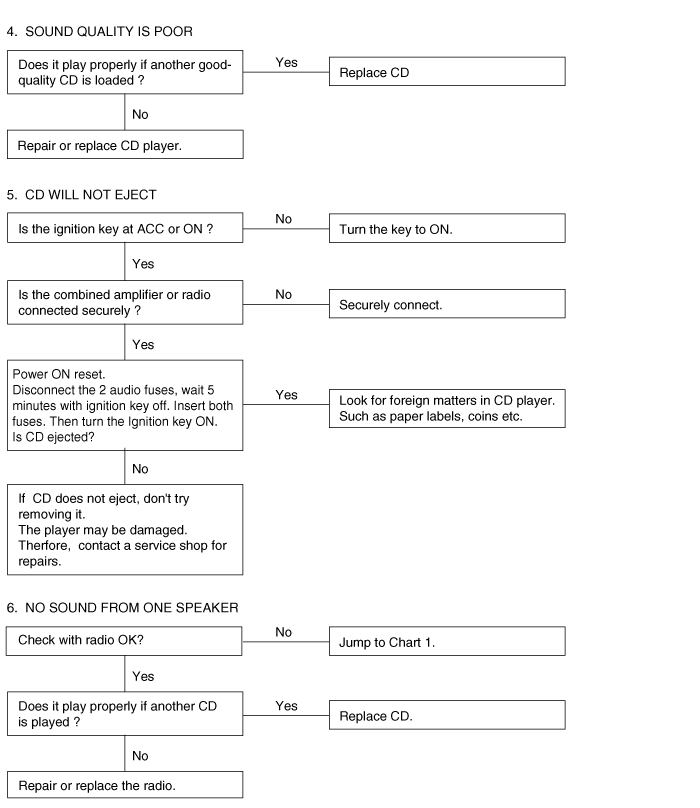

## Gráfico 5

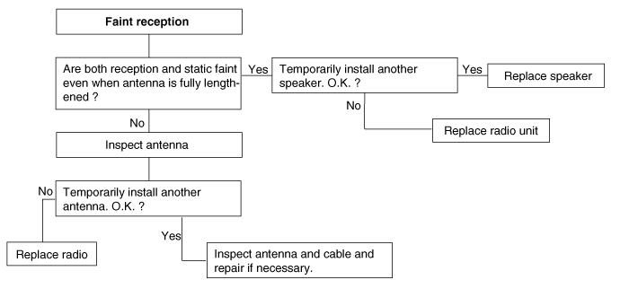

## Gráfico 6

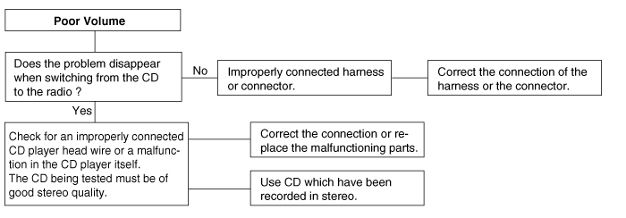

## Gráfico 7

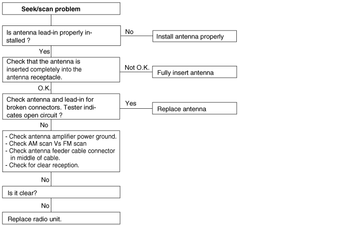
