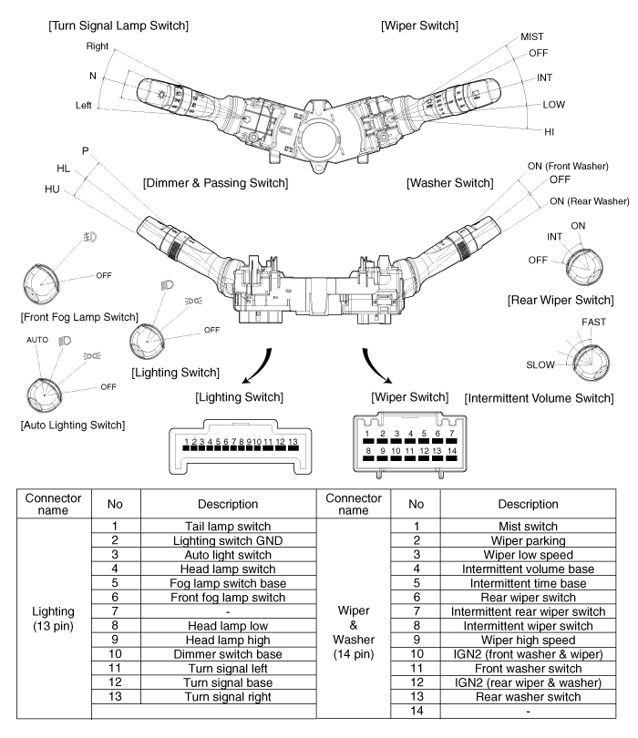

# Interruptor multifuncional — Componentes e localização

[Home](../../index.md) / [Manual de Serviço e Reparo](../sportage-482.md) / [Sistema Elétrico do Corpo](sportage-984.md) / [Interruptor multifuncional](sportage-1001.md) / Componentes e localização

## Diagrama (Componente (1))

## Legenda (1)

| Nº | Componente |
| --- | --- |
| 1 | Eixo do Pilar do Volante |
| 2 | Interruptor de Iluminação |
| 3 | Interruptor de Limpador e Lustra-vidros |
| 4 | Parafuso |
| 5 | Bobina de Memória |

## Diagrama (Componente (2))

