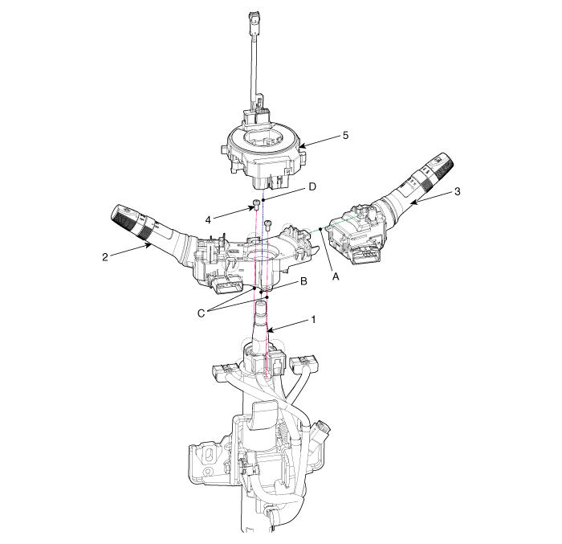

# Kia Sportage: Componentes e Localização dos Componentes

[Home](../../index.md) / [Manual de Serviço e Reparo do Kia Sportage SL](../sportage-482.md) / [Sistema Elétrico do Corpo](sportage-984.md) / [Interruptor multifuncional](sportage-1001.md) / Componentes e Localização dos Componentes

## Componente (1)

| 1. Eixo do Pilar do Volante 2. Interruptor de Iluminação 3. Interruptor de Limpador e Lustra-vidros | 4. Parafuso 5. Bobina de Memória |
| --- | --- |

## Componente (2)

